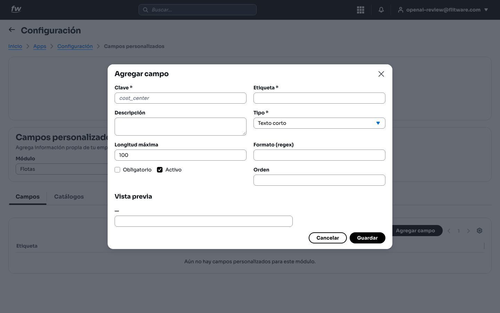
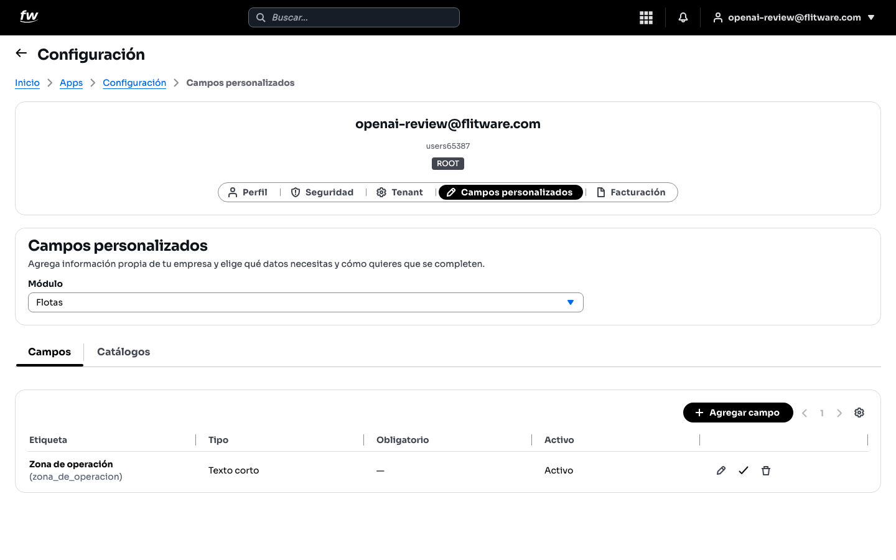

# Campos personalizados

Cada flota tiene sus propios datos: el número interno del vehículo, el tipo de carrocería, la empresa afiliadora. Los **Campos personalizados** le permiten agregar esa información propia de su empresa a cada módulo, y decidir qué datos son obligatorios y cuáles no.

## Prerrequisitos

- Rol **ROOT** (o un rol con permiso de configuración).
- Tener claro qué dato extra necesita y en qué módulo va (por ejemplo, *Flotas*, *Conductores*, *Documentos*).

## Cómo llegar

1. Entre a **Configuración** desde el menú de aplicaciones.
2. Abra la pestaña **Campos personalizados**.

Verá el selector de **Módulo**, las pestañas **Campos** y **Catálogos**, y el botón **Agregar campo**.

## Cómo ver los campos de un módulo

1. En **Módulo**, elija el módulo que quiere revisar (en la imagen, *Flotas*).
2. La pestaña **Campos** muestra los campos ya creados con su **Etiqueta**, **Tipo**, si es **Obligatorio** y si está **Activo**.
3. Si ve el mensaje *Aún no hay campos personalizados para este módulo*, significa que ese módulo todavía no tiene campos extra: es el punto de partida normal.

## Cómo agregar un campo

1. Pulse **+ Agregar campo**.

2. Escriba la **Etiqueta**: el nombre que verá su equipo (por ejemplo, *Número interno*). Use nombres cortos y claros, como los llamen en el patio.
3. Elija el **Tipo** de dato (texto, número, fecha, lista, etc.) según lo que van a escribir.
4. Marque **Obligatorio** solo si el proceso no puede continuar sin ese dato. No abuse: cada obligatorio de más es una queja del equipo en campo.
5. Deje el campo **Activo** para que aparezca de inmediato, y guarde. El campo aparecerá en la lista del módulo.

:::tip Consejo de flota
Antes de crear un campo, pregúntese: "¿alguien va a buscar o filtrar por este dato?". Si la respuesta es no, probablemente no lo necesita como campo. Menos campos bien usados valen más que veinte que nadie diligencia.
:::

## Recomendación del experto

Según la recomendación de expertos para una buena experiencia: es común que las empresas pidan 15 campos nuevos "por si acaso" y al mes nadie llene ninguno. La regla de oro: **empiece con 2 o 3 campos por módulo**, úselos un mes, y solo entonces agregue más.

Rutina recomendada:

- **Antes de crear:** valide con quien diligencia (el auxiliar, el conductor líder). Si el nombre no les suena natural, cámbielo.
- **Obligatorios con pinzas:** un campo obligatorio detiene un proceso si falta. Para flotas en movimiento, eso puede significar un vehículo parado esperando un dato. Marque obligatorio solo lo crítico (placa interna, vencimientos).
- **Cada 6 meses:** revise la lista y desactive los campos que nadie usa. Los formularios cortos se llenan; los largos se evitan.
- **Nombres consistentes:** si en un módulo dice *Número interno*, no lo llame *N° interno* en otro. La consistencia evita errores de captura.

## Errores comunes

- **Crear campos "por si acaso".** Cada campo extra es tiempo de captura y una posible fuente de error. Solo cree lo que se va a usar y consultar.
- **Marcar todo como obligatorio.** El equipo en campo termina escribiendo cualquier cosa ("N/A", "xxx") para poder continuar, y el dato pierde valor.
- **Etiquetas confusas o técnicas.** Si el auxiliar no entiende qué escribir, lo dejará vacío o mal. Use el lenguaje del patio, no el de la oficina.
- **No revisar los módulos uno por uno.** Cada módulo tiene sus propios campos: configure primero el que más usa su operación (normalmente *Flotas* o *Conductores*).
