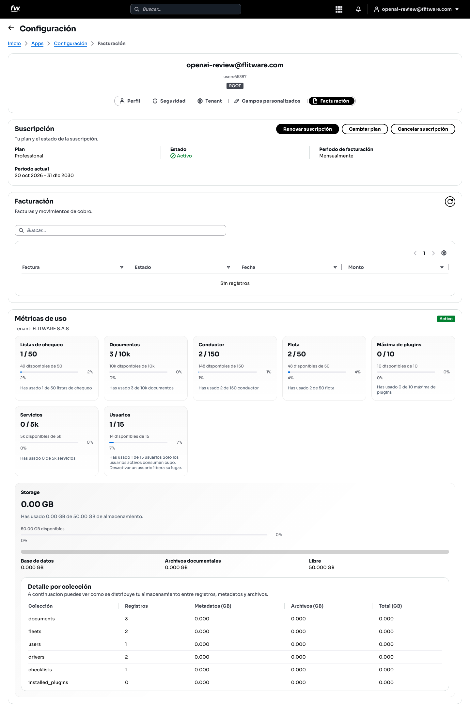
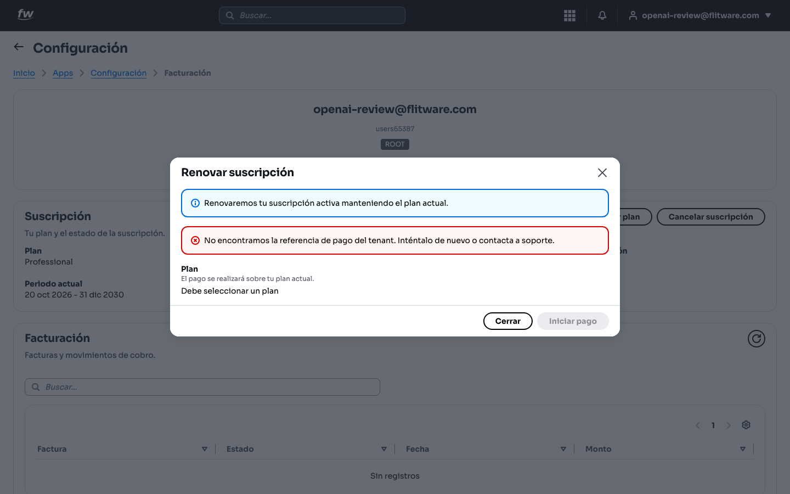
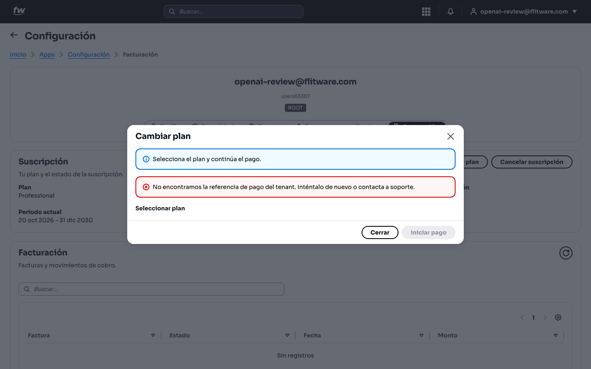
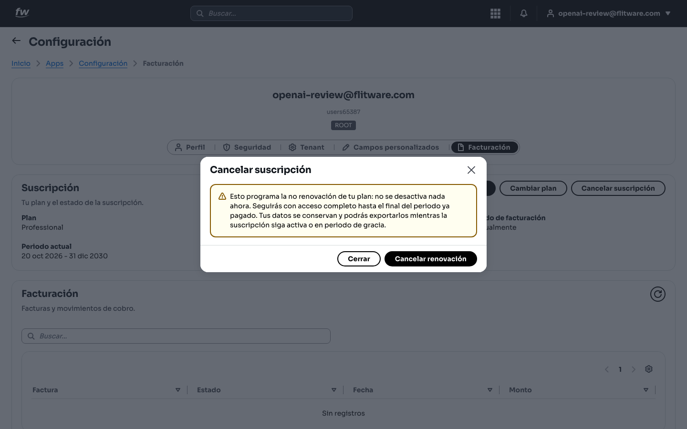

# Facturación

Aquí ve lo que paga y lo que usa: su plan, el estado de la suscripción, el historial de facturas y cuánto lleva consumido de cada cupo (usuarios, vehículos, conductores, documentos, almacenamiento). Revise esta pantalla antes de que un cupo lleno frene su operación.

## Prerrequisitos

- Rol **ROOT** (o un rol con permiso de facturación).
- Para pagar, debe tener configurado el **País de facturación** en la pestaña **Tenant**.

## Cómo llegar

1. Entre a **Configuración** desde el menú de aplicaciones.
2. Abra la pestaña **Facturación**.

## Cómo leer su suscripción

1. En el bloque **Suscripción** verá su **Plan** (por ejemplo, *Professional*), el **Estado** (debe decir **Activo** en verde), el **Periodo de facturación** y el **Periodo actual** con sus fechas.
2. Los botones disponibles son:
   - **Renovar suscripción:** extiende su plan actual.

   - **Cambiar plan:** pasa a otro plan si su operación creció o se redujo.

   - **Cancelar suscripción:** termina la renovación. Úselo con cuidado y revise las condiciones.

:::warning Importante
Si el estado no dice **Activo**, revise de inmediato: una suscripción vencida puede limitar funciones críticas de su operación.
:::

## Cómo revisar sus facturas

1. En el bloque **Facturación** encontrará la tabla de **Facturas y movimientos de cobro**, con **Factura**, **Estado**, **Fecha** y **Monto**.
2. Use el buscador para localizar un cobro por número o fecha.
3. Si ve *Sin registros*, aún no hay movimientos de cobro en el periodo.

## Cómo leer las métricas de uso

El bloque **Métricas de uso** muestra, para su empresa, cuánto lleva consumido de cada cupo: por ejemplo *Listas de chequeo 1 / 50*, *Documentos 3 / 10k*, *Conductor 2 / 150*, *Flota 2 / 50*, *Usuarios 1 / 15*. Cada tarjeta indica cuántos le quedan disponibles y el porcentaje usado.

1. Busque las tarjetas con porcentaje alto (arriba del 80%): son las que pueden frenarle primero.
2. Recuerde: **solo los usuarios activos consumen cupo**. Desactivar un usuario libera su lugar (ver la guía de [Usuarios](./usuarios.md)).
3. Abajo encontrará el **Storage**: cuánto almacenamiento usa (*0.00 GB de 50.00 GB*, por ejemplo) y el **Detalle por colección**, que muestra cómo se reparte entre registros, metadatos y archivos (documentos, flotas, usuarios, conductores, etc.).

## Recomendación del experto

Según la recomendación de expertos para una buena experiencia: trate los cupos como el combustible, **no espere a la reserva**. Un cupo lleno en el momento equivocado —quince vehículos nuevos por matricular un viernes por la tarde— detiene la operación hasta que alguien amplía el plan.

Rutina recomendada:

- **Cada mes:** revise las **Métricas de uso** junto con su plan de crecimiento. Si un cupo va por más del 80%, gestione la ampliación o la limpieza ese mismo mes.
- **Antes de crecer:** si va a afiliar vehículos, contratar conductores o cargar documentos masivamente, verifique primero que el cupo alcanza.
- **Limpieza trimestral:** desactive usuarios que ya no trabajan con usted y revise el **Storage**. Los archivos viejos que nadie consulta ocupan espacio que usted paga.
- **Suscripción siempre activa:** programe un recordatorio unos días antes del vencimiento del periodo para renovar sin afanes.

## Errores comunes

- **Descubrir el cupo lleno en plena operación.** El sistema avisa con los porcentajes; ignorarlos sale caro. Revise mensualmente.
- **Pagar un plan mayor sin limpiar primero.** Antes de subir de plan, desactive usuarios inactivos y revise si el uso real lo justifica.
- **No tener el País de facturación.** Sin ese dato en la pestaña **Tenant** no puede completar pagos. Configúrelo con anticipación, no el día del vencimiento.
- **Ignorar el Storage.** Las fotos y documentos se acumulan. Si el detalle por colección crece sin control, defina qué se guarda y por cuánto tiempo.
