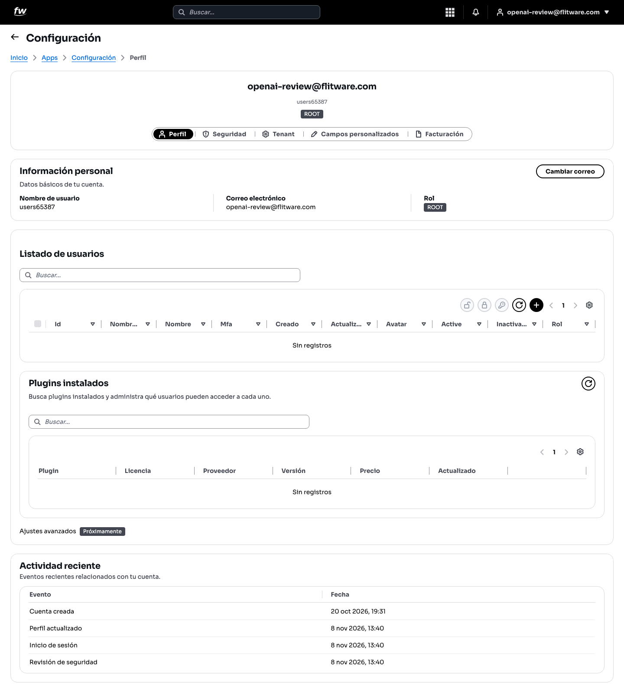
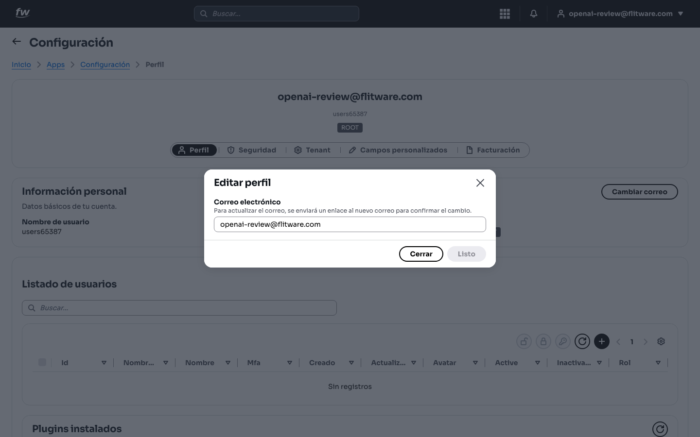

# Mi perfil

Su perfil es su tarjeta de presentación dentro de Flitware: quién es usted, con qué correo entra y qué puede hacer según su rol. Todo empieza aquí: si sus datos están correctos, las alertas, las aprobaciones y los avisos de vencimiento le llegarán sin problema.

## Prerrequisitos

- Tener una cuenta activa en Flitware (cualquier rol puede ver su propio perfil).
- Para administrar otros usuarios necesita rol **ROOT** (otros roles según los permisos que tenga asignados).

## Cómo llegar

1. Entre a **Configuración** desde el menú de aplicaciones.
2. Abra la pestaña **Perfil**.

En esta pantalla verá tres bloques: **Información personal** (sus datos), **Listado de usuarios** (solo si su rol lo permite) y **Actividad reciente** (lo último que pasó en su cuenta).

## Ver y entender su información

1. Revise su **Nombre de usuario**, **Correo electrónico** y **Rol**.
2. El rol (por ejemplo, **ROOT**) define lo que usted puede hacer. Si algo no le aparece, casi siempre es por el rol, no por un error.
3. Abajo encontrará **Actividad reciente**: eventos como *Cuenta creada*, *Perfil actualizado*, *Inicio de sesión* o *Revisión de seguridad*, cada uno con su fecha.

## Cómo cambiar su correo

1. Pulse el botón **Cambiar correo**.
2. En la ventana **Editar perfil**, escriba el nuevo **Correo electrónico**.

3. Pulse **Listo**. El sistema enviará un enlace al correo nuevo para confirmar el cambio.
4. Abra ese enlace desde su bandeja para terminar. Hasta que lo confirme, su acceso sigue con el correo anterior.

:::tip Consejo de flota
Use un correo corporativo (no personal) para su cuenta. Cuando hay rotación de personal, el correo corporativo se reasigna y nadie pierde el acceso a la operación.
:::

## Recomendación del experto

Según la recomendación de expertos para una buena experiencia: revise su **Actividad reciente** cada lunes por la mañana, le toma 30 segundos. Si ve un *Inicio de sesión* que usted no hizo, cambie su contraseña ese mismo día y revise sus sesiones activas en la pestaña **Seguridad**. La mayoría de los problemas de acceso se detectan ahí, no cuando ya es tarde.

Rutina recomendada:

- **Cada semana:** un vistazo a *Actividad reciente*.
- **Cada mes:** confirme que su correo sigue vigente y que su rol es el correcto.
- **Al cambiar de cargo:** pida que actualicen su rol antes de seguir operando; trabajar con permisos de otro puesto genera errores y riesgos.

## Errores comunes

- **No confirmar el correo nuevo.** Si no abre el enlace de confirmación, el cambio no se aplica y los avisos siguen llegando al correo viejo.
- **Usar un correo personal.** Cuando la persona sale de la empresa, se pierde el acceso y el historial queda atado a una cuenta que ya no controlan.
- **Ignorar la actividad reciente.** Un inicio de sesión desconocido es la primera señal de una cuenta comprometida. No lo deje pasar.
