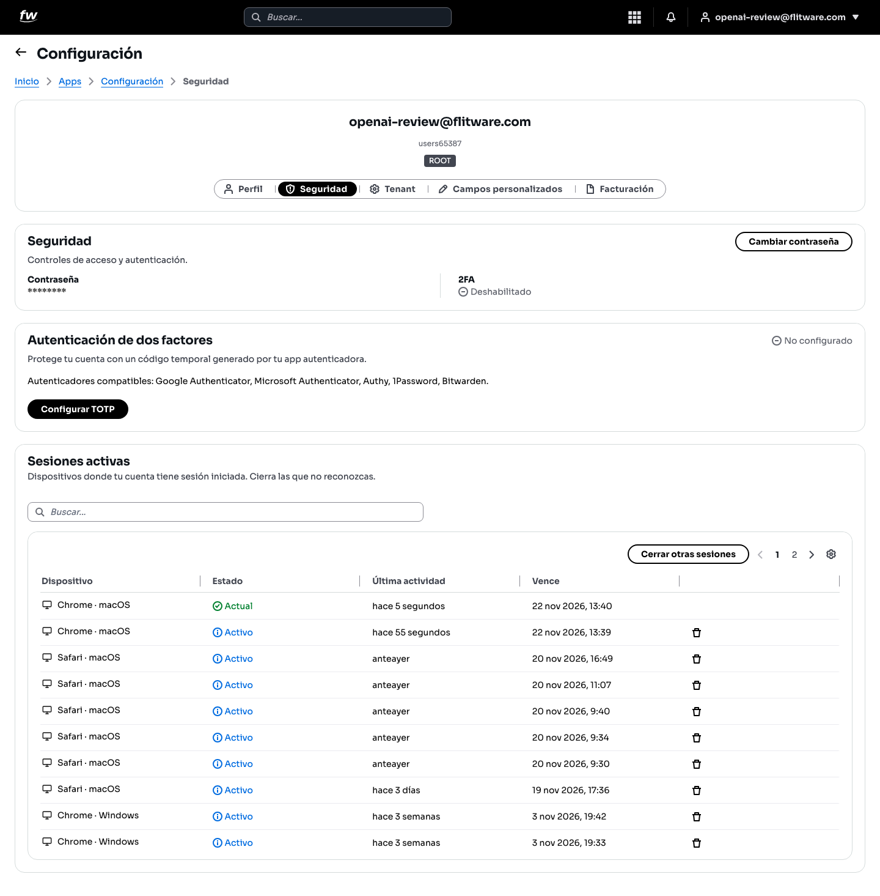
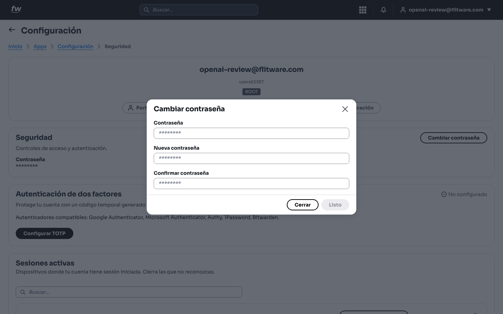
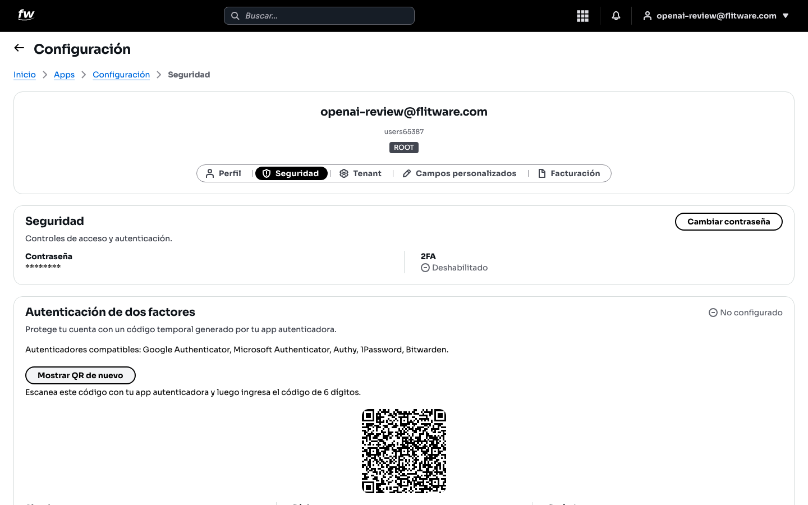
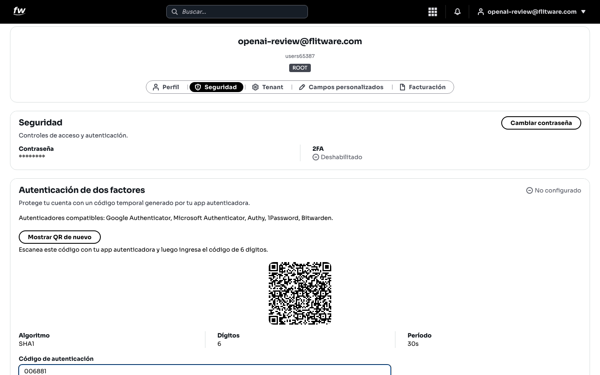
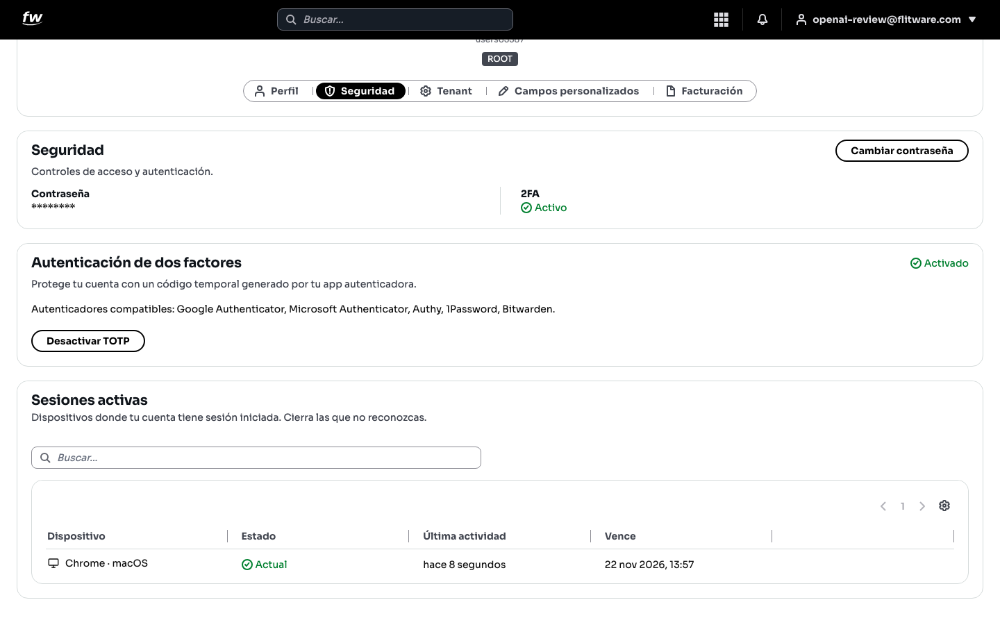
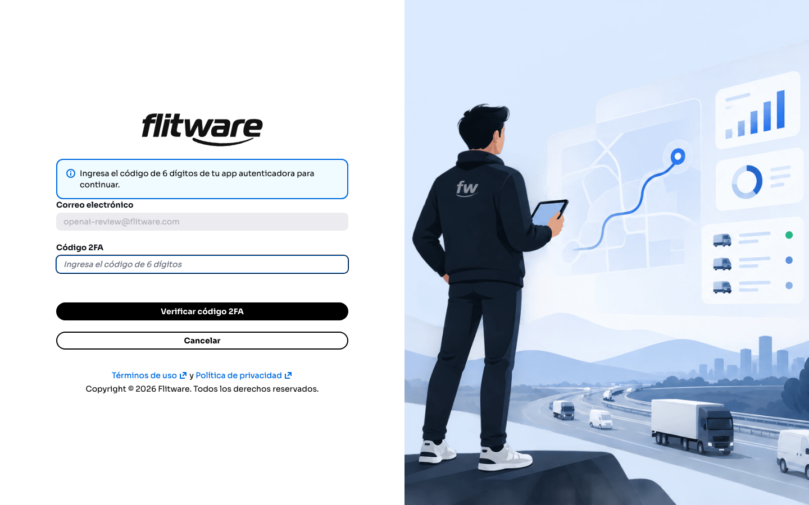
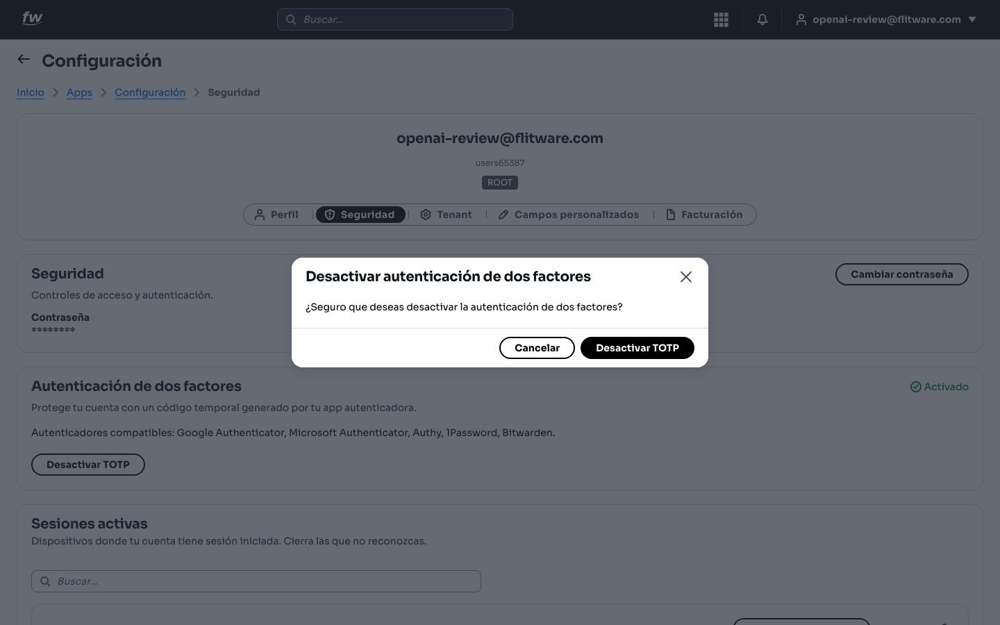
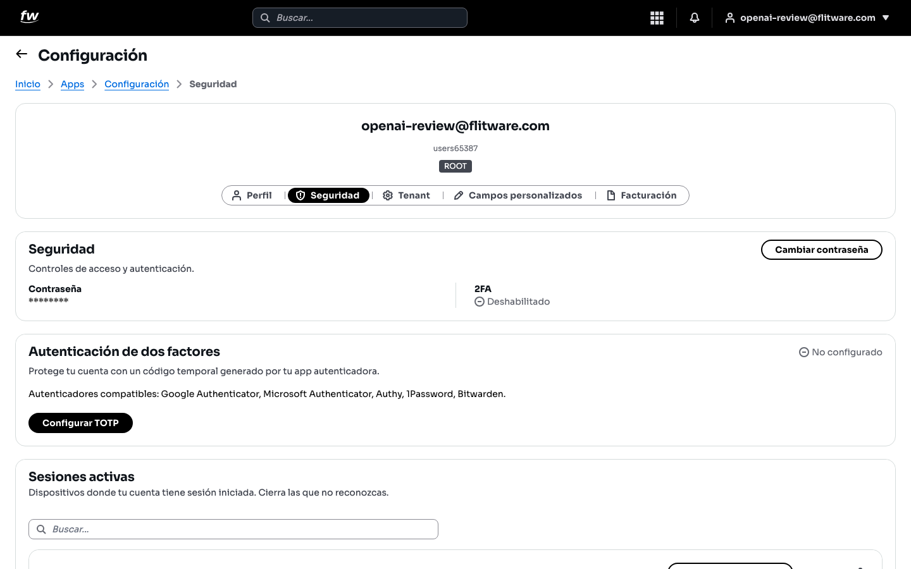

# Seguridad

Esta es la pantalla que protege su cuenta y, con ella, toda la operación de su flota. Aquí cambia su contraseña, activa el segundo factor (ese código de 6 dígitos del celular) y revisa en qué equipos tiene sesión abierta. Si solo va a leer una guía completa, que sea esta.

## Prerrequisitos

- Cualquier rol puede gestionar su **propia** seguridad.
- Para activar el doble factor necesita una app autenticadora en su celular: **Google Authenticator**, **Microsoft Authenticator**, **Authy**, **1Password** o **Bitwarden** (cualquiera sirve).

## Cómo llegar

1. Entre a **Configuración** desde el menú de aplicaciones.
2. Abra la pestaña **Seguridad**.

Verá tres bloques: **Seguridad** (contraseña y estado del 2FA), **Autenticación de dos factores** (activación) y **Sesiones activas** (sus equipos conectados).

## Cómo cambiar su contraseña

1. Pulse el botón **Cambiar contraseña**.
2. En la ventana escriba su **Contraseña** actual, la **Nueva contraseña** y repítala en **Confirmar contraseña**.

3. Pulse **Listo**. A partir de ese momento, la clave vieja deja de funcionar en todos los equipos.

:::tip Consejo de flota
Use una frase que recuerde pero otros no adivinen, por ejemplo combinando patio, placa y año de forma que solo usted entienda. Evite "Flota123" o el nombre de la empresa: son lo primero que se prueba.
:::

## Cómo activar el doble factor (2FA)

El doble factor pide, además de la contraseña, un código de 6 dígitos que cambia cada 30 segundos. Aunque alguien descubra su clave, sin su celular no puede entrar.

1. En el bloque **Autenticación de dos factores**, pulse **Configurar TOTP**.
2. Aparecerá un código QR en pantalla. Abra su app autenticadora y escenéelo.

3. La app empezará a mostrar un código de 6 dígitos. Escríbalo en el campo **Código de autenticación** y pulse **Verificar código**.

4. Si el código es correcto, verá el estado **Activado** en verde y el botón cambiará a **Desactivar TOTP**.

5. La próxima vez que entre a Flitware, después del correo y la contraseña le pedirá el **Código 2FA**. Escríbalo y pulse **Verificar código 2FA**.

## Cómo desactivar el doble factor

Solo hágalo si cambió de celular o perdió el acceso a la app autenticadora.

1. Pulse **Desactivar TOTP**.
2. Confirme en la ventana **Desactivar autenticación de dos factores** pulsando **Desactivar TOTP**.

3. El estado volverá a **No configurado** y podrá activar de nuevo con el celular nuevo.

## Cómo revisar sus sesiones activas

1. Baje al bloque **Sesiones activas**. Ahí ve cada equipo donde su cuenta tiene sesión: el dispositivo (por ejemplo *Chrome · macOS*), el estado (**Actual** es el equipo que está usando ahora), la **Última actividad** y cuándo **Vence**.
2. Si ve un equipo que no reconoce (un Windows que usted no usa, una actividad de madrugada), cierre esa sesión con el botón de la papelera de su fila.
3. Si tiene dudas, use **Cerrar otras sesiones**: lo desconecta de todo menos del equipo actual. Después cambie su contraseña.

## Recomendación del experto

En 20 años administrando flotas he visto de todo, y le puedo decir con total seguridad: **active el doble factor hoy mismo**, empezando por las cuentas con rol alto (ROOT, administradores). El ataque más común no es un hacker de película: es un correo robado o una clave adivinada. El 2FA frena eso en seco.

Mi rutina recomendada:

- **Hoy:** active el 2FA en su cuenta y pida a cada jefe que active el suyo.
- **Cada semana:** mire sus **Sesiones activas**. Si aparece un dispositivo raro, cierre la sesión y cambie la clave.
- **Si pierde el celular:** entre desde un equipo de confianza, desactive el TOTP y vuelva a configurarlo en el celular nuevo. No deje la cuenta sin 2FA "mientras tanto".
- **Cada 3 meses:** cambie su contraseña, aunque nada haya pasado. En transporte el personal rota mucho y las claves circulan más de lo que creemos.

## Errores comunes

- **"El código no sirve".** Casi siempre es la hora del celular: si el reloj está adelantado o atrasado, los códigos no coinciden. Active la hora automática y pruebe con el código más reciente.
- **Tomar foto al QR y guardarla.** Esa foto es la llave de su cuenta: quien la tenga puede generar sus códigos. Escanee el QR y no lo guarde ni lo comparta.
- **Desactivar el 2FA "temporalmente" y olvidarlo.** He visto cuentas que quedaron meses sin protección por un "temporal" que nadie retomó. Si lo desactiva, reactívelo el mismo día.
- **Ignorar sesiones desconocidas.** Un equipo que no reconoce no es un error del sistema: es alguien dentro de su cuenta. Ciérrelo y cambie la clave de inmediato.
