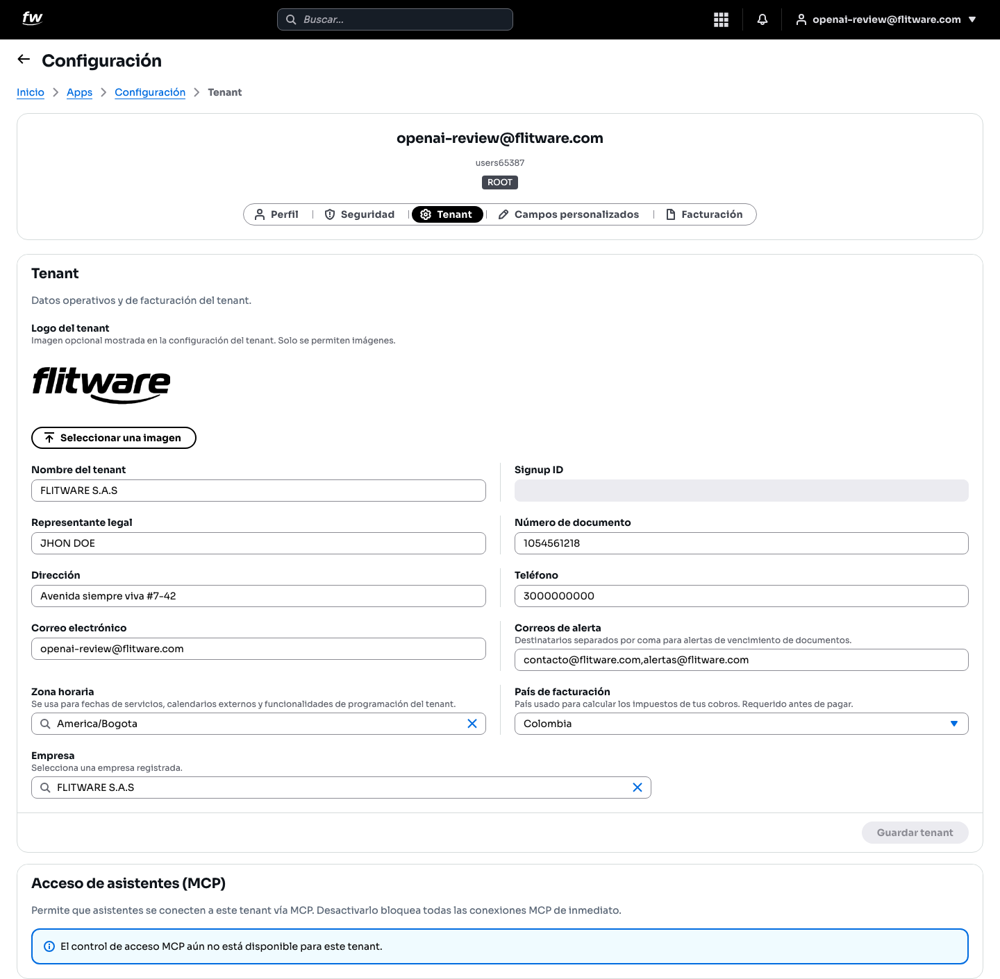
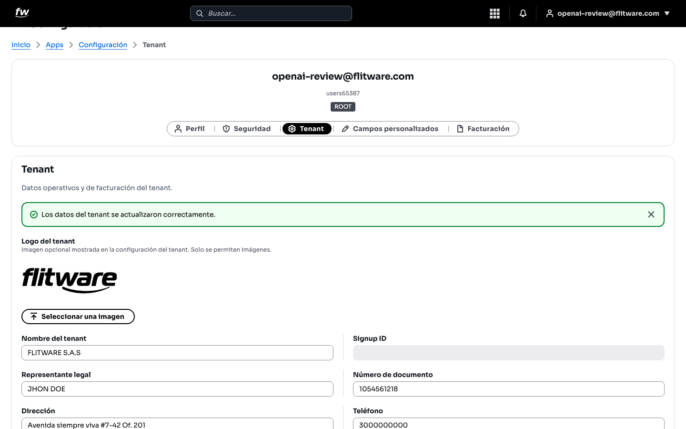

# Datos de la empresa (Tenant)

El *tenant* es su empresa dentro de Flitware: su nombre, sus documentos, su zona horaria y a dónde llegan las alertas. Si estos datos están bien, las fechas salen correctas, las facturas llegan a quien deben y nadie se pierde un vencimiento. Si están mal, todo lo demás cojea.

## Prerrequisitos

- Rol **ROOT** (o un rol con permiso para editar los datos de la empresa).
- Tenga a la mano: nombre legal de la empresa, documento, dirección, teléfono y los correos que deben recibir alertas.

## Cómo llegar

1. Entre a **Configuración** desde el menú de aplicaciones.
2. Abra la pestaña **Tenant**.

## Cómo completar los datos paso a paso

1. **Logo del tenant (opcional).** Pulse **Seleccionar una imagen** y suba el logo de su empresa. Solo se permiten imágenes.
2. **Nombre del tenant.** Escriba la razón social tal como aparece en sus documentos legales (por ejemplo, *FLITWARE S.A.S*).
3. **Representante legal** y **Número de documento.** Datos del responsable legal de la empresa.
4. **Dirección**, **Teléfono** y **Correo electrónico.** Datos de contacto oficiales.
5. **Correos de alerta.** Aquí está lo más importante para la operación: escriba, separados por coma, los correos que deben recibir los avisos de vencimiento de documentos (por ejemplo, *contacto@flitware.com,alertas@flitware.com*).
6. **Zona horaria.** Elija la zona de su operación (por ejemplo, *America/Bogota*). Se usa para fechas de servicios, calendarios y programación: si está mal, los horarios salen corridos.
7. **País de facturación.** Requerido antes de pagar; se usa para calcular los impuestos de sus cobros.
8. **Empresa.** Seleccione su empresa registrada en la lista.
9. Pulse **Guardar tenant** para aplicar los cambios. Verá un aviso de confirmación en verde.

## Sobre el bloque "Acceso de asistentes (MCP)"

Debajo de los datos verá el bloque **Acceso de asistentes (MCP)**, que permite que asistentes se conecten a su empresa por ese canal. Si muestra el aviso *El control de acceso MCP aún no está disponible para este tenant*, no tiene nada que hacer: es informativo y no afecta su operación diaria.

## Recomendación del experto

Según la recomendación de expertos para una buena experiencia, el error que más caro sale aquí es dejar los **Correos de alerta** vacíos o con un solo correo de una persona que ya salió. Esos correos son su red de seguridad contra multas: avisan antes de que venza un SOAT, una revisión o una licencia.

Rutina recomendada:

- **Hoy:** ponga mínimo dos correos de alerta: el del responsable operativo y uno genérico del área (tipo *alertas@suempresa.com*) que varias personas lean.
- **Cada 3 meses:** verifique que esos correos siguen vigentes y que alguien los lee de verdad.
- **Al abrir sede en otra ciudad:** revise la **Zona horaria** si operan en otra zona; un turno programado con la zona mal es un vehículo parado.
- **Antes de pagar:** confirme el **País de facturación**; sin eso no puede completar pagos.

## Errores comunes

- **Un solo correo de alerta, personal.** Si esa persona está de vacaciones o sale de la empresa, nadie recibe los avisos de vencimiento. Use mínimo dos y uno genérico.
- **Zona horaria equivocada.** Los servicios y calendarios salen con horas corridas y nadie entiende por qué. Verifíquela al configurar y al expandirse.
- **Olvidar pulsar Guardar tenant.** Los cambios en pantalla no se aplican solos: si sale sin guardar, pierde lo diligenciado.
- **Datos legales distintos a los documentos reales.** El nombre y documento deben coincidir con sus papeles oficiales para evitar problemas de facturación.
