# Usuarios

Aquí administra a las personas que trabajan en Flitware: quién entra, con qué rol y si su cuenta está activa. Piense en esta pantalla como el personal de su patio: cada conductor, auxiliar o jefe de operaciones necesita su propio acceso, con los permisos justos para su trabajo.

## Prerrequisitos

- Rol **ROOT** (o un rol con permiso de gestión de usuarios).
- Solo los usuarios **activos** ocupan un lugar de su plan. Desactivar a alguien libera su lugar.

## Ver la lista de usuarios

1. Entre a **Configuración** y abra la pestaña **Perfil**.
2. Baje hasta el **Listado de usuarios**. Use el buscador para encontrar a alguien por nombre o correo.
3. Cada fila muestra el estado: si está verificado, si tiene doble factor activado, si está activo y su rol.

## Cómo crear un usuario

1. En el **Listado de usuarios**, pulse el botón **+** (arriba a la derecha de la tabla).
2. Se abre la ventana **Crear usuario**. El único dato obligatorio es el **Correo electrónico**.

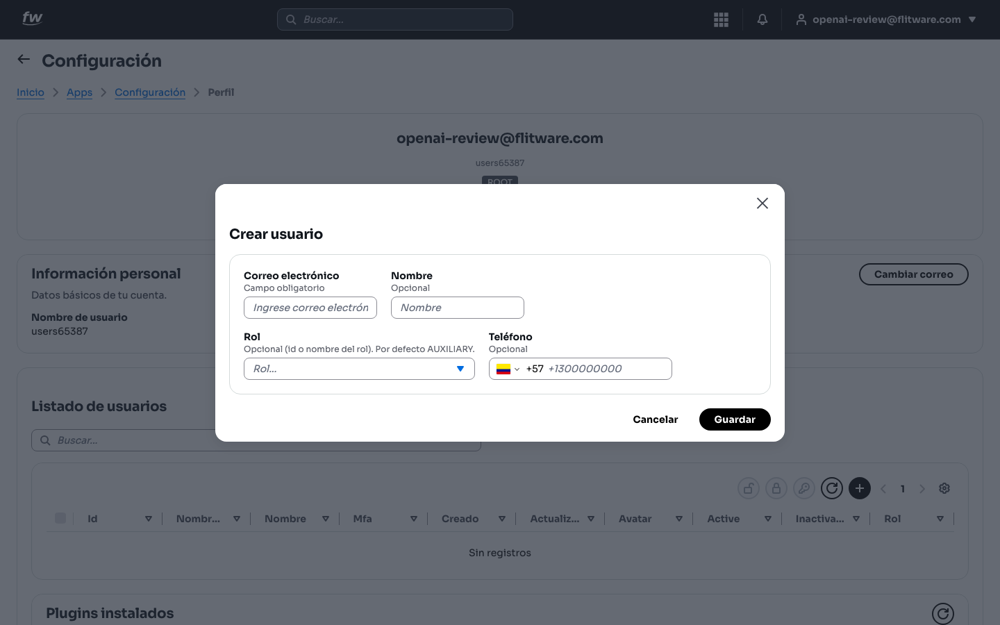

3. Complete los datos opcionales:
   - **Nombre:** escriba el nombre completo (el sistema lo muestra en mayúsculas para que sea fácil de leer en los reportes).
   - **Rol:** elija el rol según el cargo. Si no elige nada, se asigna **AUXILIARY** por defecto.
   - **Teléfono:** útil para contactar rápido al personal operativo.

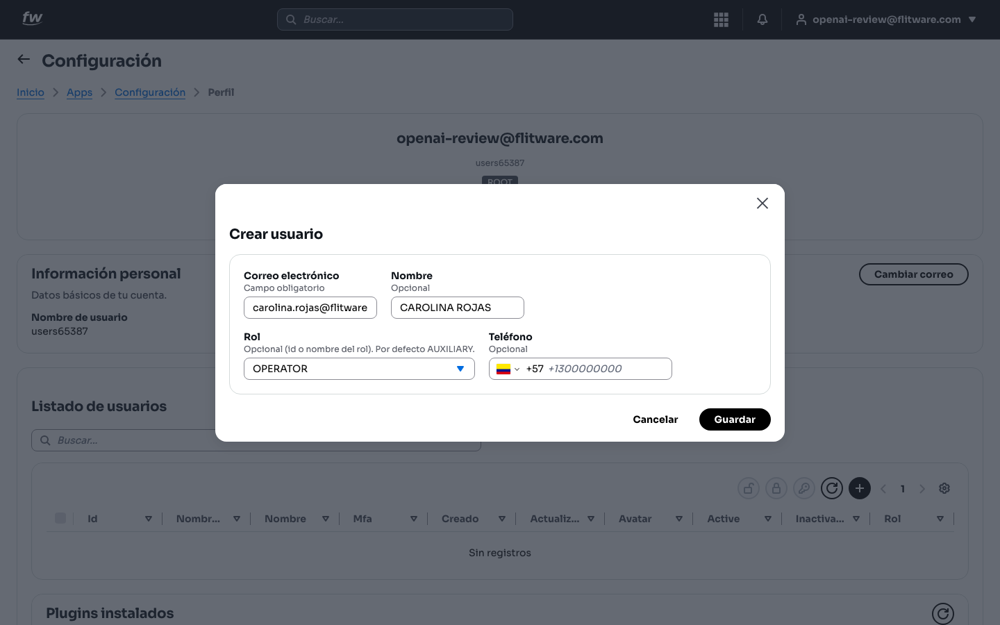

4. Pulse **Guardar**. Verá el aviso verde **Cuenta creada correctamente** y el nuevo usuario aparecerá en la lista.

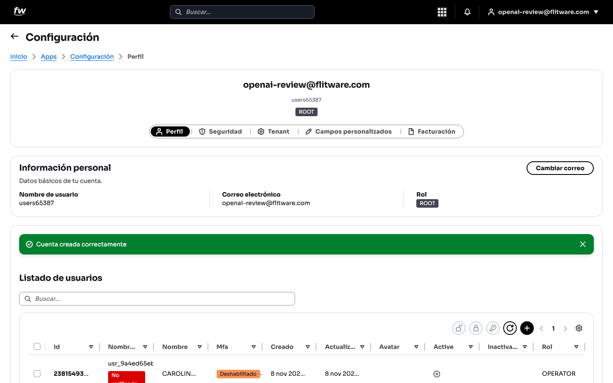

## Cómo editar un usuario

1. En la lista, abra el usuario que quiere modificar.
2. En la ventana **Editar usuario** puede cambiar el correo, el nombre, el rol y el teléfono. También tiene los botones **Restablecer contraseña** y **Desbloquear usuario**.

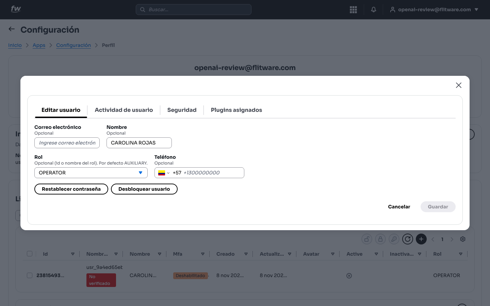

3. Pulse **Guardar** para aplicar los cambios.

La ventana de edición tiene tres pestañas más que le conviene conocer:

- **Actividad de usuario:** muestra los **Logs de usuario** (cuándo entró, desde qué dispositivo, con qué resultado). Si está vacía, la persona aún no ha usado el sistema.

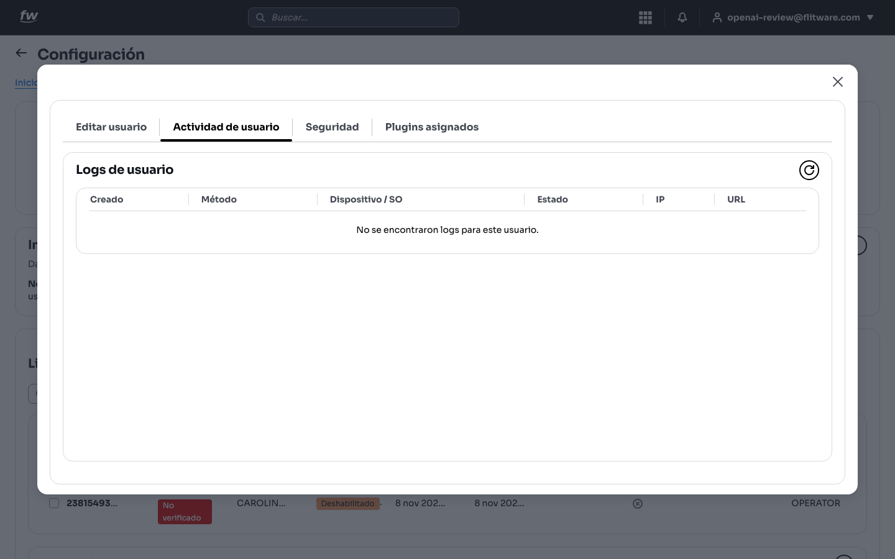

- **Seguridad:** historial de autenticación y seguridad, por ejemplo *Usuario reactivado* o *Usuario desactivado*, con fecha y hora.

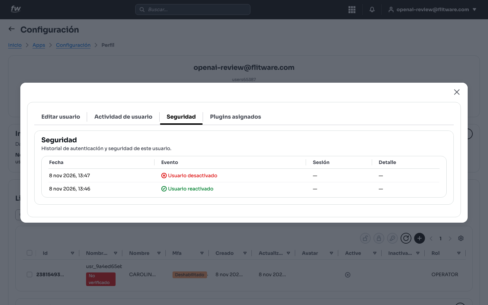

- **Plugins asignados:** qué herramientas extra tiene esta persona. Si dice *Este usuario no tiene plugins asignados*, trabaja solo con las funciones base.

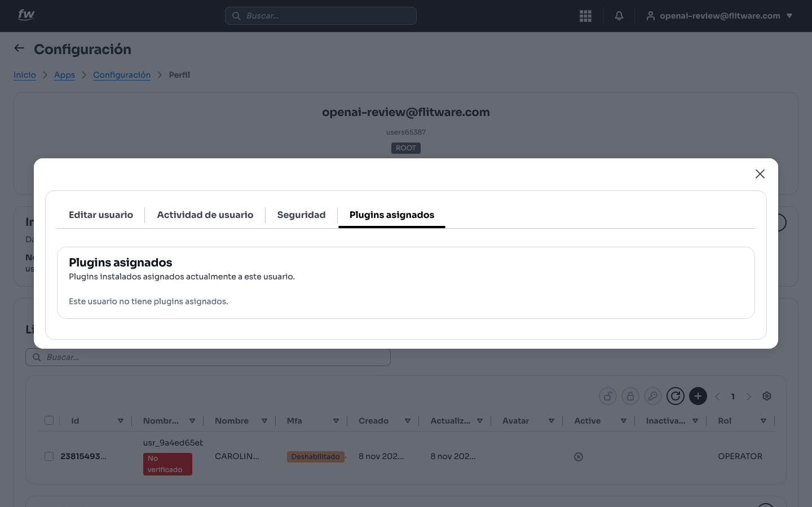

## Cómo activar y desactivar usuarios

1. Seleccione al usuario en la lista y use la acción de bloquear o desbloquear.
2. Al reactivar verá el aviso **1 usuario(s) desbloqueado(s) correctamente**.

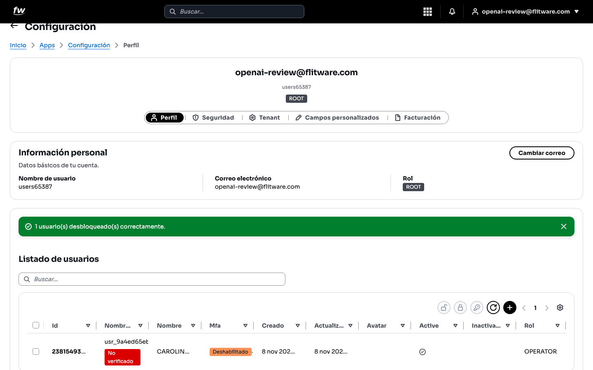

3. Al desactivar, el usuario pierde el acceso de inmediato pero **no se borra**: su historial se conserva y usted libera un lugar del plan.

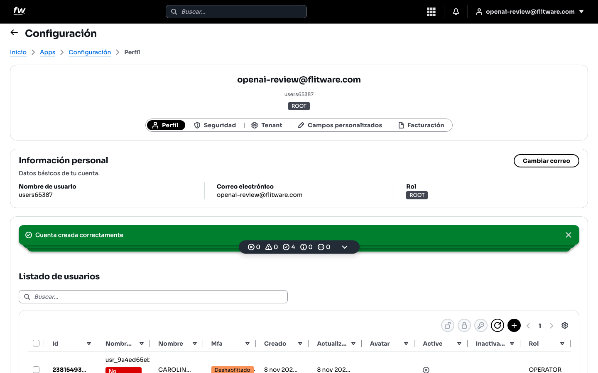

## Cómo restablecer una contraseña

1. Seleccione al usuario y use la acción de restablecimiento (o el botón **Restablecer contraseña** dentro de **Editar usuario**).
2. El sistema le envía un correo al usuario para que cree su clave nueva. Usted verá el aviso **Se envió el correo de restablecimiento a 1 usuario(s)**.

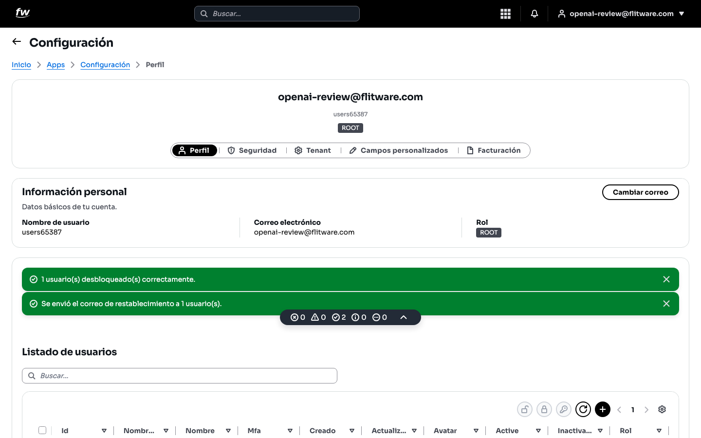

3. Avise a la persona por teléfono o chat para que revise su bandeja (y la carpeta de spam).

## Recomendación del experto

Según la recomendación de expertos para una buena experiencia: **un usuario por persona, siempre**. Nada de cuentas compartidas como "operaciones@" usadas por tres turnos. Cuando algo sale mal —un documento borrado, un cambio raro—, los **Logs de usuario** solo le sirven si cada persona tiene su propia cuenta.

Rutina recomendada:

- **Al contratar:** cree el usuario el primer día, con rol mínimo. Es más fácil dar permisos después que quitar un daño.
- **Al cambiar de cargo:** actualice el rol ese mismo día.
- **Al retirar:** desactive la cuenta de inmediato, no la deje "por si acaso". Un ex-empleado con acceso activo es uno de los riesgos más comunes en las empresas.
- **Cada mes:** revise la lista completa y desactive cuentas sin uso. Además de seguridad, libera lugares del plan.

## Errores comunes

- **Crear dos veces el mismo correo.** El sistema lo rechaza con el aviso *No se pudo crear el usuario: email: The email is invalid or already in use*. Busque primero en la lista: casi siempre el usuario ya existe y solo está desactivado.

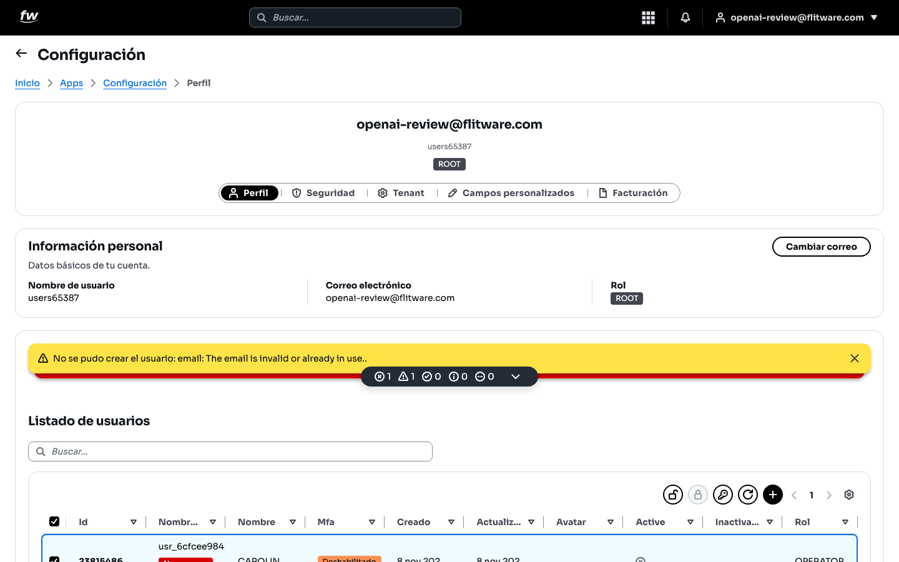

- **Dar rol de más "para que no moleste".** Un auxiliar con permisos de jefe puede cambiar datos críticos sin darse cuenta. Empiece con lo mínimo.
- **Borrar en lugar de desactivar (o pedir que lo borren).** Desactivar conserva el historial y libera el lugar del plan. Es lo correcto en el 99% de los casos.
- **No avisar del correo de restablecimiento.** El usuario no lo espera, no lo ve, y termina llamando a soporte por algo que se resolvía con un mensaje.
