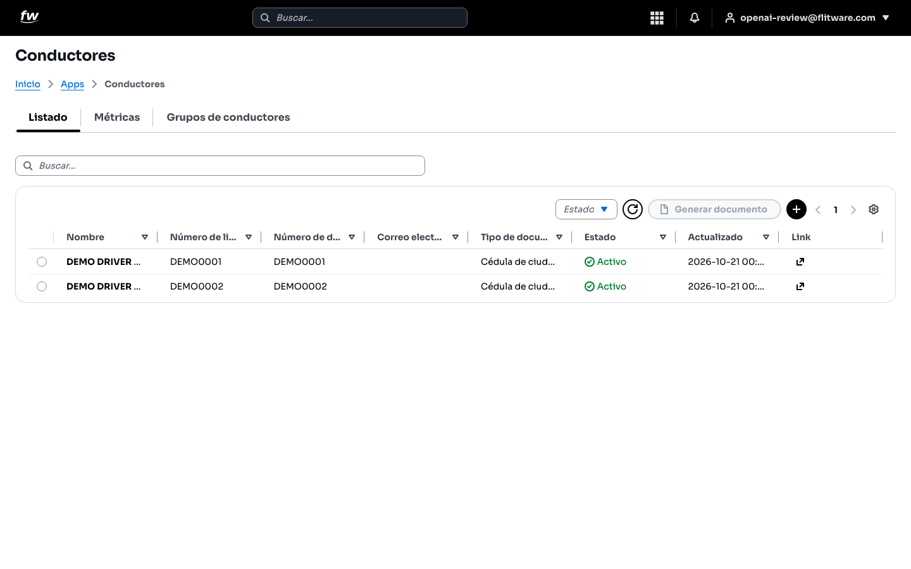
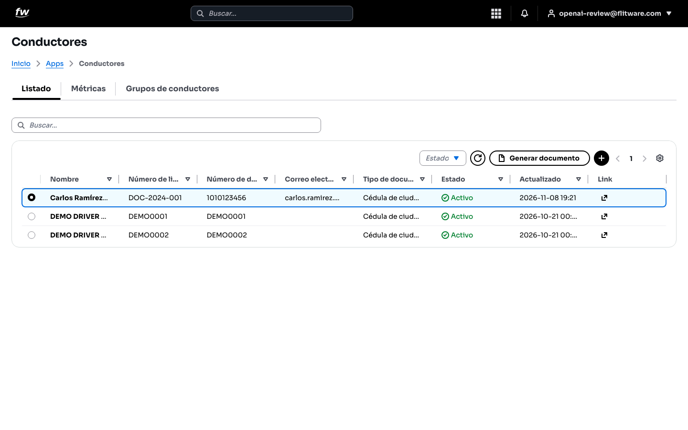
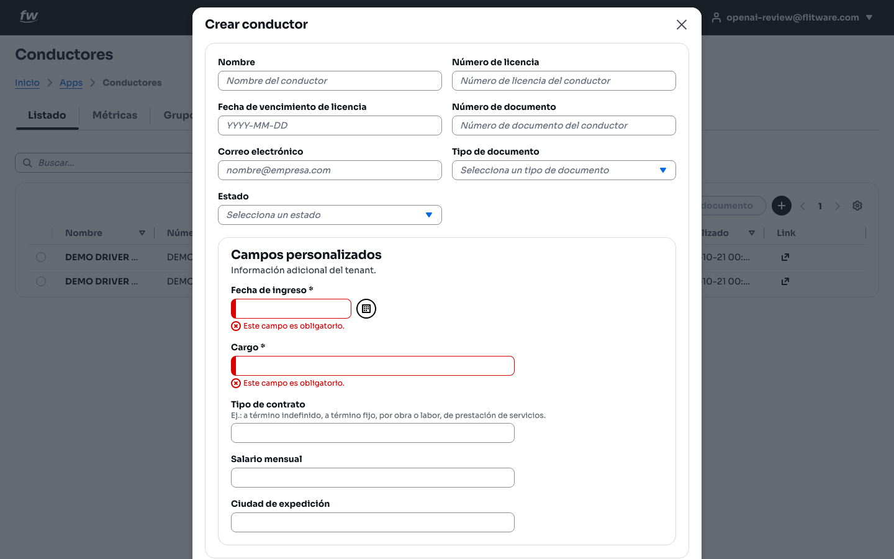
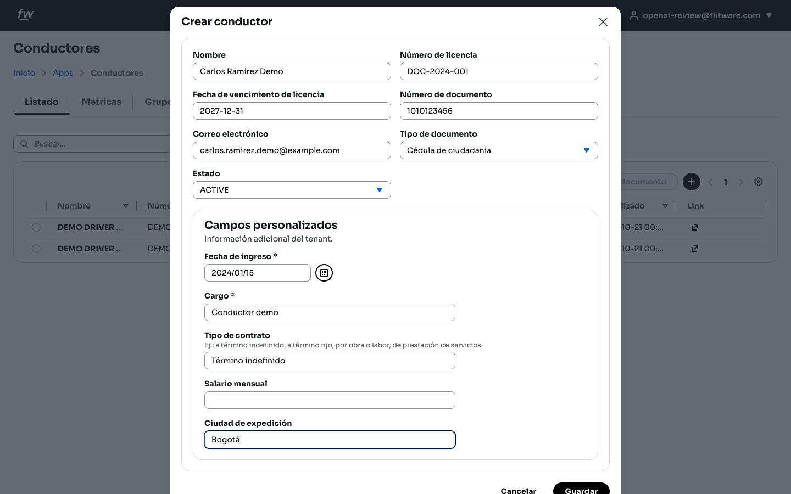
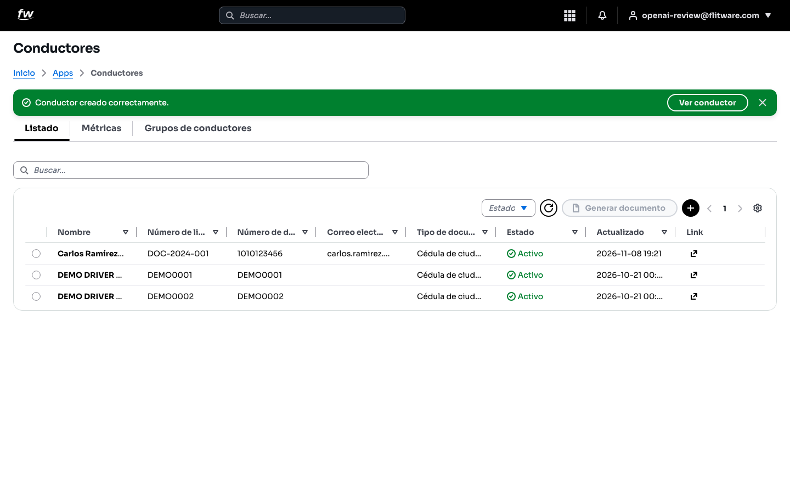
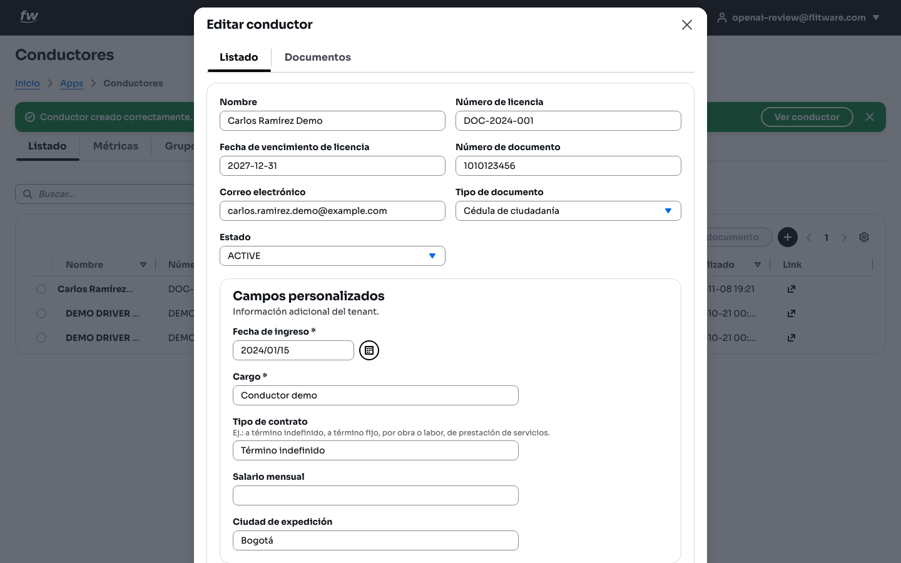
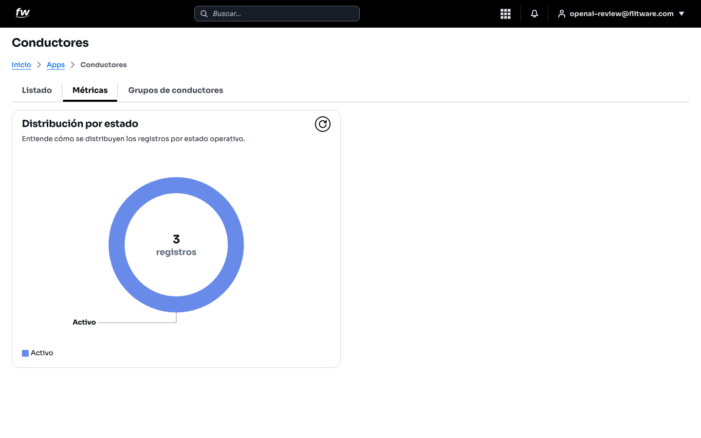

# Conductores: registre y controle su personal de conducción

Aquí registra a cada persona que conduce sus vehículos: nombre, licencia, documento y datos laborales. Mantener esta lista al día le evita multas por licencias vencidas y le permite saber quién estaba al volante de cada vehículo.

## Prerrequisitos

- Tener acceso a la aplicación. En el menú superior vaya a **Inicio > Apps > Conductores**.
- Tenga a la mano la licencia de conducción y el documento de identidad del conductor.

## Ver la lista de conductores

1. Abra **Conductores**. Verá las pestañas **Listado**, **Métricas** y **Grupos de conductores**.
2. En **Listado** use la barra **Buscar...** para encontrar un conductor por nombre, licencia o documento.
3. Las columnas muestran **Nombre**, **Número de licencia**, **Número de documento**, **Correo electrónico**, **Tipo de documento**, **Estado** (por ejemplo, **Activo** con marca verde) y **Actualizado**.
4. Con el filtro **Estado** puede ver solo conductores activos o inactivos.
5. Seleccione una fila haciendo clic en el círculo de la izquierda para activar la acción **Generar documento**.

## Crear un conductor

Pulse el botón **+** (arriba a la derecha del listado) para abrir la ventana **Crear conductor**.

1. Escriba el **Nombre** (ejemplo: Carlos Ramírez Demo).
2. Escriba el **Número de licencia** y la **Fecha de vencimiento de licencia** (YYYY-MM-DD).
3. Escriba el **Número de documento** y el **Correo electrónico**.
4. Seleccione el **Tipo de documento** (por ejemplo, Cédula de ciudadanía) y el **Estado** (ACTIVE para un conductor habilitado).
5. Complete la sección **Campos personalizados** ("Información adicional del tenant"): en este ejemplo pide **Fecha de ingreso** (obligatoria), **Cargo** (obligatorio), **Tipo de contrato**, **Salario mensual** y **Ciudad de expedición**. Si deja vacío un campo obligatorio verá el aviso *"Este campo es obligatorio."*
6. Pulse **Guardar**. Verá el mensaje verde **Conductor creado correctamente.** con el botón **Ver conductor** para abrir la ficha.

:::tip Recomendación del experto
La **Fecha de vencimiento de licencia** es el campo más importante del formulario. Anótela tal como aparece en la licencia física y programe una revisión mensual de vencimientos: un conductor con licencia vencida es una multa segura y un riesgo legal para la empresa.
:::

:::warning Errores comunes
- Guardar el conductor **sin Estado** o con estado inactivo por descuido: después "no aparece" en las asignaciones.
- Escribir el correo con errores. Si el conductor debe recibir notificaciones, verifique el correo letra por letra.
- Dejar vacíos **Fecha de ingreso** y **Cargo** (obligatorios): el sistema no le dejará guardar hasta completarlos.
:::

## Ver y editar la ficha del conductor

Haga clic en un conductor del listado para abrir **Editar conductor**. La ficha tiene las pestañas **Listado** y **Documentos**, y muestra los mismos datos del formulario (nombre, licencia, vencimiento, documento, correo, tipo de documento, estado y campos personalizados) listos para corregir y guardar.

:::tip Recomendación del experto
Cuando un conductor renueve su licencia, actualice la ficha ese mismo día y guarde la foto de la licencia nueva en la pestaña **Documentos**. Así la hoja de vida siempre respalda lo que dice el sistema.
:::

## Métricas: distribución por estado

En la pestaña **Métricas** verá la tarjeta **Distribución por estado**, que muestra *"cómo se distribuyen los registros por estado operativo"*: un gráfico circular con el total de registros y cuántos están en cada estado (por ejemplo, **Activo**).

:::tip Recomendación del experto
Si tiene conductores que ya no trabajan con usted, cámbieles el estado a inactivo en lugar de dejarlos como activos. Un conteo de activos inflado le hace creer que tiene más personal disponible del real.
:::

## Estados del conductor

- **Activo**: el conductor está habilitado y aparece con marca verde en el listado.
- **Inactivo**: el conductor está registrado pero no disponible (se retiró, está suspendido o aún no inicia).

:::warning Errores comunes
- No inactivar a tiempo a quien se retira: sigue apareciendo como disponible y puede ser asignado por error.
:::

## Rutina recomendada (5 minutos a la semana)

1. Abra **Conductores > Listado** y confirme que los conductores nuevos estén creados y **Activos**.
2. Revise las fechas de **vencimiento de licencia** próximas a vencer.
3. Inactive a quienes ya no trabajen con usted.
4. Mire **Métricas** una vez al mes para verificar que el conteo de activos cuadre con su nómina real.

## Errores comunes

- **No revisar vencimientos de licencia** hasta que llega la multa. Ponga una fecha fija al mes para revisarlos.
- **Duplicar conductores** (mismo documento, dos registros) por no buscar primero en el listado.
- **Dejar campos personalizados vacíos** "para después": la fecha de ingreso y el cargo se olvidan rápido si no se anotan el primer día.
- **Confundir Número de licencia con Número de documento**: son campos distintos; verifique cada uno contra el documento físico.
