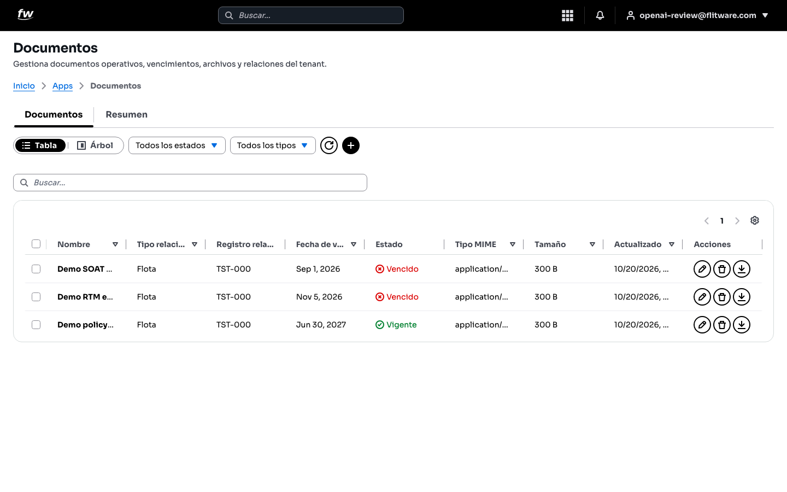
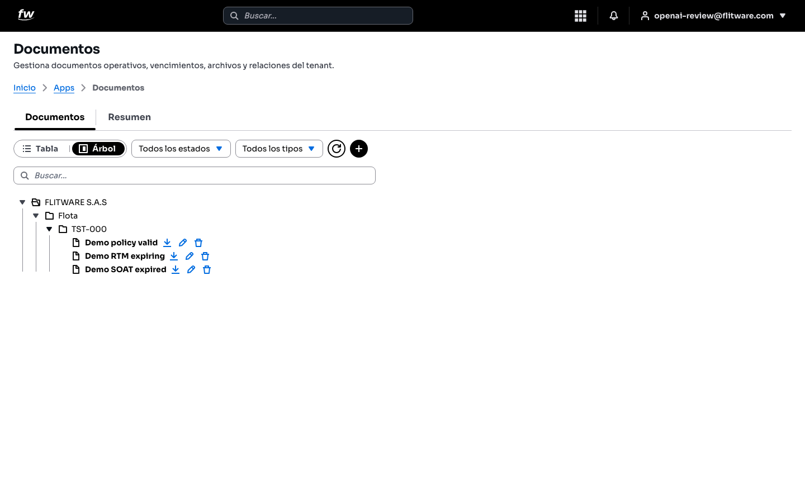
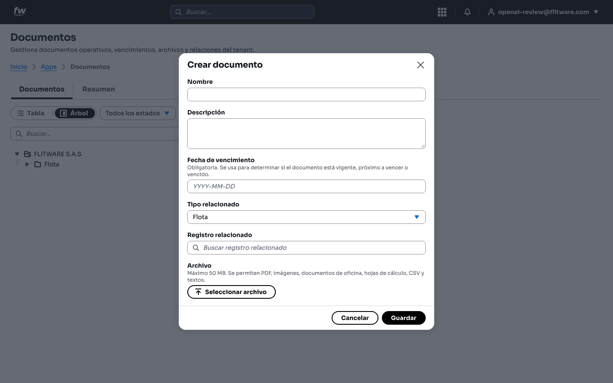
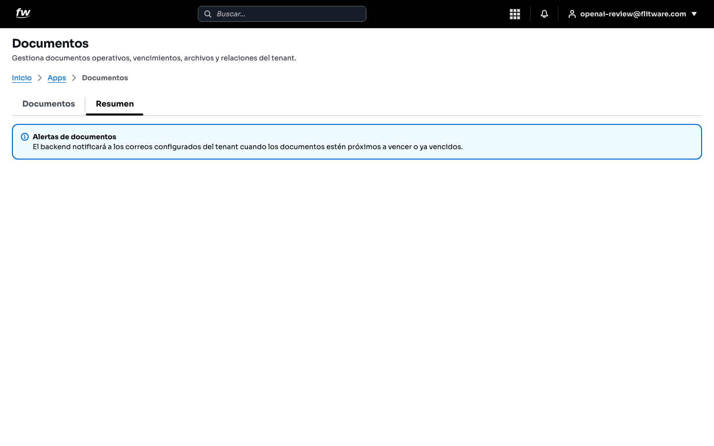
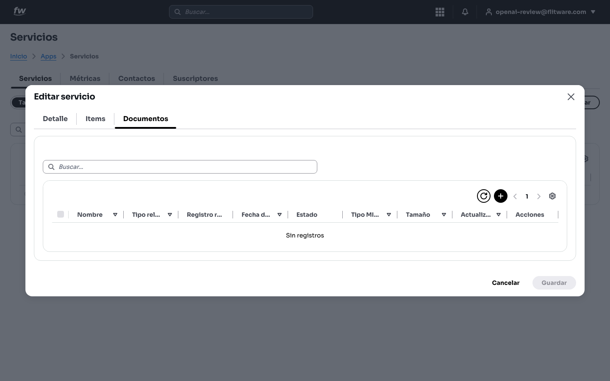

# Documentos

Aquí vive la carpeta digital de su empresa: SOAT, revisión técnico-mecánica, pólizas, contratos y cualquier archivo que necesite tener a la mano. Cada documento queda **atado a un registro** (un vehículo, un conductor, un servicio) y tiene una **fecha de vencimiento** que le avisa si está vigente o vencido. Si usted ha sufrido una inmovilización por un SOAT vencido que nadie revisó, esta pantalla es su seguro contra eso.

## Prerrequisitos

- Un usuario de su empresa con acceso a la aplicación **Documentos** (si no la ve en el menú **Apps**, pida acceso a su administrador).
- Tener a la mano el archivo que va a subir (PDF, imagen o documento de oficina, máximo 50 MB) y su fecha de vencimiento real.

## Cómo llegar

1. Entre a **Apps** desde el menú principal.
2. Abra **Documentos**.

Verá las pestañas **Documentos** y **Resumen**, y el conmutador de vista **Tabla** / **Árbol**.

## Cómo revisar sus documentos en tabla

1. Deje activa la vista **Tabla**.
2. Use los filtros **Todos los estados** y **Todos los tipos** para enfocarse (por ejemplo, solo vencidos).
3. Escriba en el campo **Buscar...** si busca un documento por nombre.

La tabla muestra **Nombre**, **Tipo relacionado**, **Registro relacionado**, **Fecha de vencimiento**, **Estado**, **Tipo MIME**, **Tamaño**, **Actualizado** y **Acciones**. El **Estado** se calcula solo a partir de la fecha de vencimiento:

- **Vigente** (verde): el documento está al día.
- **Próximo a vencer**: se acerca la fecha, actúe ya.
- **Vencido** (rojo): la fecha ya pasó, es urgente renovar.

:::tip
Empiece cada lunes filtrando por vencidos y próximos a vencer. Son 5 minutos que le ahorran comparendos, inmovilizaciones y servicios cancelados a última hora.
:::

## Cómo ver el árbol documental

1. Pulse el conmutador **Árbol**.
2. Despliegue su empresa, luego el tipo (por ejemplo **Flota**) y el registro (por ejemplo **TST-000**).

El árbol ordena los documentos por jerarquía: empresa → tipo → registro → documento. Cada documento tiene iconos para **descargar**, **editar** y **eliminar**. Use esta vista cuando quiera responder "¿qué papeles tiene este vehículo?" de un vistazo, en vez de buscar fila por fila en la tabla.

## Cómo crear un documento

1. Pulse el botón **+** (arriba, junto al icono de recargar).
2. Se abre la ventana **Crear documento**. Complete los campos:

3. Escriba el **Nombre** (sea específico: *SOAT Placa ABC-123 2026*, no solo *SOAT*).
4. Agregue una **Descripción** si ayuda a su equipo (aseguradora, número de póliza, etc.).
5. Digite la **Fecha de vencimiento** en formato AAAA-MM-DD. Es **obligatoria**: sin ella el sistema no puede avisarle si el documento vence.
6. En **Tipo relacionado** elija a qué pertenece el documento (por ejemplo **Flota**).
7. En **Registro relacionado** use el buscador (**Buscar registro relacionado**) para atarlo al vehículo, conductor o servicio exacto.
8. Pulse **Seleccionar archivo** y suba el archivo (máximo 50 MB: PDF, imágenes, documentos de oficina, hojas de cálculo, CSV y textos).
9. Pulse **Guardar**.

:::warning
Un documento sin registro relacionado es un papel suelto: nadie lo encontrará cuando lo necesite. Siempre átelo al vehículo o registro que corresponda.
:::

## Cómo ver las alertas de vencimiento

1. Abra la pestaña **Resumen**.

Verá el aviso **Alertas de documentos**: el sistema notificará a los correos configurados de su empresa cuando los documentos estén próximos a vencer o ya vencidos. Verifique con su administrador que esos correos estén bien configurados; de nada sirve la alerta si llega a un buzón que nadie lee.

## Cómo ver los documentos de un servicio

Los documentos también aparecen dentro de cada servicio, para que el coordinador no tenga que saltar entre pantallas:

1. Abra el servicio y pulse **Editar servicio**.
2. Vaya a la pestaña **Documentos** (junto a **Detalle** e **Items**).

Si el servicio aún no tiene documentos verá el mensaje **Sin registros**. Use el botón **+** para agregar los que correspondan a ese viaje o trabajo.

## Recomendación del experto

Trate esta pantalla como la cartelera de vencimientos de su oficina, no como un archivo muerto:

- **Rutina semanal (lunes, 10 minutos):** abra la **Tabla**, filtre por **Vencido** y **Próximo a vencer**, y anote qué debe renovarse esta semana y quién es responsable. Luego revise el **Resumen** para confirmar que las alertas están activas.
- **Rutina mensual (primer día del mes, 30 minutos):** recorra el **Árbol** vehículo por vehículo (o conductor por conductor) y confirme que cada uno tiene sus documentos completos y vigentes. Lo que falte, créelo ese mismo día.
- **Regla de oro:** el día que le entregan un documento nuevo (el SOAT recién comprado, la póliza renovada), súbalo de inmediato con su fecha de vencimiento real. El error más caro es "lo subo después" y que ese después nunca llegue.
- **Nombres que se entienden solos:** incluya tipo, placa o persona y año (*RTM TST-000 2026*). Cuando tenga cientos de documentos, lo agradecerá.

## Errores comunes

- **Subir el archivo sin fecha de vencimiento (o con una fecha inventada):** el estado sale mal y las alertas no sirven. Copie siempre la fecha real del papel.
- **Atar el documento al registro equivocado:** un SOAT del vehículo A guardado en el vehículo B es peor que no tenerlo, porque da falsa tranquilidad. Verifique la placa antes de guardar.
- **Guardar todo como tipo Flota por pereza:** si el documento es de un conductor (licencia, certificado médico), relaciónelo con el conductor. Así, cuando esa persona salga, sus papeles salen con ella.
- **Dejar archivos gigantes:** el límite es 50 MB. Si escanea, use PDF a resolución normal, no fotos de 20 MB por página.
- **Nadie revisa el Resumen:** las alertas solo ayudan si los correos configurados son los correctos y alguien los lee. Pregunte a su administrador a dónde llegan.
