# Servicios

Esta es su mesa de operaciones: cada viaje o trabajo que su empresa hace para un cliente es un **servicio** con fecha, origen, destino, precio y estado. Aquí programa los servicios, lleva la agenda del mes, guarda los datos de sus clientes (**Contactos**), revisa números (**Métricas**) y decide quién recibe avisos (**Suscriptores**). Si los Documentos son la carpeta, los Servicios son el tablero diario.

## Prerrequisitos

- Un usuario de su empresa con acceso a la aplicación **Servicios** (si no la ve en el menú **Apps**, pida acceso a su administrador).
- Para crear servicios necesitará tener creado al menos un **contacto** (cliente) al cual asignarlo.
- Tenga claros origen, destino, fecha programada y precio antes de empezar.

## Cómo moverse: las cuatro pestañas

Al abrir **Servicios** verá cuatro pestañas: **Servicios**, **Métricas**, **Contactos** y **Suscriptores**. Cada una se explica abajo. Todo el trabajo diario ocurre en **Servicios**; las otras tres son de apoyo (números, clientes y avisos).

## Cómo ver la lista de servicios

1. Abra la pestaña **Servicios** con la vista **Tabla** activa.
2. Use el campo **Buscar...**, el filtro **Estado** y el botón **Actualizar** para ubicar lo que necesita.

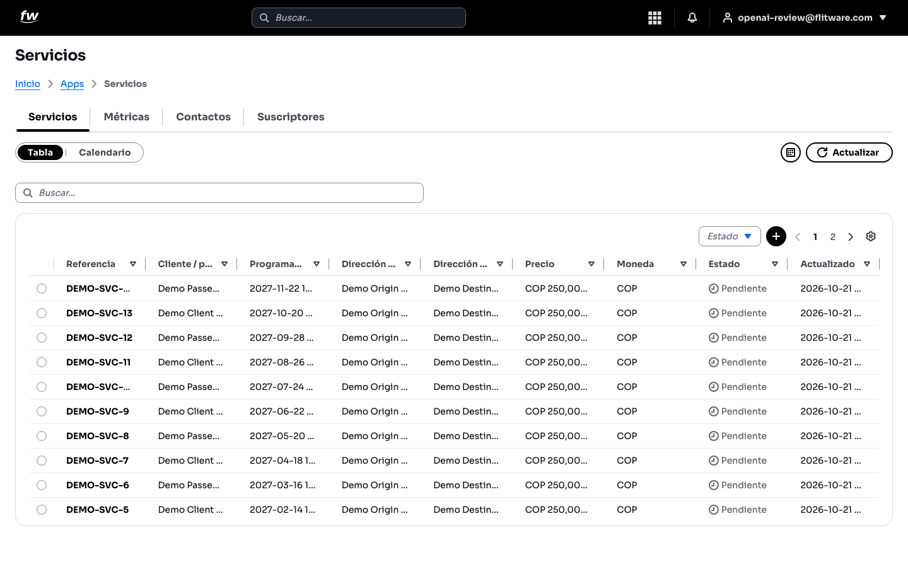

La tabla muestra **Referencia** (el código del servicio, por ejemplo *DEMO-SVC-13*), **Cliente / partner**, fecha **Programada**, **Dirección de origen**, **Dirección de destino**, **Precio**, **Moneda**, **Estado** y **Actualizado**. El **Estado** le dice en qué va cada trabajo: **Pendiente**, **Asignado**, y los demás estados operativos (en ruta, en sitio, completado, etc.) a medida que avanza.

## Cómo usar la agenda (Calendario)

1. En la pestaña **Servicios**, cambie el conmutador a **Calendario**.
2. Navegue con las flechas y el botón **Hoy**, y cambie entre **Mes**, **Semana** y **Día** según necesite.

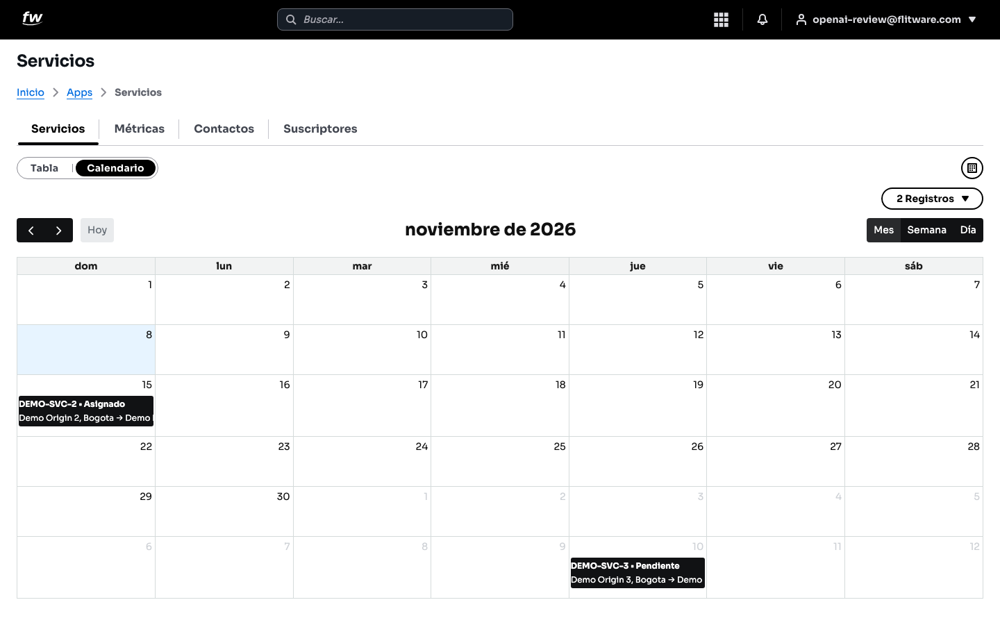

Cada tarjeta muestra la referencia, el estado y la ruta (por ejemplo *DEMO-SVC-2 • Asignado, Demo Origin 2, Bogotá → Demo...*). El contador (**2 Registros**) le dice cuántos servicios hay en el periodo visible. Use el **Mes** para planear la carga de trabajo, la **Semana** para coordinar vehículos y conductores, y el **Día** para la operación de hoy.

:::tip
La agenda y la tabla muestran lo mismo de dos formas: programe y controle en el **Calendario**, y busque detalles, precios y filtros en la **Tabla**. Alterne según la pregunta que tenga.
:::

## Cómo leer las métricas

1. Abra la pestaña **Métricas**.
2. Para exportar, elija el **Rango de fechas** (obligatorio: se exporta por fecha programada), el **Tipo de exportación** (**Servicios**), y opcionalmente **Cliente** (**Buscar un contacto**) y **Placa** (**Buscar por placa**). Luego elija el **Formato** (**.xlsx**) y pulse el botón de descarga.

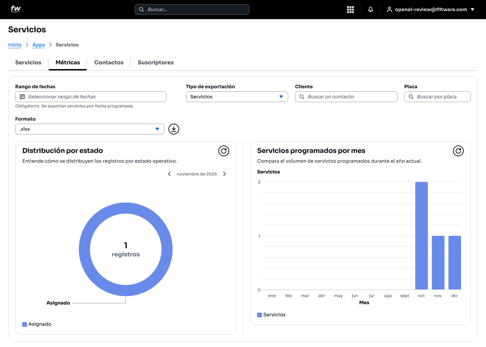

Abajo verá dos gráficas: **Distribución por estado** (cómo se reparten sus servicios: asignados, pendientes, etc., en el mes elegido) y **Servicios programados por mes** (el volumen mes a mes, de enero a diciembre). Úselas para responder "¿estamos creciendo?" y "¿dónde se nos acumula el trabajo?".

## Cómo ver sus contactos (clientes)

1. Abra la pestaña **Contactos**.
2. Busque con el campo **Buscar...** o filtre por **Tipo** y **Estado**.

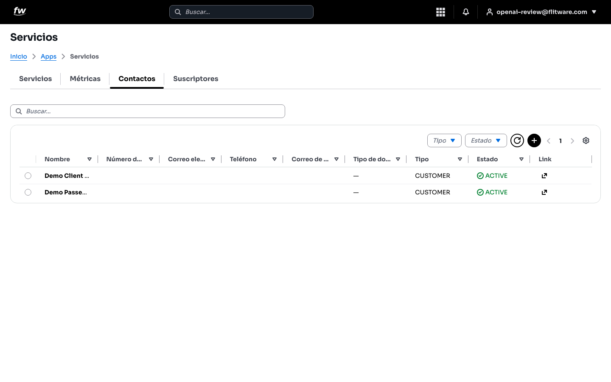

La tabla muestra **Nombre**, **Número de documento**, **Correo electrónico**, **Teléfono**, **Correo de facturación**, **Tipo de documento**, **Tipo** (por ejemplo *CUSTOMER* para clientes), **Estado** (*ACTIVE*) y **Link**. Sin contactos no hay a quién asignar un servicio, así que mantenga esta lista al día antes de programar.

## Cómo configurar los suscriptores

1. Abra la pestaña **Suscriptores**.

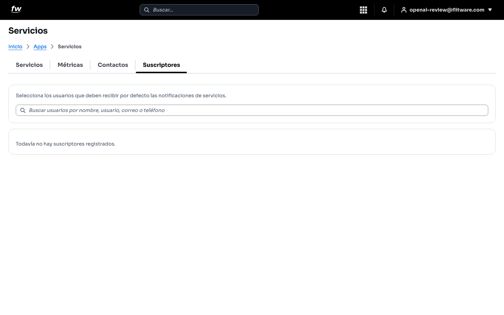

Aquí elige qué usuarios reciben por defecto las notificaciones de servicios, buscándolos en **Buscar usuarios por nombre, usuario, correo o teléfono**. Si ve **Todavía no hay suscriptores registrados**, nadie está recibiendo esos avisos: agregue al coordinador y a quien deba estar enterado.

## Cómo crear un contacto

1. En la pestaña **Contactos**, pulse el botón **+**.
2. Se abre la ventana **Crear contacto**:

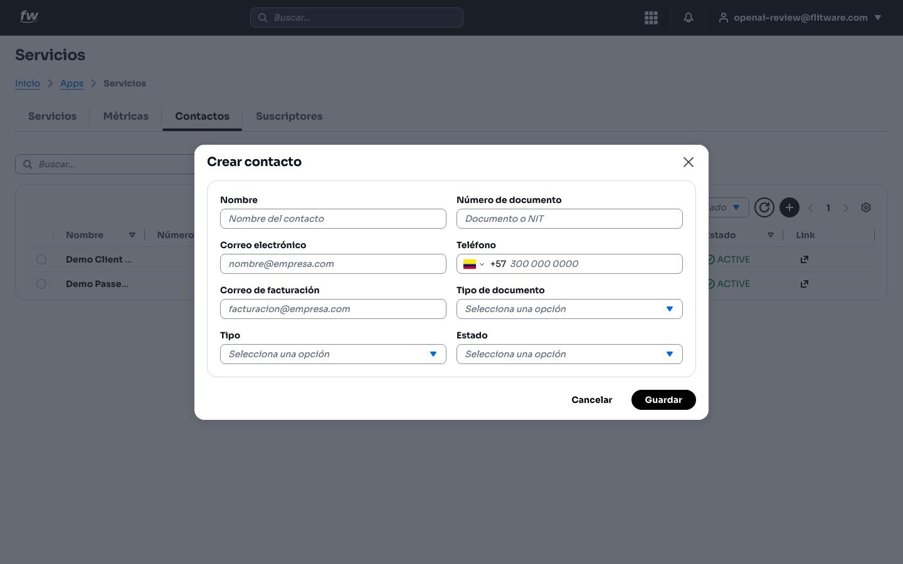

3. Complete los campos: **Nombre** (**Nombre del contacto**), **Número de documento** (**Documento o NIT**), **Correo electrónico** (**nombre@empresa.com**), **Teléfono** (con indicativo, por ejemplo +57), **Correo de facturación** (**facturacion@empresa.com**), **Tipo de documento**, **Tipo** y **Estado**. Ejemplo diligenciado:

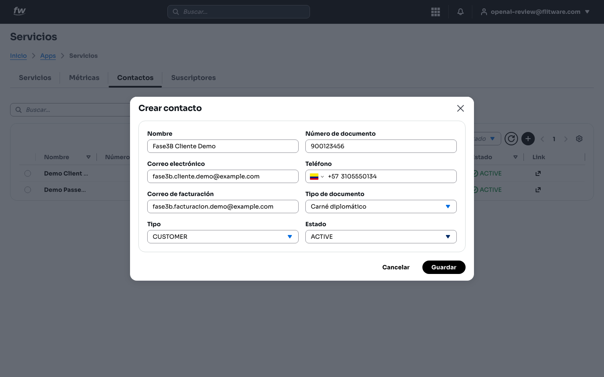

4. Pulse **Guardar**. Si todo sale bien verá el aviso verde de confirmación y el contacto aparecerá en la lista:

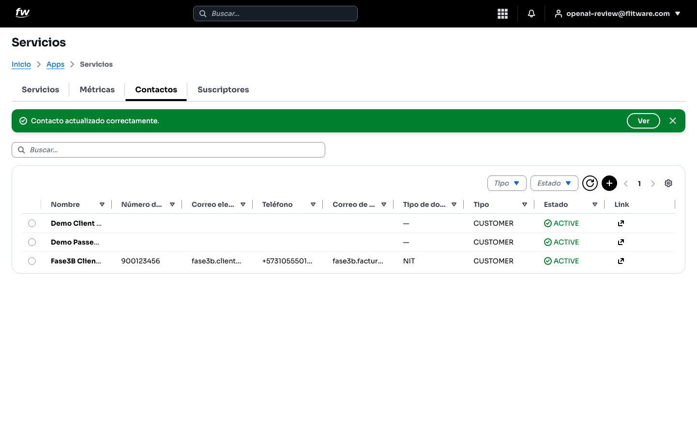

:::warning
No deje el **Correo de facturación** vacío si este cliente genera cobros: después toca perseguir facturas porque el correo de contacto operativo no era el de contabilidad.
:::

## Cómo crear un servicio

1. En la pestaña **Servicios**, pulse el botón **+** (el mismo que crea registros).
2. Se abre la ventana **Crear servicio**:

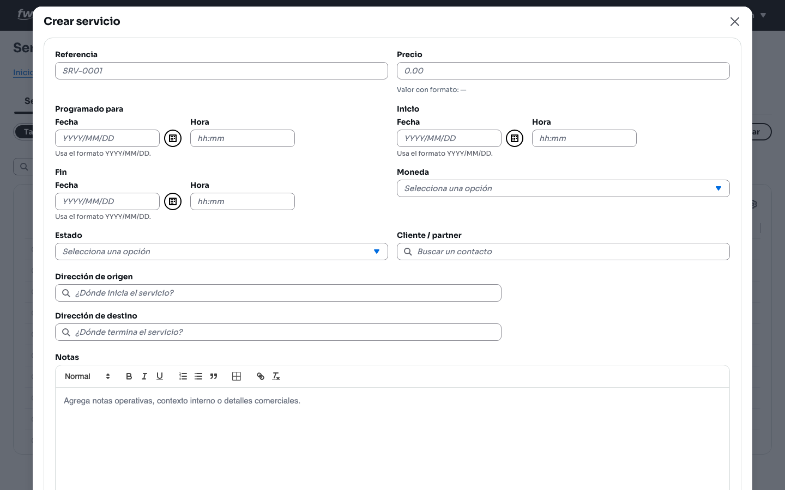

3. Escriba la **Referencia** (el código con el que lo identificará, por ejemplo *SRV-0001*) y el **Precio** (verá el **Valor con formato** calculado).
4. En **Programado para** digite **Fecha** (formato AAAA/MM/DD) y **Hora** (hh:mm). Complete **Inicio** y **Fin** de la misma forma cuando los conozca.
5. Elija la **Moneda** (por ejemplo *Colombian Peso • COP*) y el **Estado** inicial (normalmente **Pendiente**).
6. En **Cliente / partner** busque el contacto (**Buscar un contacto**) y selecciónelo.
7. Escriba la **Dirección de origen** (**¿Dónde inicia el servicio?**) y la **Dirección de destino** (**¿Dónde termina el servicio?**); el buscador sugiere direcciones mientras escribe.
8. Agregue **Notas** operativas si hace falta (punto de encuentro, contacto en sitio, condiciones). Ejemplo diligenciado:

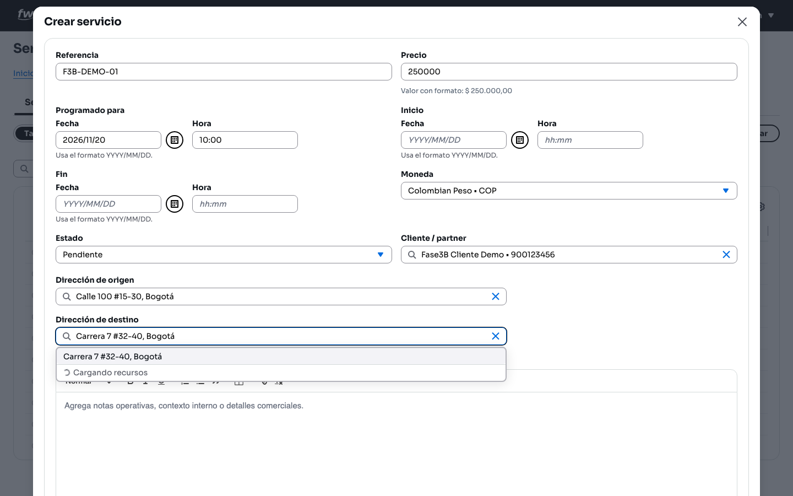

9. Pulse guardar. Verá el aviso verde **Servicio creado correctamente**:

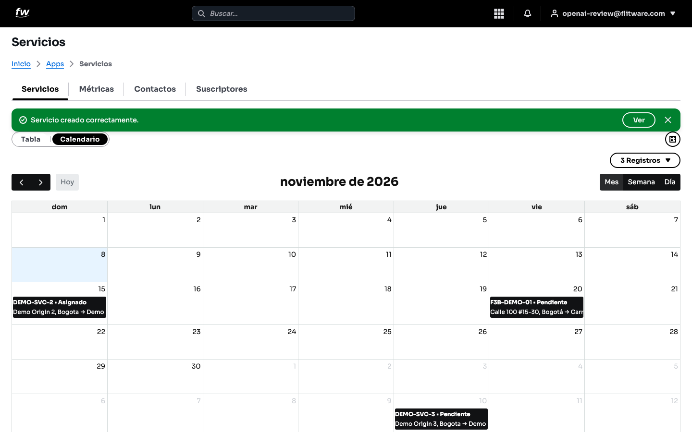

10. El servicio aparece de inmediato en la agenda, en su fecha programada:

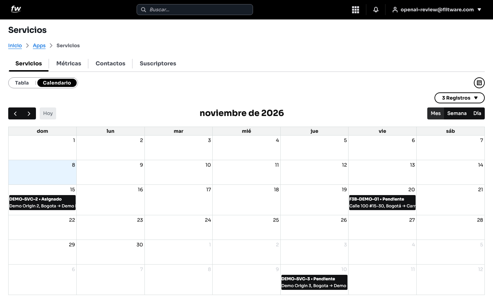

Observe cómo el contador subió a **3 Registros** y la tarjeta *F3B-DEMO-01 • Pendiente* quedó en el día 20 con su ruta (*Calle 100 #15-30, Bogotá → Carr...*).

## Recomendación del experto

La diferencia entre una operación tranquila y una caótica está en programar completo desde el primer minuto:

- **Rutina diaria (mañanas, 10 minutos):** abra el **Calendario** en vista **Día**, confirme los servicios de hoy (cliente, horas, origen y destino) y verifique que cada uno tiene conductor y vehículo asignados. Lo pendiente sin asignar es su lista de urgencias del día.
- **Rutina semanal (viernes, 20 minutos):** revise la **Semana** siguiente en la agenda, confirme precios y estados, y mire las **Métricas** del mes para ver si el volumen sube o baja.
- **Primero el contacto, después el servicio:** nunca programe un servicio "a la carrera" sin cliente asignado o con un cliente improvisado. Crear bien el contacto (documento, correo de facturación, teléfono) le ahorra horas de cobro después.
- **Referencias con lógica:** use un consecutivo claro (*SRV-0001*, *SRV-0002*...) o por mes. Cuando un cliente llame a preguntar por su servicio, usted lo encuentra en segundos con **Buscar...**.
- **Las Notas son su memoria:** anote ahí lo que normalmente se pierde por teléfono (portón 3, preguntar por doña Marta, llevar remisión firmada). El conductor y el coordinador lo agradecerán.
- **Suscriptores desde el día uno:** configure quién recibe notificaciones antes de que empiece la operación fuerte, no después del primer servicio que nadie atendió.

## Errores comunes

- **Crear servicios sin fecha programada clara o en formato distinto a AAAA/MM/DD:** quedan fuera de la agenda y de las exportaciones por rango de fechas. Sin fecha no hay programación.
- **Dejar el precio en 0.00 "para después":** el después rara vez llega y fin de mes se vuelve un detective de precios. Digite el valor real al crear.
- **Programar con direcciones vagas** (*oficina del cliente*): el conductor pierde tiempo y el servicio se retrasa. Use direcciones completas con las sugerencias del buscador.
- **No actualizar el Estado:** servicios que siguen en **Pendiente** cuando ya están asignados o terminados ensucian la agenda y las métricas. Actualice el estado a medida que avanza el trabajo.
- **Tener contactos duplicados** (*Cliente Demo* y *CLIENTE DEMO*): los reportes por cliente salen divididos y mal. Busque antes de crear uno nuevo.
- **Ignorar la pestaña Suscriptores:** si está vacía (**Todavía no hay suscriptores registrados**), las notificaciones no le llegan a nadie. Revísela con su administrador.
- **Exportar sin rango de fechas:** el **Rango de fechas** es obligatorio para exportar; sin él no hay reporte.
