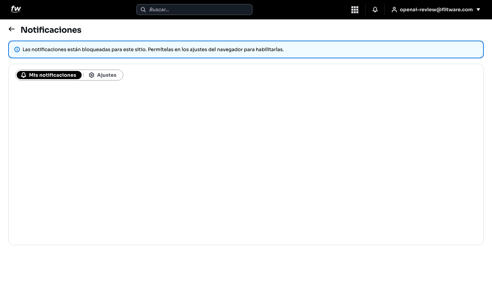

# Notificaciones

Las notificaciones son los avisos que Flitware le deja sobre lo que pasa en su operación. Se abren con la campana de la barra superior y se concentran en la pantalla **Notificaciones**, con dos pestañas: **Mis notificaciones** (sus avisos) y **Ajustes** (sus dispositivos y permisos). Si todavía no tiene avisos, la lista se verá vacía: eso es normal cuando todo está al día.

## Prerrequisitos

- Tener sesión iniciada en Flitware.
- Para avisos en tiempo real en el navegador: permitir las notificaciones cuando el navegador se lo pida.

## Cómo ver sus notificaciones

1. Pulse la campana en la barra superior o abra la pantalla **Notificaciones**.
2. Quédese en la pestaña **Mis notificaciones** para ver sus avisos.
3. Si la lista está vacía, no hay nada pendiente de revisar.

En la parte superior puede aparecer un aviso sobre el permiso de notificaciones del navegador. Si dice que están bloqueadas para el sitio, permítalas en los ajustes de su navegador para recibir avisos en tiempo real.

## Qué puede hacer con cada aviso

Cuando tenga notificaciones, cada una muestra su título y su descripción, y le ofrece estas acciones:

- **Abrir notificación:** la lleva directo al registro relacionado (un servicio, un vehículo, etc.) y la marca como leída.
- **Marcar como leída:** la marca como revisada sin abrirla. Las ya revisadas se muestran como **Leída**.
- **Eliminar notificación:** la borra de su lista.

## Cómo gestionar sus dispositivos (pestaña Ajustes)

1. Abra la pestaña **Ajustes** dentro de **Notificaciones**.
2. Verá sus **Dispositivos** registrados para avisos push.
3. Desde ahí puede **Habilitar notificaciones**, silenciar un dispositivo o eliminarlo (el sistema le pedirá confirmación antes de eliminarlo).

:::tip Consejo de flota
Habilite las notificaciones en el dispositivo que lleva a la operación (normalmente el celular), no solo en el computador de oficina. Los avisos importantes —un servicio que cambia, un documento por vencer— sirven si le llegan donde usted está.
:::

## Recomendación del experto

Con 20 años administrando flotas le digo esto: la lista de notificaciones es su bandeja de pendientes del sistema. Revísela a diario, abra lo que requiera acción y marque como leído o elimine lo demás. Una lista con avisos viejos sin revisar es igual a no tener avisos: cuando llegue algo urgente, quedará enterrado entre lo viejo.

Mi rutina recomendada:

- **Cada día:** abra *Mis notificaciones*, atienda lo urgente y deje la lista en cero.
- **Cada semana:** revise la pestaña *Ajustes* y elimine los dispositivos que ya no usa (celulares viejos, navegadores que cambió).
- **Al cambiar de celular:** habilite las notificaciones en el nuevo y elimine el viejo para no perder avisos.

## Errores comunes

- **Tener las notificaciones bloqueadas en el navegador.** El aviso en pantalla lo dice claro: si están bloqueadas, hay que permitirlas en los ajustes del navegador.
- **Dejar avisos viejos acumulados.** La lista pierde valor si nunca se limpia; lo urgente se pierde entre lo viejo.
- **Eliminar un aviso en vez de atenderlo.** Borrarlo no resuelve lo que avisa: ábralo, resuelva el tema y luego elimínelo.
- **No revisar los dispositivos.** Avisos llegando a un celular que ya no tienen mientras el actual nunca se habilitó.
