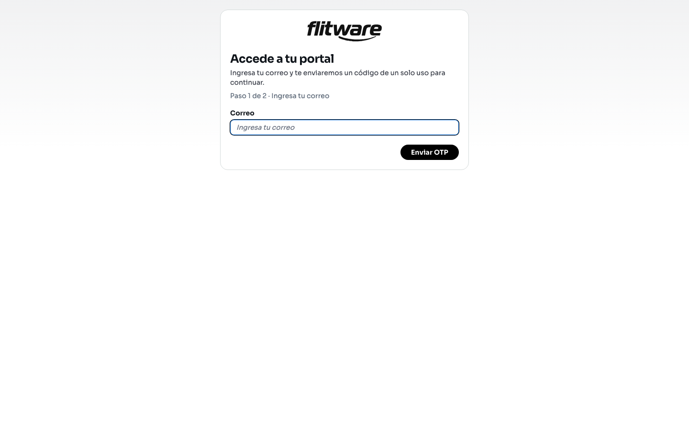

# Portal del conductor

El portal del conductor es la página pública donde cada conductor entra a ver sus servicios y sus tareas, sin necesidad de una cuenta de Flitware ni de contraseña. El acceso es con un código de un solo uso que se envía a su correo: el conductor escribe su correo, recibe el código, lo escribe y entra. Son dos pasos y no hay nada que instalar.

## Prerrequisitos

- El conductor debe estar registrado y habilitado en Flitware para acceder al portal.
- Necesita acceso al correo donde recibirá el código.
- Necesita el enlace público de su portal (lo entrega la empresa).

## Cómo entra el conductor (paso 1: pedir el código)

1. Abra el enlace público del portal.
2. Verá la pantalla **Accede a tu portal** con el **Paso 1 de 2 · Ingresa tu correo**.
3. Escriba su **Correo** y pulse **Enviar OTP**.

4. Revise su bandeja: recibirá un código de verificación de un solo uso.

## Cómo entra el conductor (paso 2: verificar el código)

1. En el **Paso 2 de 2 · Verifica tu código**, escriba el código en el campo **Código OTP**.
2. Pulse **Verificar código** para entrar.
3. Si el código no llega, use **Reenviar código**. Si se equivocó de correo, use **Cambiar correo** para volver al paso 1.

Si el acceso expiró, el portal avisará que solicite un código nuevo. Si el conductor no está habilitado para el portal, verá un aviso indicándolo: en ese caso la empresa debe habilitarlo primero en Flitware.

:::tip Consejo de flota
Envíele a cada conductor su enlace del portal por el canal que sí lea (muchos responden más rápido al WhatsApp que al correo) y pídale que entre una vez delante de usted. Un acceso probado el primer día evita llamadas de auxilio cuando ya va tarde al servicio.
:::

## Recomendación del experto

Con 20 años administrando flotas le digo esto: el portal solo sirve si los conductores entran sin fricción. El código por correo es sencillo, pero falla cuando el conductor no revisa ese correo o lo tiene lleno de spam. Verifique con cada conductor cuál correo revisa de verdad y deje registrado ese, no el que alguien anotó hace años en una hoja.

Mi rutina recomendada:

- **Al vincular un conductor:** confirme su correo real, envíele el enlace y haga una entrada de prueba con él.
- **Cada mes:** revise que los conductores activos estén habilitados en el portal; los que salieron deben quedar fuera.
- **Cuando un conductor no puede entrar:** revise primero si está habilitado y si el correo es el correcto, antes de asumir un problema técnico.

## Errores comunes

- **Usar un correo que el conductor no revisa.** El código llega, pero nadie lo lee; el acceso se estanca en el paso 1.
- **No habilitar al conductor en Flitware.** Sin habilitación, el portal rechaza el acceso aunque el correo sea correcto.
- **Compartir enlaces entre conductores.** Cada enlace es personal; compartirlos mezcla accesos y rompe la trazabilidad.
- **Dejar el código vencer.** Los códigos expiran: si tarda demasiado, pida uno nuevo con *Reenviar código* en vez de insistir con el viejo.
