# Flotas: registre y controle cada vehículo

Aquí vive la hoja de vida de cada vehículo de su operación: placa, propietario, datos técnicos y lecturas de odómetro. Si mantiene esta información al día, el resto del sistema (mantenimientos, listas de chequeo, documentos) funciona solo.

## Prerrequisitos

- Tener acceso a la aplicación. En el menú superior vaya a **Inicio > Apps > Flota**.
- Tenga a la mano la tarjeta de propiedad del vehículo y el documento del propietario.

## Ver la lista de vehículos

1. Abra **Flota**. Verá las pestañas **Listado**, **Métricas**, **Listas de chequeo** y **Grupos de flotas**.
2. En **Listado** use la barra **Buscar...** para encontrar un vehículo por placa, propietario u otro dato.
3. Con el filtro **Estado** puede ver solo los vehículos en un estado operativo (por ejemplo, disponibles).
4. Seleccione una fila haciendo clic en el círculo de la izquierda para activar las acciones **Exportar ficha técnica** y **Generar documento**.

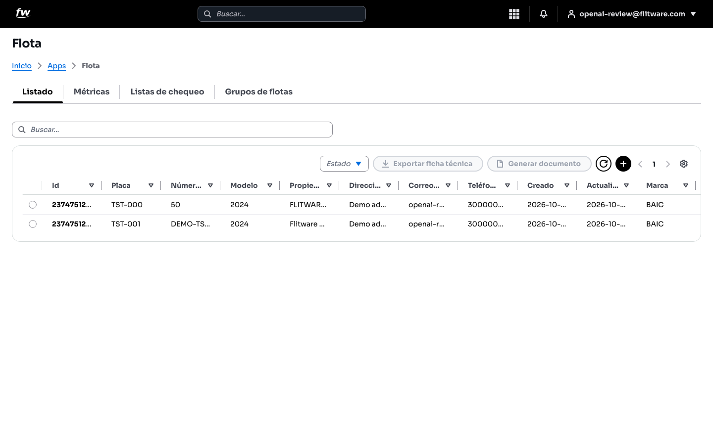

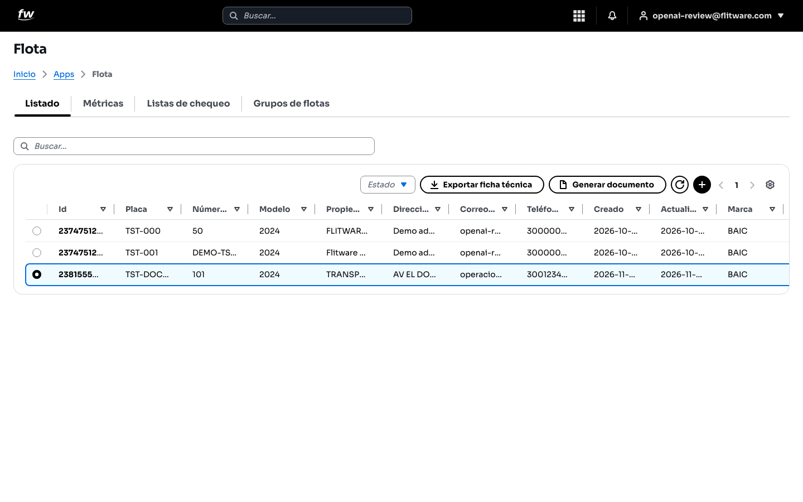

:::tip Consejo de uso diario
Antes de programar cualquier trabajo, busque el vehículo por placa en el **Listado** para confirmar que existe y en qué estado está. Le toma 10 segundos y evita crear registros duplicados.
:::

## Crear un vehículo: asistente de 5 pasos

Pulse el botón **+** (arriba a la derecha del listado) para abrir la ventana **Crear flota**. El asistente le muestra el **Progreso del formulario** (por ejemplo, 7/12) y los 5 pasos en el costado izquierdo. Puede devolverse con **Atrás** en cualquier momento.

### Paso 1 — Ingresar Placa

1. Escriba la **Placa** del vehículo (ejemplo: AAA001...).
2. En la sección **Tarjeta de propiedad** puede subir una foto de la tarjeta: pulse **Elegir imagen** y después **Leer tarjeta con OCR**. El sistema intentará leer la placa y los datos del documento del propietario para ayudarle a completar la consulta automáticamente.
3. Pulse **Siguiente**.

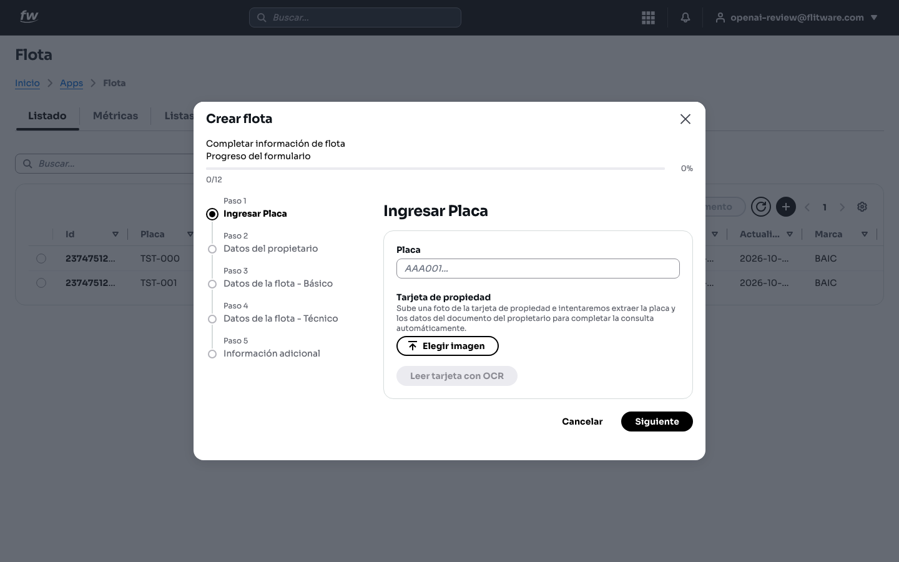

:::tip Recomendación del experto
Tome la foto de la tarjeta sobre una mesa, con buena luz y sin dedos encima. Si el OCR no lee bien un dato, corríjalo a mano: un error de un dígito en la placa se arrastra a todos los documentos del vehículo.
:::

### Paso 2 — Datos del propietario

1. Seleccione el **Tipo de documento propietario** (por ejemplo, NIT).
2. Escriba el **Documento propietario**, el **Propietario**, la **Dirección del propietario**, el **Correo del propietario** y el **Teléfono del propietario**. En el teléfono, verifique el indicativo del país (por ejemplo, +57 Colombia; pulse la bandera para cambiarlo) y escriba el número sin espacios ni guiones.
3. El sistema le recuerda: *"Valida el número de documento del propietario antes de iniciar la consulta del vehículo."*
4. Pulse **Consultar datos del vehículo** para traer los datos oficiales asociados a la placa y el documento.
5. Pulse **Siguiente**.

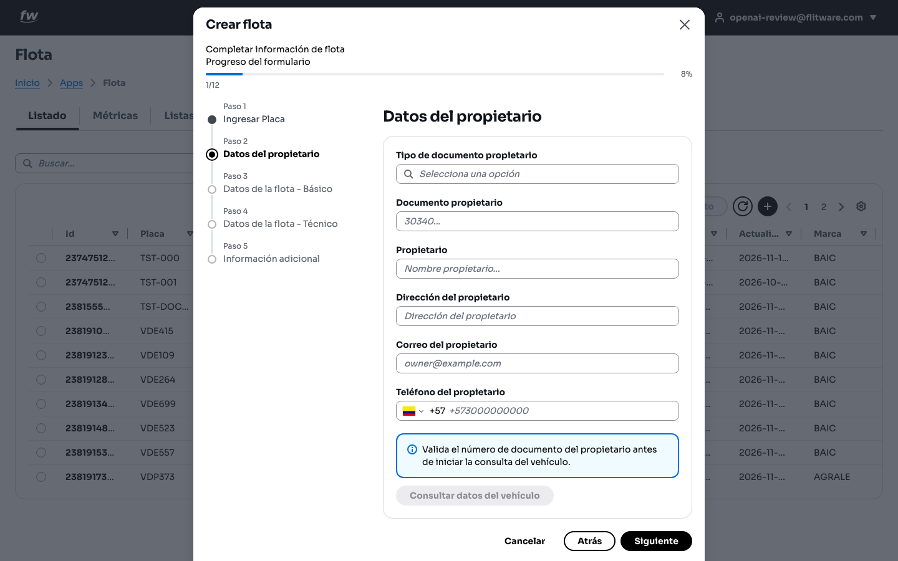

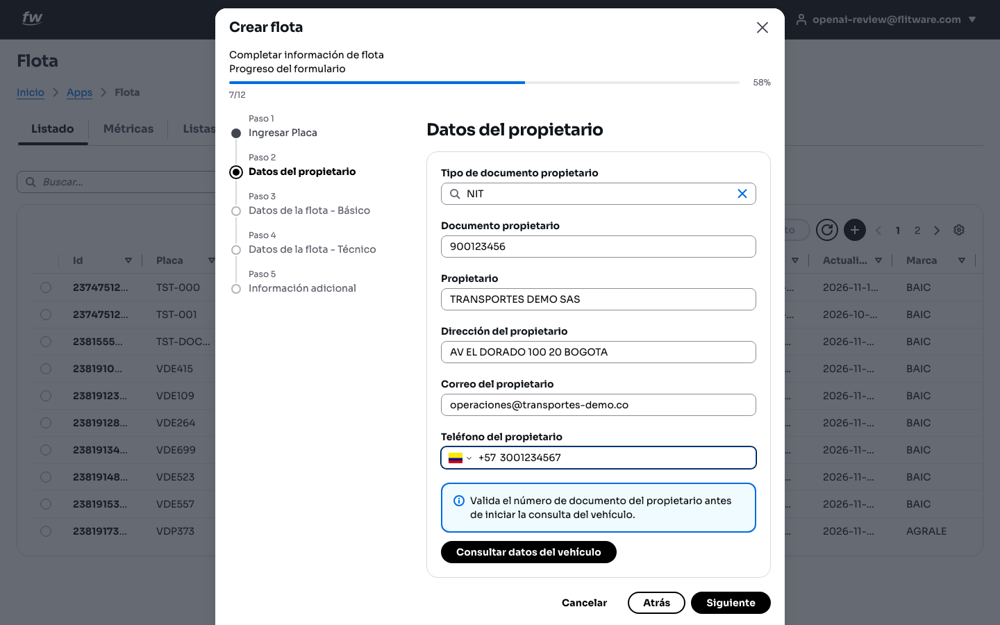

:::warning Errores comunes
- Escribir el documento del propietario con puntos o guiones de más. Use solo números.
- Dejar el correo vacío o con errores: ahí llegan notificaciones importantes del vehículo.
:::

### Paso 3 — Datos de la flota - Básico

1. Escriba el **Modelo** (año, ejemplo: 2026).
2. Seleccione la **Marca** y el **Tipo de combustible** con la opción **Selecciona una opción**.
3. Pulse **Siguiente**.

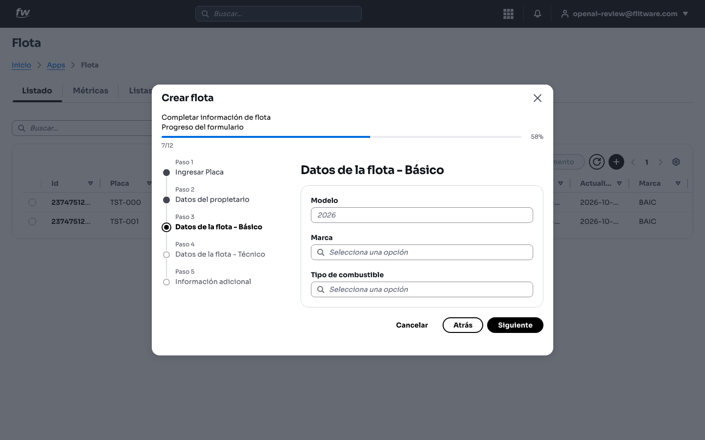

### Paso 4 — Datos de la flota - Técnico

1. Seleccione el **Tipo de servicio**, el **Tipo** y el **Tipo de carrocería**.
2. Escriba el **Cilindraje** y el **VIN** (el número largo que está en el chasis o en la tarjeta).
3. Escriba el **Odómetro** (kilometraje actual) y elija la **Unidad del odómetro** (Kilómetros o Millas).
4. Si el vehículo trabaja por horas (maquinaria, planta), escriba el **Horómetro** en horas (h).
5. Pulse **Siguiente**.

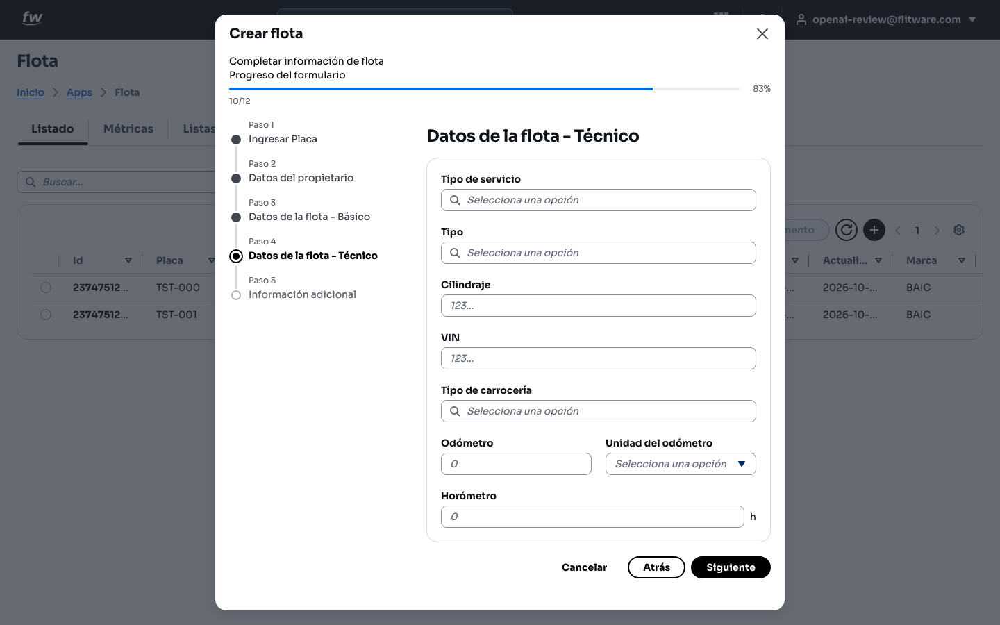

:::tip Recomendación del experto
El odómetro inicial es sagrado: anote el kilometraje real que marca el tablero el día del registro. De ese número dependen los planes de mantenimiento por kilómetros. Si no está seguro, deje constancia y corríjalo cuanto antes desde la ficha del vehículo.
:::

### Paso 5 — Información adicional

1. Escriba el **Número de licencia de flota**, el **Número interno** (el código con el que usted identifica el vehículo en su empresa), la **Fecha de matriculación** (YYYY/MM/DD) y el **Número de motor**.
2. Pulse **Guardar**. Verá el mensaje verde **Flota creada exitosamente** con el botón **Ver flota** para abrir la ficha.

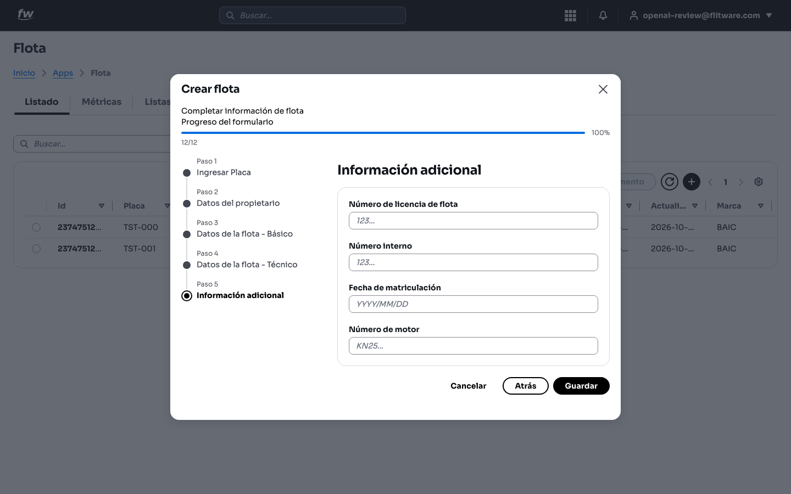

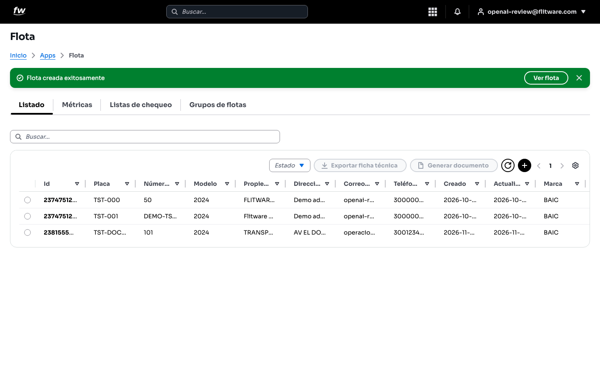

:::tip Recomendación del experto
Use el **Número interno** con un código corto que sus conductores y mecánicos reconozcan (por ejemplo, 101, 102). En el patio nadie se sabe las placas de memoria, pero todos recuerdan "el 101".
:::

## Ver y editar la ficha del vehículo

Haga clic en un vehículo del listado para abrir **Editar flota**. La ficha está organizada por pestañas: **Datos generales**, **Datos del propietario**, **Datos del vehículo**, **Datos técnicos**, **Campos personalizados**, **Historial**, **Documentos** y **Mantenimiento**.

### Datos generales

Aquí están la **Placa**, el **Número interno**, el **Número de licencia de flota**, la **Fecha de matriculación** y la **Imagen de la flota** (botón **Seleccionar imagen**; solo imágenes, máximo 5 MB). Guarde con el botón **Guardar**.

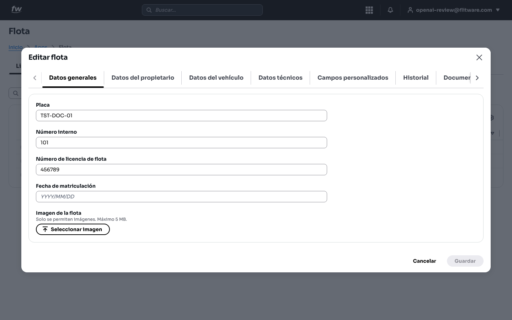

### Datos técnicos

Aquí están el **Cilindraje**, el **VIN**, el **Número de motor**, el **Odómetro** con su **Unidad del odómetro** (Kilómetros), el **Horómetro** y un resumen con el valor actual y la **Última actualización** (fecha y hora).

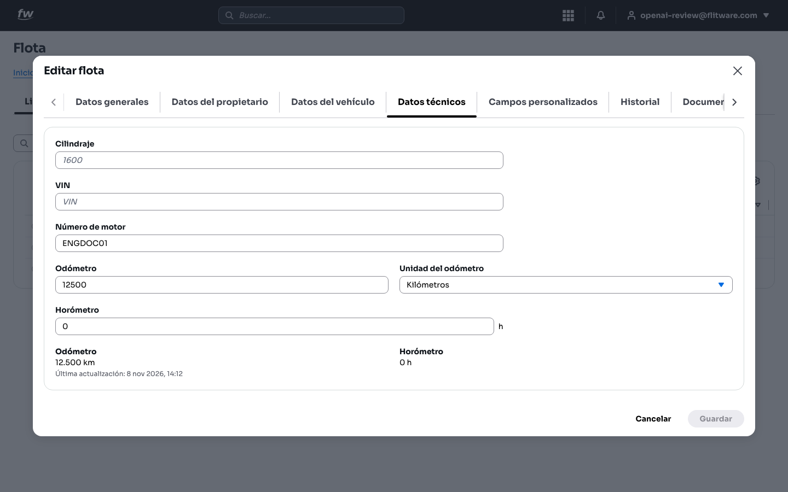

### Historial: lecturas de medidores

En la pestaña **Historial** verá:

- **Lecturas de medidores**: valor actual del **Odómetro** (ejemplo: 12.500 km, con última lectura, número de lecturas y utilización) y del **Horómetro**.
- **Historial de lecturas**: tabla con **Fecha de lectura**, **Medidor**, **Lectura**, **Origen** (por ejemplo, Manual) y **Referencia**. Puede filtrar con **Todos los medidores** y buscar con la barra **Buscar...**.

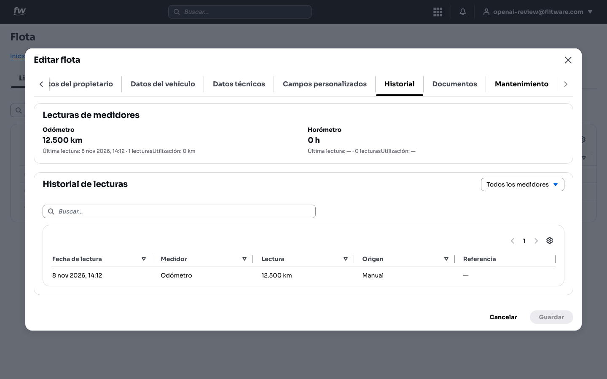

### Mantenimiento: órdenes y novedades del vehículo

En la pestaña **Mantenimiento** verá las **Órdenes de trabajo** del vehículo (código, título y estado), sus **Novedades** abiertas (título, severidad y estado) y las **Lecturas de medidor**. Pulse el código de una orden o el título de una novedad para abrir su detalle en el módulo de Mantenimiento. Con **Ver mantenimiento completo** irá al listado general.

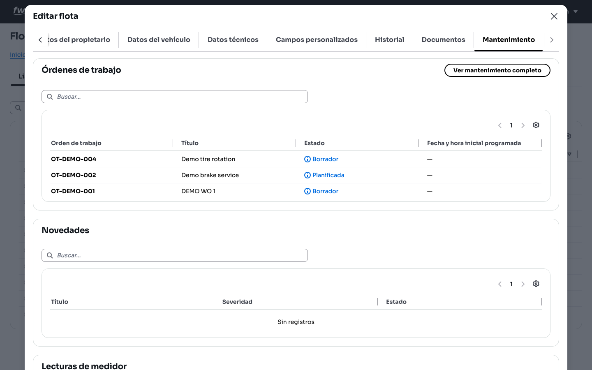

:::tip Recomendación del experto
Pida a cada conductor que reporte el kilometraje al terminar su turno y regístrelo el mismo día. Un historial de lecturas completo es la diferencia entre un mantenimiento planeado y una varada en carretera.
:::

## Métricas: distribución por estado

En la pestaña **Métricas** verá la tarjeta **Distribución por estado**, que muestra *"cómo se distribuyen los registros por estado operativo"*: un gráfico circular con el total de registros y cuántos están en cada estado (por ejemplo, **Disponible**).

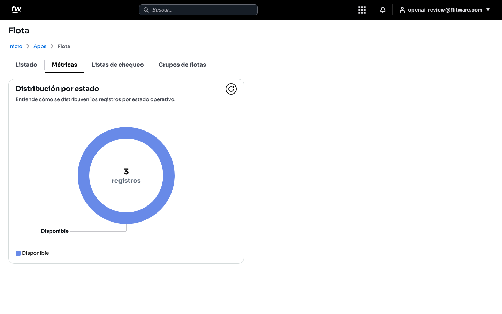

:::tip Recomendación del experto
Mire esta pantalla cada lunes por la mañana. Si el número de vehículos disponibles baja sin explicación, algo está pasando en el patio: vehículos retenidos, sin reportar o con el estado desactualizado.
:::

## Rutina recomendada (10 minutos al día)

1. Abra **Flota > Listado** y revise que los vehículos nuevos del día estén creados.
2. Actualice los odómetros con los reportes de los conductores.
3. Revise **Métricas** una vez por semana para detectar estados desactualizados.

## Errores comunes

- **Crear el mismo vehículo dos veces** con la placa escrita distinto (espacios, guiones). Busque primero en el listado.
- **Dejar el odómetro en 0** "para después". Después nunca llega y los mantenimientos por kilometraje quedan mal calculados.
- **No elegir la unidad del odómetro** (Kilómetros o Millas). Sin unidad, las lecturas no significan nada.
- **Subir una foto borrosa de la tarjeta** y no revisar lo que leyó el OCR. Verifique siempre placa y documento.
- **No actualizar la ficha** cuando cambia el propietario o el teléfono. Cuando se necesita, nadie encuentra a quién llamar.
