# Mantenimiento: del plan al cierre sin perder un peso

El módulo de Mantenimiento es su taller digital: aquí planea los servicios preventivos, atiende los correctivos con órdenes de trabajo (OT), controla repuestos, compras, proveedores y mide resultados. Si lo usa bien, cada vehículo entra y sale del taller con trazabilidad completa de qué se hizo, cuánto costó y quién lo autorizó.

## Prerrequisitos

- Rol con acceso al módulo **Mantenimiento** (consulte a su administrador si no ve la opción en Apps).
- Vehículos (flota) ya registrados, para poder asignarlos a planes y órdenes.
- Para aprobar gastos: rol técnico asignado en **Roles y aprobaciones**.

## 1. Resumen e indicadores: su tablero de cada mañana

1. Abra **Inicio > Apps > Mantenimiento**. La primera pestaña es **Resumen**.
2. Revise el bloque **Requiere atención**: muestra las **OT abiertas** y el botón **Ver listado** para ir directo a ellas.

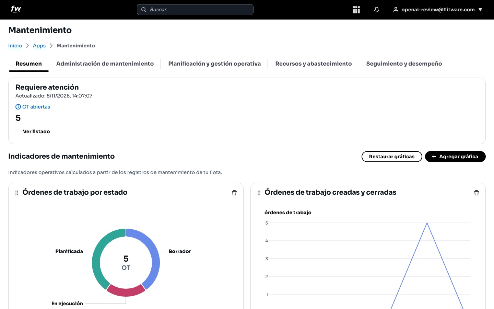

3. Baje a **Indicadores de mantenimiento**: gráficas como **Órdenes de trabajo por estado** (Borrador, Planificada, En ejecución) y **Órdenes de trabajo creadas y cerradas** por mes.
4. Desplácese para ver más gráficas: **Trabajo preventivo y correctivo** y **Costo real de mantenimiento** por mes.

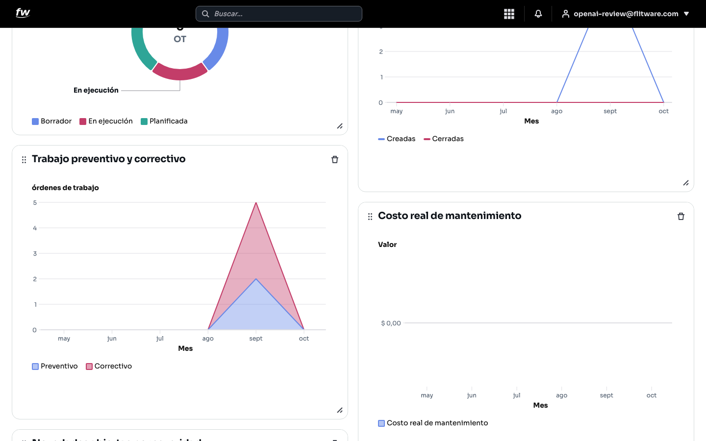

5. Use **Agregar gráfica** para sumar indicadores y **Restaurar gráficas** para volver al tablero original.

:::tip Rutina de 5 minutos
Empiece el día aquí: OT abiertas, luego el balance preventivo vs. correctivo del mes. Si el correctivo supera al preventivo, sus planes necesitan ajuste.
:::

## 2. Planes: el preventivo que evita varadas

1. Vaya a **Planificación y gestión operativa > Planes**.
2. Verá la lista de planes con columnas **Plan de mantenimiento**, **Estado** (por ejemplo, Activo) y **Estrategia** (por ejemplo, Preventivo).

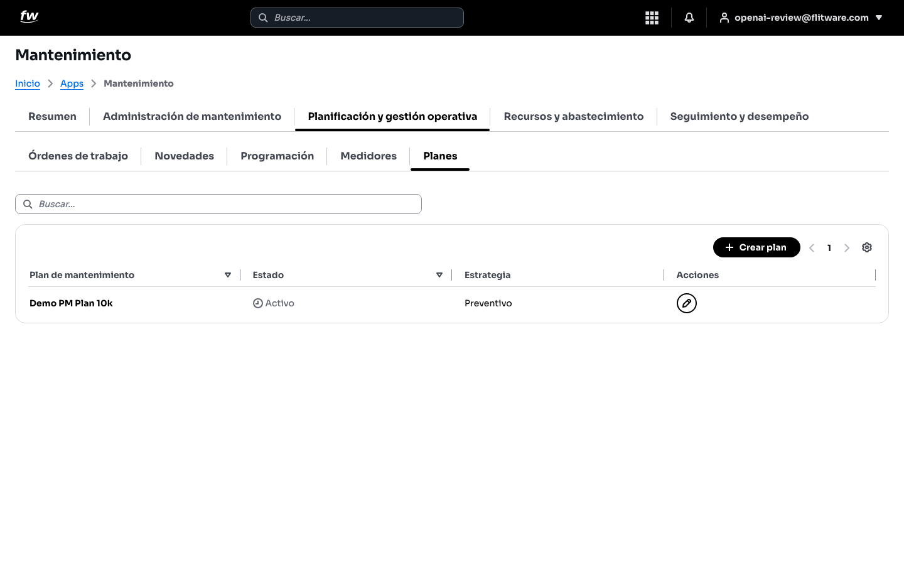

3. Pulse **Crear plan** para registrar un nuevo plan (por ejemplo, "PM cada 10.000 km").
4. Use el buscador para localizar un plan y el lápiz de **Acciones** para editarlo.

:::warning
Un plan creado no hace magia solo: revíselo cada mes contra las OT reales. Plan sin seguimiento es papel mojado.
:::

## 3. Órdenes de trabajo: el corazón del taller

1. Vaya a **Planificación y gestión operativa > Órdenes de trabajo**.
2. La tabla muestra **Orden de trabajo** (OT-DEMO-001...), **Flota**, **Tipo de mantenimiento** (Correctivo o Preventivo), **Prioridad** (Baja, Normal, Alta, Urgente), **Estado**, **Fecha y hora inicial** y **Costo real**.

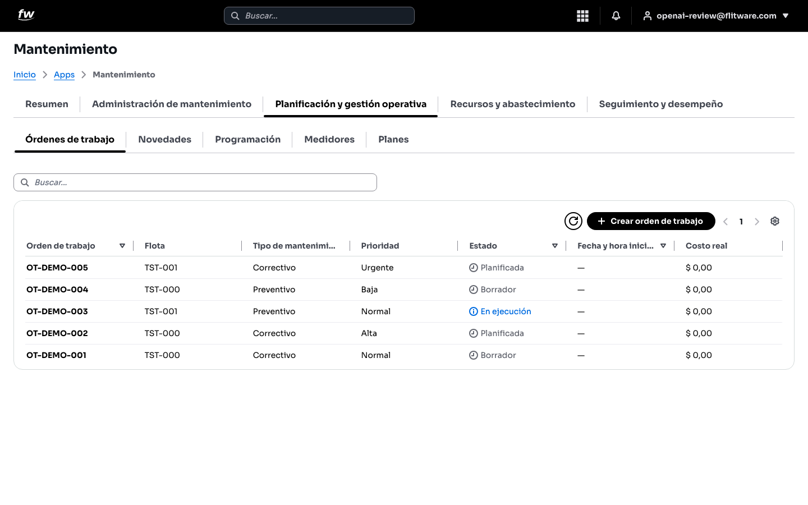

3. Pulse **Crear orden de trabajo** para abrir una OT nueva.
4. Haga clic en una OT existente para abrir su espacio de trabajo (ver siguiente sección).

## 4. Espacio de trabajo de la OT: todo en un solo lugar

Al abrir una OT aparece la ventana **Editar** con pestañas: **General, Tareas, Materiales, Costos, Documentos, Historial**.

### 4.1 General

1. Complete **Flota** (vehículo, por ejemplo TST-000), **Título**, **Tipo de mantenimiento** (Correctivo o Preventivo) y **Prioridad**.
2. Defina **Estado** e **Impacto operacional** (por ejemplo, Operativo).
3. Programe **Fecha y hora inicial programada** y **Fecha y hora final programada**, indique el **Costo estimado** y escriba la **Descripción**.
4. Al cerrar el trabajo, diligencie el **Resumen de cierre**.

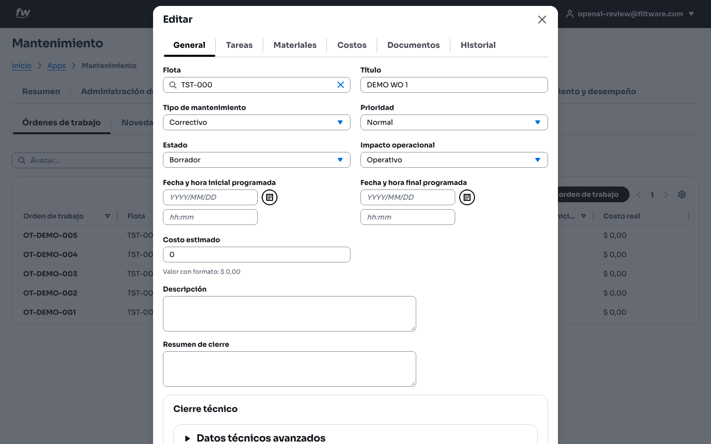

### 4.2 Tareas

1. Entre a la pestaña **Tareas**.
2. Pulse **Agregar tarea**: la tabla controla **Título**, **Estado**, si es **Obligatoria** y **Acciones**.

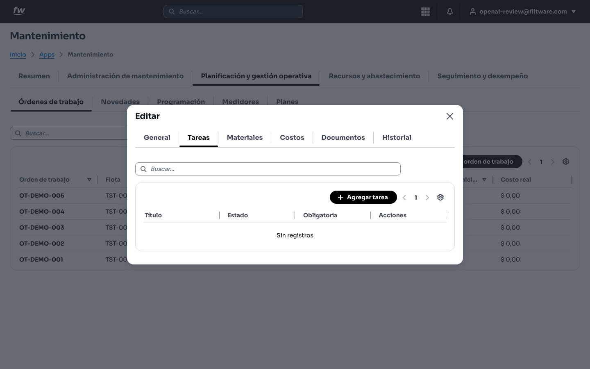

### 4.3 Materiales

1. Entre a la pestaña **Materiales**.
2. Pulse **Reservar material** para apartar repuestos del almacén (columnas: Almacén, Ítem, Reservado, Consumido, Estado).
3. Abajo, el bloque **Material emitido a esta orden de trabajo** muestra lo que ya salió del almacén (Emitido, Disponible).

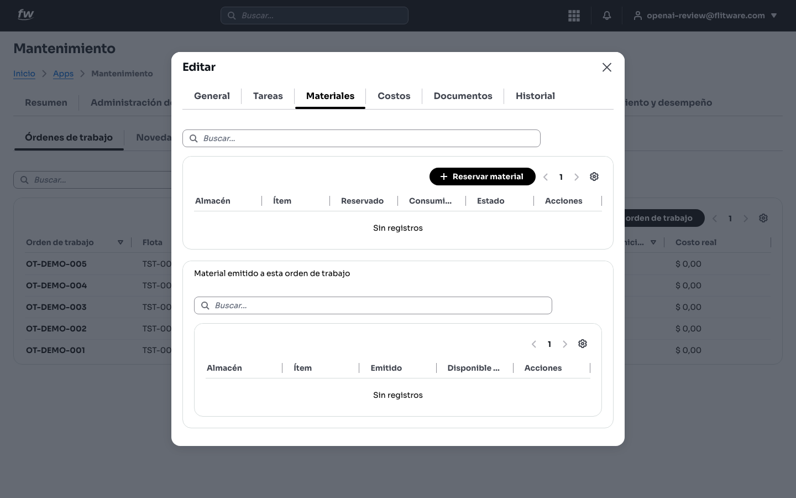

### 4.4 Costos

1. Entre a la pestaña **Costos**.
2. Pulse **Agregar costo**: la tabla registra **Descripción**, **Cantidad**, **Total** y **Estado de aprobación**.

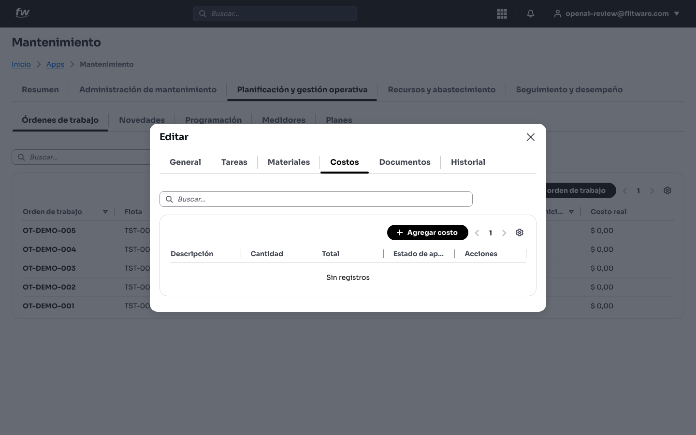

### 4.5 Historial

1. Entre a la pestaña **Historial** para auditar la OT: **Fecha**, **Evento** (por ejemplo, "Orden de trabajo creada"), **Realizado por** y **Cambios**, con la opción **Mostrar detalle técnico**.

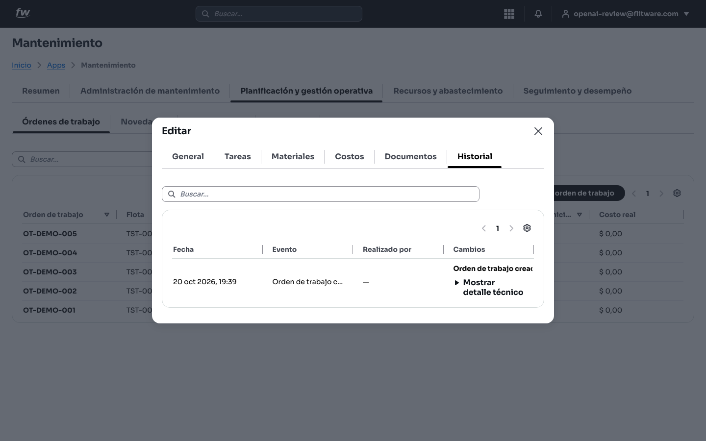

## 5. Transiciones de estado: avance paso a paso

1. En la pestaña **General**, despliegue el campo **Estado**.
2. Desde **Borrador** el sistema solo ofrece movimientos válidos: **Borrador, Pendiente de aprobación, Planificada, Cancelada**. Usted no puede saltar a un estado que el flujo no permita.

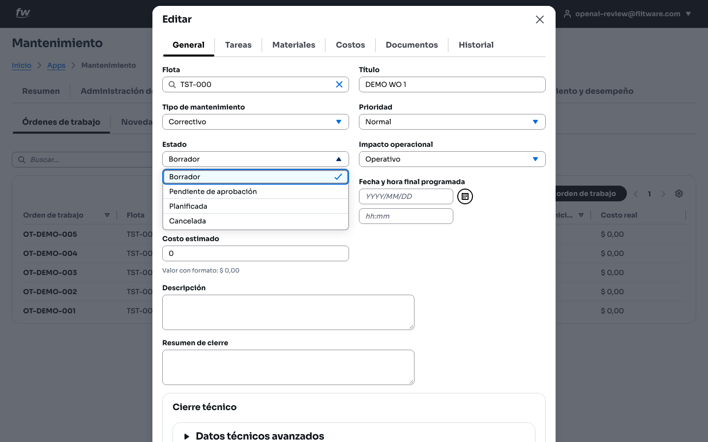

3. El flujo general verificado es: Borrador → Pendiente de aprobación (si requiere autorización) → Planificada → En ejecución → cierre. La cancelación siempre pide justificación.

:::tip
Si un estado no aparece en la lista, no es un error: es el sistema protegiendo el proceso. Avance al siguiente estado permitido.
:::

## 6. Aprobaciones: quién autoriza el gasto

1. Vaya a **Administración de mantenimiento > Roles y aprobaciones**.
2. Aquí se configuran por empresa los rangos de aprobación, monedas, responsables, vigencias y delegaciones. El sistema aclara que ningún límite se define en código y que solo flujos autorizados crean y resuelven decisiones.
3. Use **Nueva matriz** para crear una matriz de aprobación antes de comprometer gastos, **Asignar rol** para roles técnicos y **Nueva delegación** para ausencias temporales.

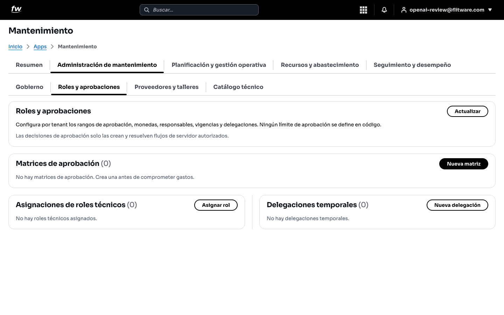

## 7. Alertas: que nada se le pase

1. Vaya a **Seguimiento y desempeño**: arriba verá **Alertas que requieren acción** (columnas: Severidad, Título, Responsable, Vence, Estado, Acciones).
2. Abajo, en **Alertas de mantenimiento**, marque las recurrentes que desea recibir: **Mantenimiento próximo, Mantenimiento vencido, Novedades críticas**.

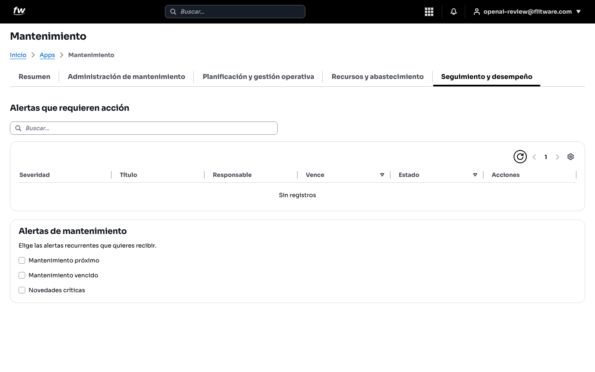

## 8. Inventario: repuestos bajo control

1. Vaya a **Recursos y abastecimiento > Inventario**.
2. Los botones superiores son: **Agregar unidad, Agregar almacén, Agregar ítem, Registrar conteo físico, Transferir inventario** y **Registrar movimiento**.
3. Las subpestañas **Saldos, Conteos cíclicos, Transferencias, Ítems, Almacenes, Unidades** organizan el kardex multi-almacén auditable.
4. En **Saldos** controle por almacén e ítem: Existencia física, Reservado, Disponible, Mínimo, Máximo y Costo unitario.

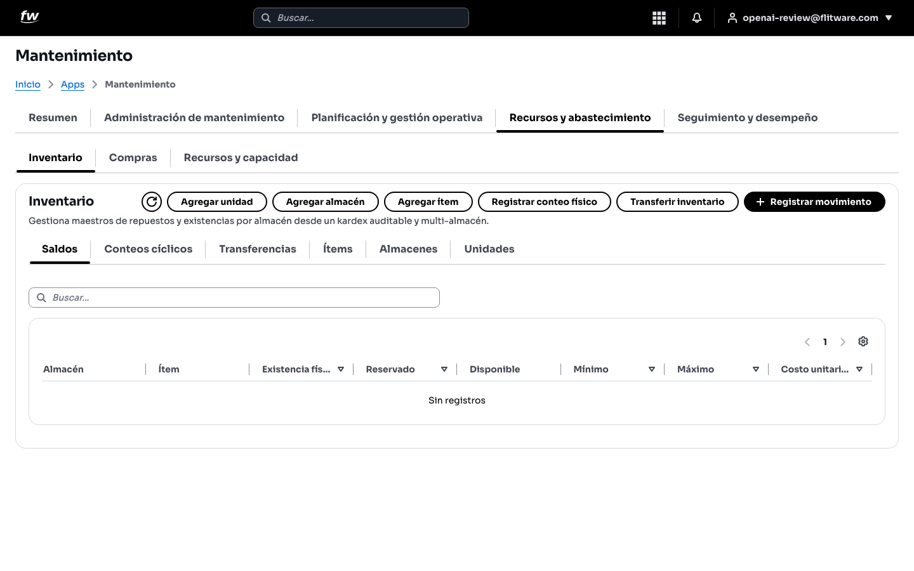

## 9. Compras: del compromiso a la recepción

1. Vaya a **Recursos y abastecimiento > Compras**.
2. Pulse **Nueva orden de compra**. Recuerde la regla del sistema: una orden es un compromiso auditable con el proveedor, pero **no es inventario ni gasto real hasta registrar una recepción posterior**.
3. La tabla controla **Orden, Proveedor homologado, Almacén receptor, Total de orden, Estado** y **Acciones**.

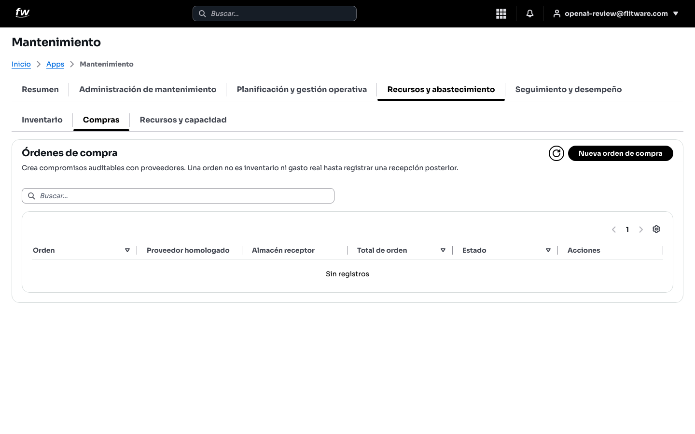

## 10. Proveedores y talleres: homologue, no improvise

1. Vaya a **Administración de mantenimiento > Proveedores y talleres**.
2. Pulse **Agregar perfil de proveedor**.
3. La tabla registra **Contacto, Tipo de perfil, Especialidades, SLA (horas), Calificación, Estado de homologación, Vigente hasta** y **Acciones**.
4. Si un proveedor sale, **inactive el registro en lugar de eliminarlo** para conservar la trazabilidad de OT y compras (así lo indica el propio sistema).

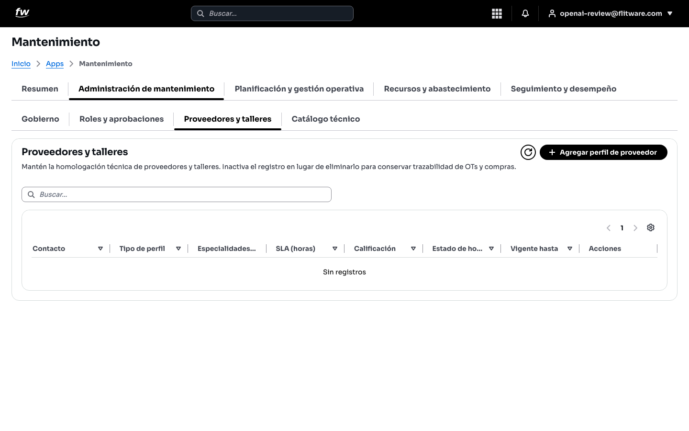

## 11. Gobierno: reglas claras antes de medir

1. Vaya a **Administración de mantenimiento > Gobierno > Calendarios y políticas**.
2. El bloque **Gobierno de confiabilidad** define el tiempo planificado y las reglas auditables antes de calcular MTTR, MTBF, disponibilidad o cumplimiento PM.
3. Cree primero un calendario con **Nuevo calendario**; después defina la política. Una política publicada queda versionada y los indicadores futuros conservarán versión, denominadores y exclusiones.

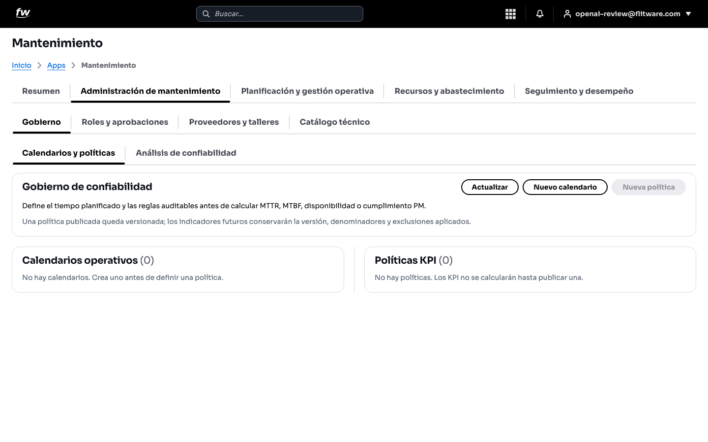

## Rutina semanal recomendada

1. **Lunes:** revise Resumen (OT abiertas) y Alertas que requieren acción.
2. **Martes-jueves:** ejecute OT, reserve materiales y registre costos el mismo día.
3. **Viernes:** revise preventivo vs. correctivo del mes, saldos bajo mínimo y órdenes de compra pendientes de recepción.
4. **Mensual:** valide planes contra OT reales y revise cumplimiento PM en Gobierno.

## Recomendación del experto

Según la recomendación de expertos para una buena experiencia, el error más caro no es una varada: es no saber cuánto costó ni por qué. **Toda OT nace con flota, prioridad y costo estimado, y muere con resumen de cierre y costo real**. Si su equipo registra materiales y costos el mismo día, en tres meses tendrá el costo por kilómetro por vehículo, y con eso se negocia con talleres, se decide renovar flota y se acaba el "más o menos". El preventivo programado en Planes siempre sale más barato que el correctivo urgente: apunte a que al menos 7 de cada 10 OT sean preventivas.

## Errores comunes

- **Crear la OT después del arreglo:** se pierde el control de materiales y el costo real queda en cero. Abra la OT antes de intervenir el vehículo.
- **Dejar todo en Borrador:** las OT en borrador no comprometen recursos ni generan alertas. Planifíquelas para que entren al flujo.
- **Registrar la compra como gasto inmediato:** la orden de compra no es gasto hasta la recepción. No infle costos antes de tiempo.
- **Eliminar proveedores:** inactive el registro; si lo elimina, rompe la historia de sus OT y compras.
- **Medir sin gobierno:** publicar políticas y calendarios primero; sin reglas versionadas, el MTBF y la disponibilidad de cada mes no son comparables.
- **Ignorar las alertas recurrentes:** active Mantenimiento próximo y Mantenimiento vencido; son su red de seguridad contra el olvido.
