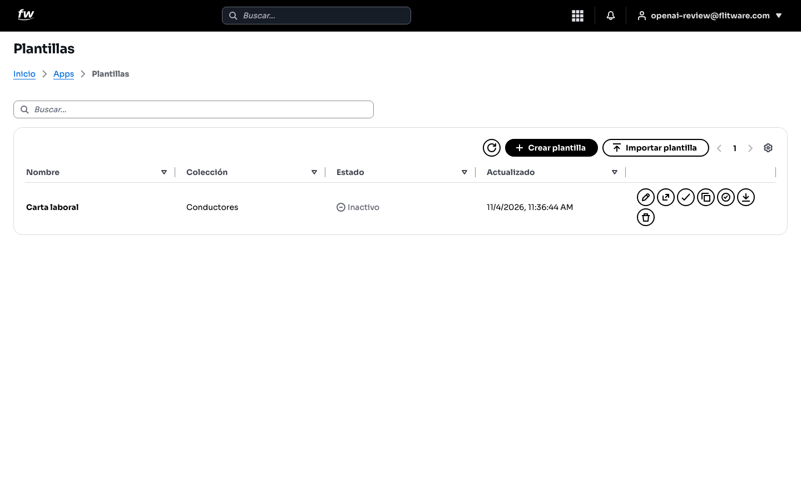
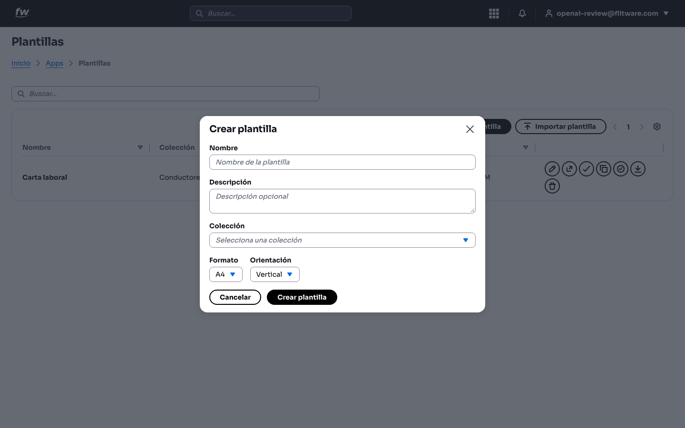
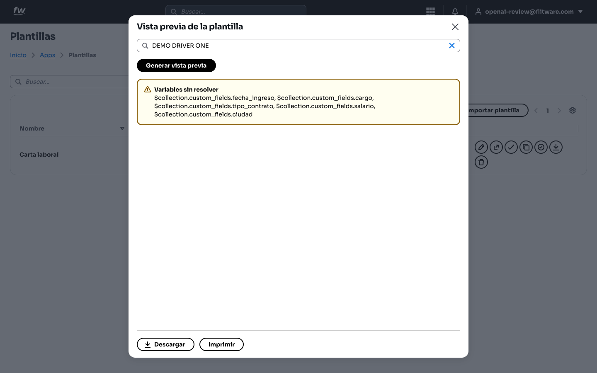
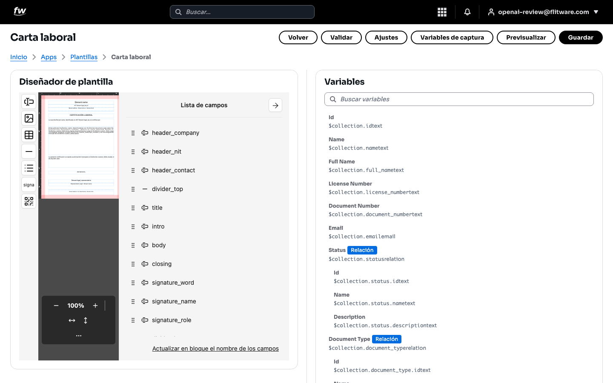
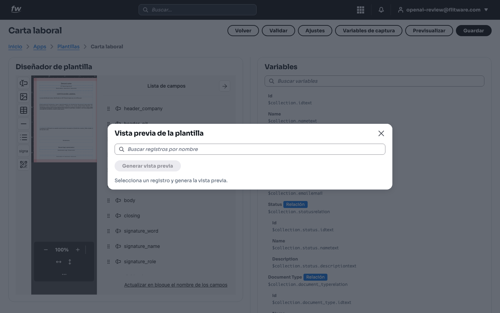

# Plantillas: documentos perfectos sin reescribir nada

Las Plantillas convierten los datos que ya tiene en la flota (conductores, vehículos, mantenimientos) en documentos listos para descargar o imprimir: cartas laborales, certificados, reportes. Usted diseña una vez y el sistema rellena los datos de cada registro automáticamente.

## Prerrequisitos

- Rol con acceso al módulo **Plantillas** (consulte a su administrador si no lo ve en Apps).
- Registros existentes en la colección origen (por ejemplo, Conductores) para probar la vista previa con datos reales.

## 1. Catálogo: su biblioteca de documentos

1. Abra **Inicio > Apps > Plantillas**.
2. Verá la tabla con **Nombre** (por ejemplo, Carta laboral), **Colección** (por ejemplo, Conductores), **Estado** (Activo o Inactivo) y **Actualizado**.
3. A la derecha de cada fila tiene las acciones para editar, previsualizar, validar, duplicar y descargar.
4. Arriba a la derecha: **Crear plantilla** para una nueva e **Importar plantilla** para traer una existente.

5. Para crear una, pulse **Crear plantilla** y complete **Nombre**, **Descripción** opcional, **Colección** (de dónde saldrán los datos), **Formato** (por ejemplo, A4) y **Orientación** (Vertical u Horizontal). Luego pulse **Crear plantilla** para confirmar o **Cancelar** para salir.

:::tip
Una plantilla = una colección. Antes de crearla, tenga claro de qué lista saldrán los datos (Conductores, Vehículos...). Cambiar de colección después obliga a rehacer las variables.
:::

## 2. Vista previa: compruebe antes de entregar

1. Desde el catálogo, elija la plantilla y abra la **Vista previa de la plantilla**.
2. Busque y seleccione un registro real (por ejemplo, DEMO DRIVER ONE).
3. Pulse **Generar vista previa**.
4. Si faltan datos, el sistema avisa con **Variables sin resolver** y lista cuáles (por ejemplo, fecha de ingreso, cargo, tipo de contrato, salario, ciudad). Complete esos datos en el registro origen y regenere.
5. Cuando esté correcta, use **Descargar** o **Imprimir**.

:::warning
Nunca entregue un documento con variables sin resolver: el aviso amarillo significa que esos campos saldrán vacíos. Corrija primero el registro origen.
:::

## 3. Diseñador: ajuste el documento (explorar sin guardar)

1. Abra la plantilla en el diseñador (por ejemplo, **Carta laboral**). Arriba verá los botones **Volver, Validar, Ajustes, Variables de captura, Previsualizar** y **Guardar**.
2. A la izquierda está el **Diseñador de plantilla** con la **Lista de campos** (header_company, header_nit, title, intro, body, closing, signature_word, signature_name, signature_role...).
3. A la derecha está el panel **Variables** con el buscador **Buscar variables**: cada variable muestra de qué dato se alimenta (por ejemplo, Full Name desde el nombre del conductor, Document Number, Email, Status).

4. Para probar cambios sin compromiso: pulse **Previsualizar**, busque un registro por nombre en **Buscar registros por nombre** y pulse **Generar vista previa**. Así valida el resultado con datos reales.

5. Si solo estaba explorando, pulse **Volver** sin tocar **Guardar**: sus pruebas no alteran la plantilla publicada. Solo pulse **Guardar** cuando esté seguro del cambio, y antes pase por **Validar**.

:::tip
El orden seguro es: ajustar → Previsualizar con un registro real → Validar → Guardar. Saltarse la previsualización es la causa número uno de cartas con campos vacíos.
:::

## Recomendación del experto

Según la recomendación de expertos para una buena experiencia: los documentos consumen más tiempo del que parece: cartas laborales, certificados de ingreso, paz y salvos. **Dedique una tarde a dejar una plantilla impecable por cada documento que firma cada mes**, con sus variables probadas en al menos tres registros distintos (uno completo, uno con datos parciales y uno nuevo). A partir de ahí, cada solicitud se resuelve en dos clics: seleccionar registro, generar vista previa, descargar. Y nombre sus campos con lógica (header_, signature_) como en el ejemplo: dentro de un año, cuando necesite ajustar la carta, lo agradecerá.

## Errores comunes

- **Crear la plantilla sobre la colección equivocada:** las variables no encontrarán datos. Verifique la colección antes de diseñar.
- **Ignorar "Variables sin resolver":** el documento sale con huecos. Complete los campos en el registro origen, no en la plantilla.
- **Guardar sin previsualizar:** siempre pruebe con un registro real antes de guardar cambios en el diseñador.
- **Dejar la plantilla Inactiva y esperar usarla:** revise el Estado en el catálogo; una plantilla inactiva no debería usarse para documentos oficiales.
- **Duplicar plantillas casi iguales:** si solo cambia el encabezado, edite campos en lugar de crear otra plantilla; menos plantillas, menos mantenimiento.
