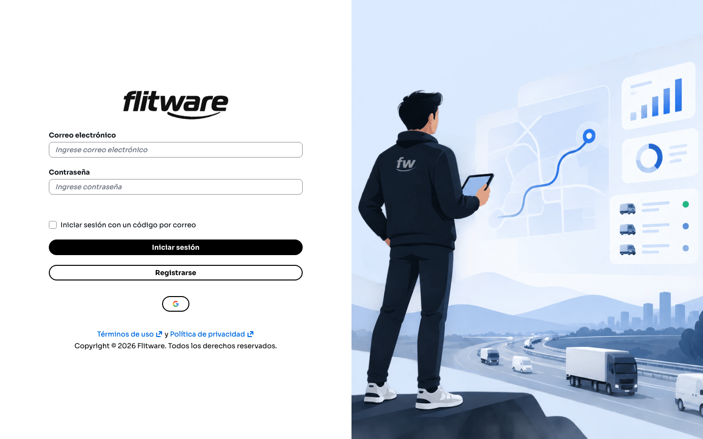
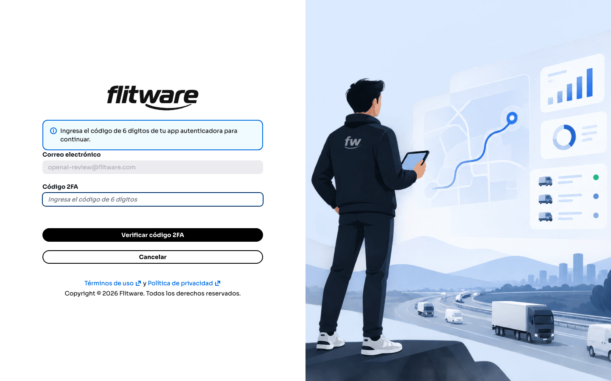
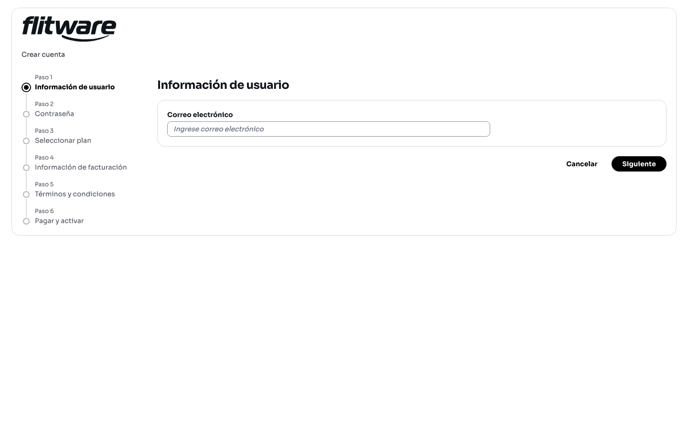
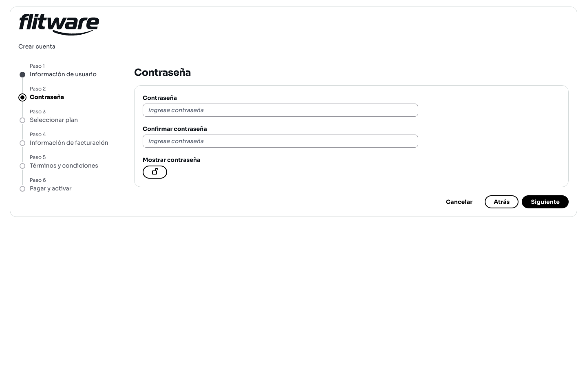
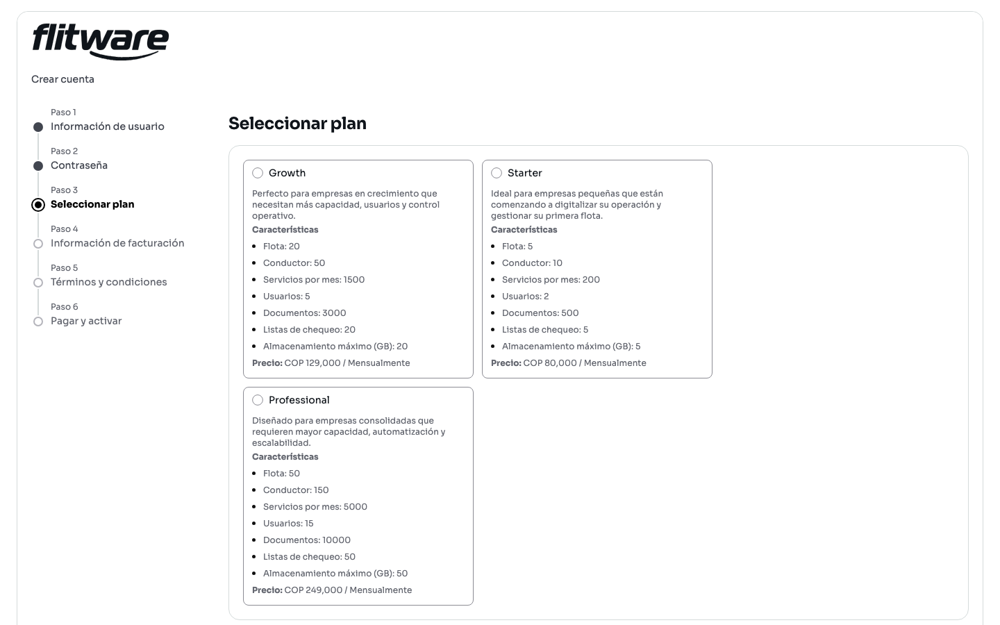
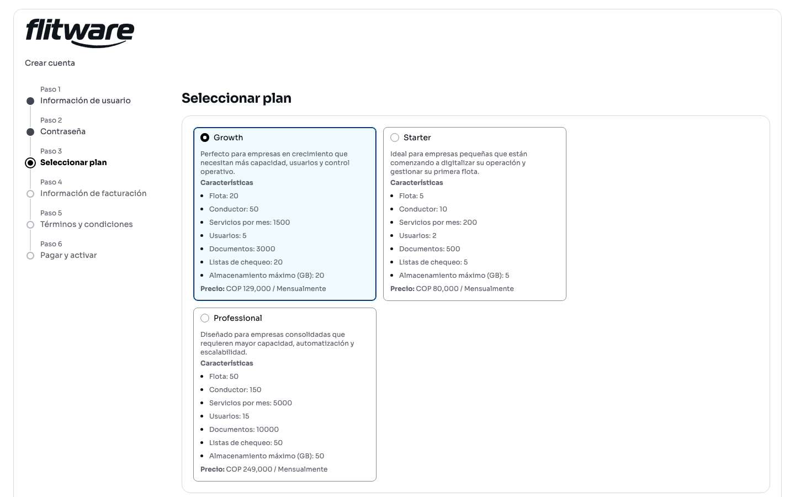
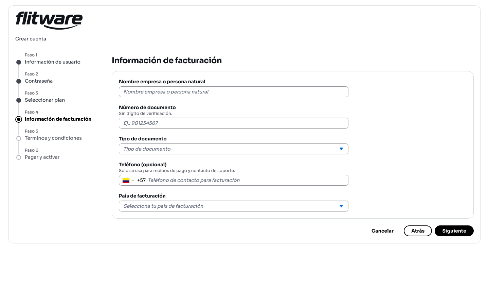
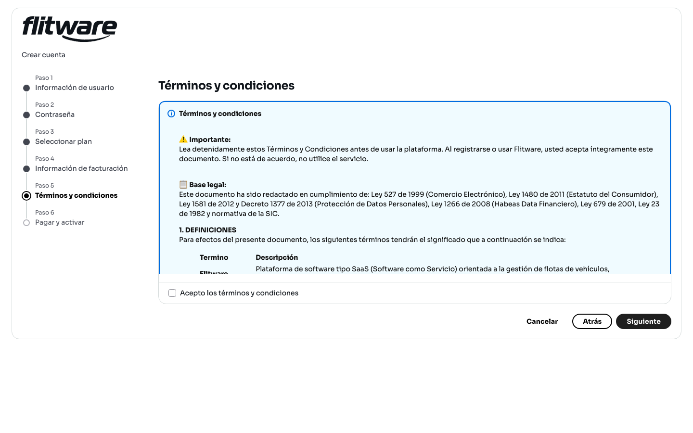
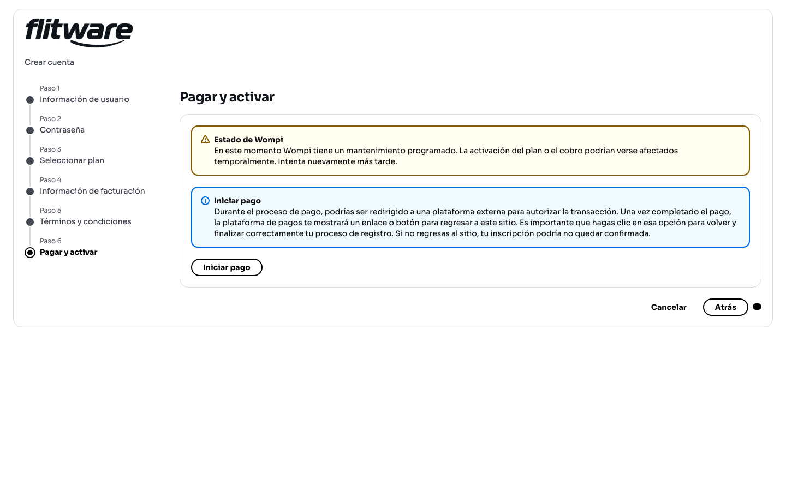

# Acceso y registro

Aquí entra a Flitware todos los días y aquí crea su cuenta si es nuevo. La pantalla de acceso le pide su correo y su contraseña, y si su cuenta tiene verificación en dos pasos, le pedirá además un código de 6 dígitos. Crear una cuenta toma unos minutos y se hace en 6 pasos guiados: sus datos, su contraseña, su plan, su facturación, los términos y el pago.

## Prerrequisitos

- Para entrar: tener una cuenta activa y conocer su correo y su contraseña.
- Para la verificación en dos pasos: tener su app autenticadora a la mano.
- Para registrarse: un correo válido, los datos de facturación de su empresa y un medio de pago.

## Cómo iniciar sesión

1. Abra la página de acceso de Flitware.
2. Escriba su **Correo electrónico** y su **Contraseña**.
3. Pulse **Iniciar sesión**.
4. Si su cuenta tiene verificación en dos pasos, escriba el **Código 2FA** de 6 dígitos de su app autenticadora y pulse **Verificar código 2FA**.

Si aún no tiene cuenta, pulse **Registrarse** para empezar el registro de 6 pasos que se explica abajo. También verá una casilla de **Iniciar sesión con un código por correo**, que es una forma alternativa de entrar sin contraseña: el sistema le envía un código a su correo para validar su acceso.

## Cómo completar la verificación en dos pasos (2FA)

Después de pulsar **Iniciar sesión**, si su cuenta tiene 2FA activa, verá esta pantalla pidiendo el código de su app autenticadora.

1. Abra su app autenticadora en el celular y lea el código actual de Flitware.
2. Escríbalo en el campo **Código 2FA**.
3. Pulse **Verificar código 2FA**.
4. Si se equivocó de cuenta o quiere volver, pulse **Cancelar**.

:::tip Consejo de flota
Active el 2FA en todas las cuentas con rol administrativo. Son las cuentas que pueden cambiar planes, ver facturación y gestionar usuarios: si alguien les roba la contraseña, el código del celular es lo único que protege su operación.
:::

## Cómo crear una cuenta (paso a paso)

Pulse **Registrarse** desde la pantalla de acceso. El asistente **Crear cuenta** lo guiará por 6 pasos. Puede devolverse con **Atrás** en cualquier momento, o salir con **Cancelar**.

### Paso 1 · Información de usuario

1. Escriba su **Correo electrónico**.

2. Pulse **Siguiente**.

### Paso 2 · Contraseña

1. Escriba su **Contraseña** y repítala en **Confirmar contraseña**.
2. Si quiere revisar lo que escribió, use el botón **Mostrar contraseña**.

3. Pulse **Siguiente**.

### Paso 3 · Seleccionar plan

Compare los planes disponibles y elija el que corresponda al tamaño de su operación. Cada plan muestra sus límites: flota, conductores, servicios por mes, usuarios, documentos, listas de chequeo y almacenamiento máximo.

1. Marque el círculo del plan elegido. Quedará resaltado para confirmar su selección.

2. Pulse **Siguiente**.

### Paso 4 · Información de facturación

1. Complete **Nombre empresa o persona natural**, **Número de documento** (sin dígito de verificación), **Tipo de documento** y **País de facturación**.
2. El **Teléfono** es opcional y solo se usa para recibos de pago y contacto de soporte.

3. Pulse **Siguiente**.

### Paso 5 · Términos y condiciones

1. Lea los **Términos y condiciones** que se muestran en pantalla.
2. Marque la casilla **Acepto los términos y condiciones**.

3. Pulse **Siguiente**.

### Paso 6 · Pagar y activar

En este último paso verá el botón **Iniciar pago**. Al pulsarlo, podrá ser redirigido a una plataforma externa para autorizar la transacción; cuando termine el pago, esa plataforma le mostrará un enlace o botón para regresar a Flitware. Es muy importante que pulse esa opción para volver y finalizar correctamente su registro: si no regresa al sitio, su inscripción podría no quedar confirmada.

También pueden aparecer avisos sobre el estado de la plataforma de pagos (por ejemplo, mantenimientos programados). Si ve uno, siga la indicación del aviso antes de intentar pagar.

## Recomendación del experto

Según la recomendación de expertos para una buena experiencia: el registro no es un trámite, es la base de todo lo que viene después. Regístrese con el correo corporativo de la empresa, no con el personal de quien hace el trámite; elija el plan según la flota que tendrá en 6 meses, no la de hoy, para no quedarse sin cupo de servicios a mitad de mes; y verifique que el nombre y el documento de facturación queden exactos, porque corregir facturas después cuesta tiempo y llamadas.

Rutina recomendada:

- **Al registrarse:** guarde el correo de la cuenta y el plan elegido donde todo el equipo administrativo los encuentre.
- **Cada mes:** revise cuántos servicios consumió frente al límite de su plan y ajuste antes de quedarse corto.
- **Siempre:** después de pagar, regrese a Flitware con el enlace que da la plataforma de pagos. No cierre la ventana a mitad del proceso.

## Errores comunes

- **Registrarse con un correo personal.** Cuando esa persona sale, la cuenta y la facturación quedan en el aire.
- **Equivocarse en el documento de facturación.** Incluyen el dígito de verificación o un nombre distinto al fiscal, y luego la factura no sirve.
- **No regresar a Flitware después de pagar.** Cierran la ventana del pago y el registro queda sin confirmar.
- **Elegir el plan por precio y no por cupo.** El plan más barato se queda corto en servicios por mes y frena la operación.
- **Escribir mal el código 2FA.** Los códigos cambian cada pocos segundos: lea el código actual y escríbalo completo antes de pulsar verificar.
