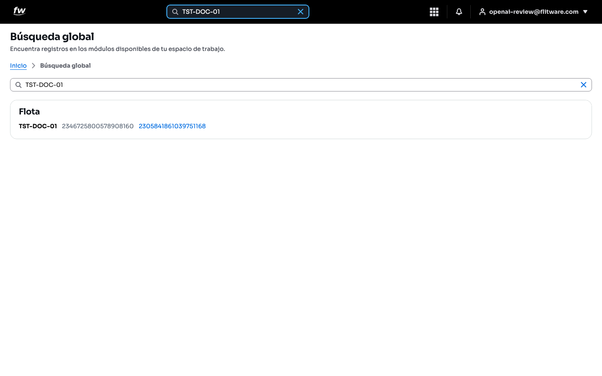

# Búsqueda global

La búsqueda global encuentra registros en todos los módulos de su espacio de trabajo desde un solo lugar. En vez de entrar módulo por módulo a buscar un vehículo, un servicio o un documento, escribe una palabra o un código y Flitware le muestra los resultados agrupados por módulo. Es la forma más rápida de llegar a un registro cuando sabe qué busca pero no dónde está.

## Prerrequisitos

- Tener sesión iniciada en Flitware.
- Conocer al menos una parte del dato a buscar (placa, código, nombre). Escriba mínimo 2 caracteres.

## Cómo buscar

1. Pulse el campo **Buscar** en la barra superior, o abra la pantalla **Búsqueda global**.
2. Escriba lo que busca (por ejemplo, el código de un servicio o la placa de un vehículo).
3. Revise los resultados agrupados por módulo y pulse el que necesita para abrirlo.

En el ejemplo, al buscar un código aparece el resultado bajo el módulo **Flota**, con el registro y sus datos para abrirlo directamente. Si no hay coincidencias, verá el mensaje *No encontramos resultados*; si algo falla, verá un aviso con la opción **Reintentar**.

:::tip Consejo de flota
Busque por el dato más exacto que tenga: el código del servicio o la placa completa antes que un nombre. Un código exacto lo lleva al registro en un clic; un nombre común le devuelve una lista para filtrar a ojo.
:::

## Recomendación del experto

Según la recomendación de expertos para una buena experiencia: enseñe a todo su equipo a buscar antes de crear. La mitad de los registros duplicados nacen porque alguien no encontró un vehículo o un servicio y lo volvió a crear. Una búsqueda de 10 segundos evita un duplicado que después cuesta horas limpiar.

Rutina recomendada:

- **Antes de crear cualquier registro:** búsquelo primero por su código o placa.
- **Cada día:** use la búsqueda para saltar a los registros del día en vez de navegar por menús.
- **Con el equipo nuevo:** muéstreles la búsqueda el primer día; es lo que más tiempo les ahorra.

## Errores comunes

- **Buscar con un solo carácter.** La búsqueda necesita al menos 2 caracteres para empezar.
- **Crear duplicados sin buscar.** Si el registro ya existe y crean otro, los reportes y los servicios se reparten entre los dos.
- **Buscar por palabras muy generales.** Una palabra común devuelve muchos resultados; afine con códigos o datos exactos.
- **Rendirse ante "No encontramos resultados".** Revise la ortografía, pruebe con menos palabras o con el código parcial antes de dar el registro por inexistente.
