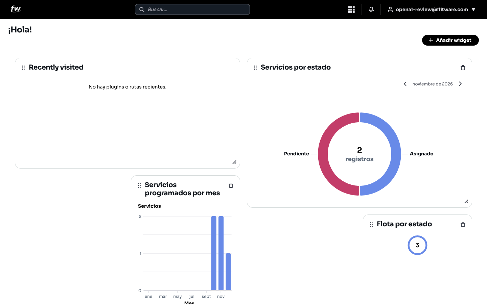

# Inicio

La pantalla de inicio es su tablero de cada mañana: un saludo, sus accesos recientes y las gráficas de su operación. De un vistazo sabrá cuántos servicios tiene por estado, cómo va el volumen de servicios del mes y en qué estado está su flota. Todo se organiza en tarjetas (widgets) que puede mover, agrandar y quitar a su gusto.

## Prerrequisitos

- Tener sesión iniciada en Flitware.
- Tener servicios o vehículos registrados para que las gráficas muestren datos.

## Cómo leer su inicio

1. Entre a Flitware. Lo primero que verá es el saludo **¡Hola!** con su tablero.
2. Revise sus tarjetas: accesos recientes y gráficas de servicios y flota.
3. Use el botón **Añadir widget** (arriba a la derecha) para agregar más tarjetas a su tablero.

Esto es lo que muestra cada tarjeta:

- **Recently visited:** sus plugins o rutas visitadas recientemente, para volver rápido a donde estaba. Si está empezando, verá el mensaje *No hay plugins o rutas recientes*.
- **Servicios por estado:** gráfica circular con el total de registros y su reparto por estado (por ejemplo, *Pendiente* y *Asignado*). Puede cambiar el mes con las flechas.
- **Servicios programados por mes:** gráfica de barras con el volumen de servicios de cada mes del año.
- **Flota por estado:** resumen del estado de sus vehículos.

En la parte superior siempre tiene a la mano el buscador, el menú de aplicaciones, la campana de **Notificaciones** y su cuenta.

:::tip Consejo de flota
Empiece cada día con 60 segundos en esta pantalla: mire los servicios pendientes del mes actual y el estado de la flota antes de abrir cualquier otra cosa. Si algo se salió de lo normal, lo verá aquí primero.
:::

## Cómo ordenar su tablero

Las tarjetas se pueden arrastrar para moverlas de lugar, estirar desde la esquina para cambiar su tamaño y eliminar con el icono de papelera. El tablero guarda su orden automáticamente.

## Recomendación del experto

Según la recomendación de expertos para una buena experiencia: el tablero vale según lo que usted ponga primero. Deje arriba lo que decide su día —los servicios pendientes y el estado de la flota— y abajo lo de consulta ocasional. Un tablero ordenado por prioridad le ahorra abrir cinco pantallas cada mañana.

Rutina recomendada:

- **Cada mañana:** revise *Servicios por estado* del mes actual y *Flota por estado*. Si hay pendientes acumulándose, ese es su primer tema del día.
- **Cada semana:** compare las barras de *Servicios programados por mes* para ver si el volumen sube o baja, y ajuste conductores y vehículos a tiempo.
- **Cada mes:** quite las tarjetas que ya no mira y agregue las que necesite. Un tablero lleno de gráficas que nadie lee solo estorba.

## Errores comunes

- **No mirar el tablero y operar a ciegas.** Entran directo a los módulos y se enteran tarde de los pendientes acumulados.
- **Dejar el mes equivocado en la gráfica.** Revisan *Servicios por estado* en un mes viejo y creen que todo está tranquilo.
- **Llenar el tablero de tarjetas.** Con demasiadas gráficas, ninguna se lee. Menos tarjetas, mejor ubicadas, rinden más.
