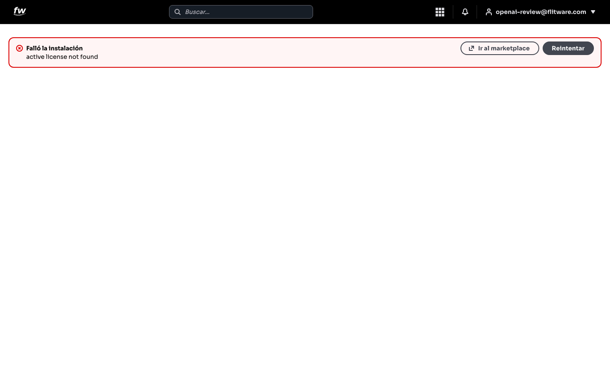
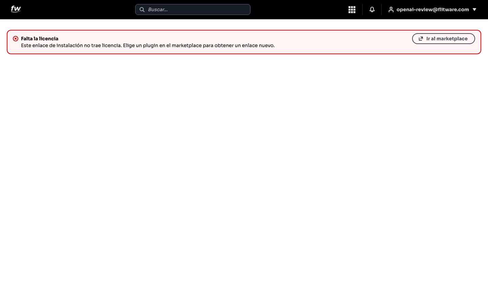

# Marketplace e instalación

Los plugins añaden funciones extra a Flitware: no son aplicaciones aparte, sino partes del mismo sistema que usted activa según lo que su operación necesite. Algunos pueden requerir suscripción o plan. Cada plugin se instala desde el marketplace con un enlace que trae su licencia; esta guía explica qué verá durante la instalación y qué hacer si algo sale mal.

## Prerrequisitos

- Tener sesión iniciada en Flitware.
- Tener el enlace de instalación del plugin, obtenido desde el marketplace (el enlace trae la licencia incluida).

## Cómo se instala un plugin

1. Abra el enlace de instalación que obtuvo en el marketplace.
2. Verá el mensaje *Instalando tu plugin…* mientras el sistema trabaja.
3. Si el plugin ya estaba instalado en su espacio de trabajo, verá el aviso **Ya instalado** con la opción de **Volver al inicio**.

## Si la instalación falla

Si algo sale mal, verá el aviso **Falló la instalación** con el motivo. En el ejemplo, el motivo es que no se encontró una licencia activa.

1. Lea el motivo del error.
2. Si el problema puede ser temporal, pulse **Reintentar**.
3. Si necesita revisar el plugin o conseguir un enlace nuevo, pulse **Ir al marketplace**.

## Si falta la licencia

Si el enlace de instalación no trae licencia, verá el aviso **Falta la licencia**: *Este enlace de instalación no trae licencia. Elige un plugin en el marketplace para obtener un enlace nuevo.*

1. Pulse **Ir al marketplace**.
2. Elija el plugin y obtenga un enlace de instalación nuevo, que sí traerá su licencia.

:::tip Consejo de flota
Guarde los enlaces de instalación y las licencias que reciba por correo en una carpeta compartida del equipo administrativo. Cuando haya que reinstalar o auditar qué tiene contratado cada sede, esos correos son su comprobante.
:::

## Recomendación del experto

Según la recomendación de expertos para una buena experiencia: instale solo lo que su operación va a usar este trimestre. Cada plugin activo suma opciones, permisos y cosas que mantener; un sistema lleno de plugins que nadie usa es más lento de operar y más difícil de enseñar. Empiece con lo esencial y agregue el resto cuando el equipo lo pida.

Rutina recomendada:

- **Antes de instalar:** confirme que el plugin corresponde a su plan y que el enlace trae licencia.
- **Al instalar:** si falla, lea el motivo antes de reintentar a ciegas; la mayoría de los fallos son de licencia, no del sistema.
- **Cada trimestre:** revise los plugins instalados y desactive lo que nadie usa.

## Errores comunes

- **Usar un enlace viejo o recortado.** Si al enlace le falta la licencia, verá *Falta la licencia*: pida un enlace nuevo desde el marketplace, no insista con el mismo.
- **Reintentar sin leer el motivo.** Si el error dice que no hay licencia activa, reintentar no lo arregla; hay que resolver la licencia primero.
- **Instalar plugins de más.** Activan todo lo que ven y terminan con un sistema recargado que confunde al equipo.
- **Perder los correos con licencias.** Sin la licencia no hay reinstalación; archívelas desde el primer día.
