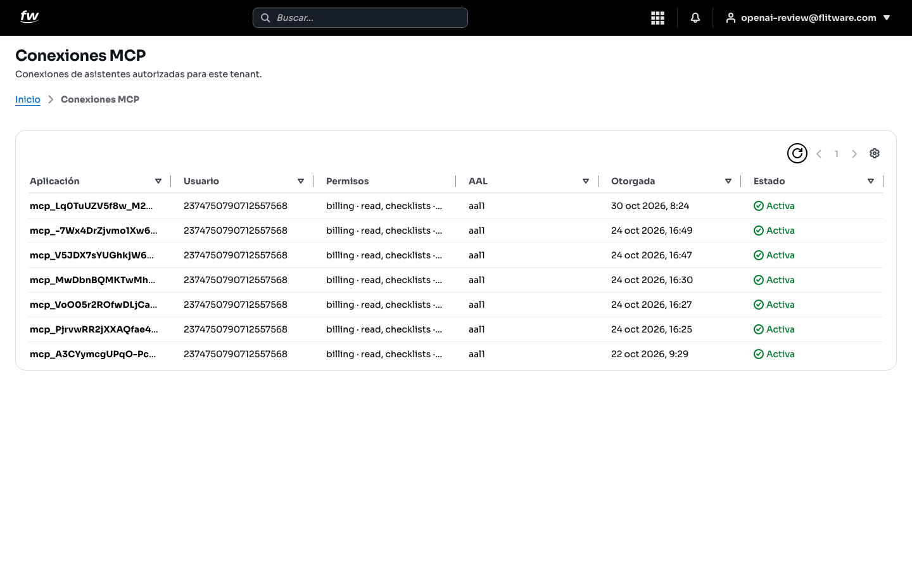
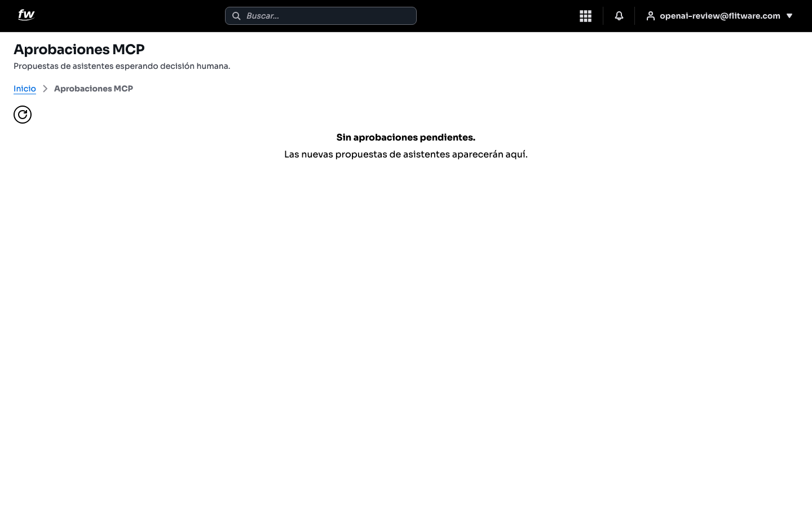

# Conexiones y aprobaciones de asistentes (MCP)

Flitware permite que asistentes externos se conecten a su empresa para ayudar con tareas, siempre con su autorización. Estas dos pantallas son su panel de control para eso: **Conexiones MCP** muestra qué asistentes están autorizados hoy, y **Aprobaciones MCP** muestra las propuestas que están esperando su decisión. Esta guía es de consulta: le enseña a revisar qué hay autorizado, no a operar los asistentes.

## Prerrequisitos

- Tener sesión iniciada en Flitware.
- Tener rol **ROOT**: solo los usuarios ROOT pueden ver y gestionar las conexiones y aprobaciones MCP.

## Cómo revisar las conexiones autorizadas

1. Abra la pantalla **Conexiones MCP**.
2. Revise la tabla de conexiones autorizadas para su empresa.

Cada fila es un asistente autorizado y muestra:

- **Aplicación:** qué asistente se conectó.
- **Usuario:** a nombre de qué usuario se otorgó.
- **Permisos:** qué puede hacer (por ejemplo, lectura de ciertos módulos).
- **AAL:** nivel de seguridad con el que se otorgó.
- **Otorgada:** fecha y hora de la autorización.
- **Estado:** **Activa** mientras el asistente conserva el acceso, o **Revocada** si ya se le retiró.

Si aún no hay conexiones, verá el mensaje *Aún no hay conexiones*: aparecerán aquí cuando se autorice un asistente.

## Cómo revisar las aprobaciones pendientes

1. Abra la pantalla **Aprobaciones MCP**.
2. Revise si hay propuestas de asistentes esperando decisión humana.

Si no hay nada pendiente, verá *Sin aprobaciones pendientes*. Las nuevas propuestas aparecerán aquí para que una persona las revise.

:::tip Consejo de flota
Trate las conexiones de asistentes como llaves de sus oficinas: revise cada mes quién tiene una y retire las que ya no se usan. Un asistente autorizado que nadie recuerda es un acceso abierto sin dueño.
:::

## Recomendación del experto

Según la recomendación de expertos para una buena experiencia: el riesgo no es usar asistentes, es autorizarlos y olvidarse. Cada conexión activa puede leer o hacer cosas en su operación, así que la revisión periódica no es opcional. Ponga una fecha fija al mes para abrir estas dos pantallas y pregúntese por cada fila: ¿quién pidió esto, para qué, y sigue vigente?

Rutina recomendada:

- **Cada mes:** abra *Conexiones MCP* y verifique que cada conexión activa tenga un responsable y un motivo vigente.
- **Cada semana:** eche un vistazo a *Aprobaciones MCP* para que ninguna propuesta quede esperando sin decisión.
- **Cuando alguien sale del equipo:** revise si había conexiones otorgadas a su nombre y retírelas.

## Errores comunes

- **Autorizar y olvidar.** Las conexiones se acumulan y nadie sabe cuáles siguen en uso.
- **No revisar los permisos.** Autorizan sin fijarse en qué puede hacer el asistente; revise la columna *Permisos* antes y después.
- **Dejar propuestas sin decidir.** Las aprobaciones pendientes se estancan porque nadie las revisa; una decisión a tiempo vale más que una perfecta tarde.
- **Entrar sin rol ROOT.** Si no ve estas pantallas, es por el rol: pida a un administrador que haga la revisión con usted.
