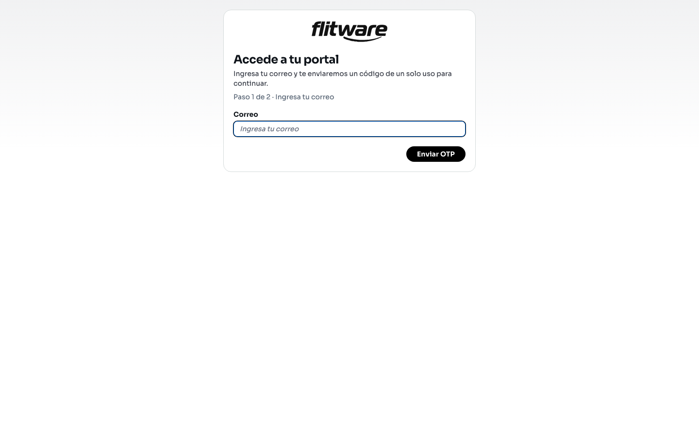

# Portal del contacto

El portal del contacto es la página pública de autogestión donde cada cliente consulta y gestiona sus servicios, sin necesidad de una cuenta de Flitware ni de contraseña. El acceso es con un código de un solo uso que se envía a su correo: el contacto escribe su correo, recibe el código, lo escribe y entra. Son dos pasos y no hay nada que instalar.

## Prerrequisitos

- El contacto debe estar registrado y habilitado en Flitware para acceder al portal.
- Necesita acceso al correo donde recibirá el código.
- Necesita el enlace público de su portal (lo entrega la empresa).
- En este portal las notificaciones push son obligatorias: antes de pedir el código, el navegador pedirá permiso con **Activar notificaciones**. Si no aparece el permiso, abra el portal en una ventana normal (no incógnito).

## Cómo entra el contacto (paso 1: pedir el código)

1. Abra el enlace público del portal.
2. Verá la pantalla **Accede a tu portal** con el **Paso 1 de 2 · Ingresa tu correo**.
3. Escriba su **Correo** y pulse **Enviar OTP**.

4. Revise su bandeja: recibirá un código de verificación de un solo uso (*Enviamos un código de verificación a tu correo*).

## Cómo entra el contacto (paso 2: verificar el código)

1. En el **Paso 2 de 2 · Verifica tu código**, escriba el código en el campo **Código OTP**.
2. Pulse **Verificar código** para entrar.
3. Si el código no llega, use **Reenviar código** (puede pedir uno nuevo cuando termine la cuenta regresiva). Si se equivocó de correo, use **Cambiar correo** para volver al paso 1.

Si el acceso expiró, el portal avisará que solicite un código nuevo (*Tu acceso expiró. Solicita un nuevo OTP para continuar*). Si el contacto no está habilitado, verá el aviso *Este contacto no tiene permisos para autenticarse*: en ese caso la empresa debe habilitarlo primero en Flitware.

:::tip Consejo de flota
Envíele a cada cliente su enlace del portal por el canal que sí lea y pídale que entre una vez delante de usted, aceptando las notificaciones. Un acceso probado el primer día evita llamadas de auxilio cuando el cliente necesita ver su servicio con urgencia.
:::

## Qué puede hacer dentro del portal

Una vez dentro, el contacto entra al **Portal de autogestión** (*Administra la información compartida para tus operaciones de servicio*):

- **Información del contacto:** ver y actualizar sus datos (*Nombre*, *Correo*, *Teléfono*, *Correo de facturación*, *Número de documento*). Solo los campos habilitados para autogestión son editables; los cambios se guardan con **Guardar cambios**.
- **Servicios:** consultar la lista de servicios disponibles (*Consulta y gestiona los servicios disponibles para tu contacto*). Si aún no hay ninguno, verá *Todavía no hay servicios disponibles para este contacto*.
- **Detalle del servicio:** abrir un servicio para ver su información e **Items del servicio**, con acciones como **Abrir origen**, **Abrir destino** y **Abrir ruta** en el mapa, además de **Descargar página actual**.
- **Crear servicio:** registrar una nueva solicitud completando la información requerida (*Completa la información requerida para registrar una nueva solicitud de servicio*).
- **Cancelar servicio:** disponible solo mientras el servicio esté pendiente o asignado. La confirmación advierte que *Esta acción cambiará el estado del servicio a Cancelado y no podrás revertirla desde el portal*.
- **Notificaciones y dispositivos:** recibir avisos de sus servicios en el equipo y gestionar desde qué dispositivos.

Para salir, use **Cerrar acceso**.

## Recomendación del experto

Según la recomendación de expertos para una buena experiencia: el portal solo reduce llamadas si los clientes entran sin fricción y encuentran sus servicios al día. El código por correo es sencillo, pero falla cuando el cliente no revisa ese correo o lo tiene lleno de spam. Verifique con cada cliente cuál correo revisa de verdad y deje registrado ese; y mantenga los servicios con estados y fechas correctas, porque eso es exactamente lo que el cliente ve del otro lado.

Rutina recomendada:

- **Al vincular un cliente:** confirme su correo real, envíele el enlace, haga una entrada de prueba con él y verifique que aceptó las notificaciones.
- **Cada semana:** revise que los servicios visibles en el portal tengan el estado correcto; un servicio desactualizado genera más llamadas que ningún portal.
- **Cuando un cliente no puede entrar:** revise primero si está habilitado, si el correo es el correcto y si aceptó las notificaciones, antes de asumir un problema técnico.

## Errores comunes

- **Usar un correo que el cliente no revisa.** El código llega, pero nadie lo lee; el acceso se estanca en el paso 1.
- **No habilitar al contacto en Flitware.** Sin habilitación, el portal rechaza el acceso aunque el correo sea correcto.
- **Bloquear las notificaciones del navegador.** En este portal son obligatorias: sin ellas no se puede pedir el código. Si usa incógnito, cambie a una ventana normal.
- **Compartir enlaces entre clientes.** Cada enlace es personal; compartirlos mezcla accesos y rompe la trazabilidad.
- **Dejar el código vencer.** Los códigos expiran: si tarda demasiado, pida uno nuevo con *Reenviar código* en vez de insistir con el viejo.
