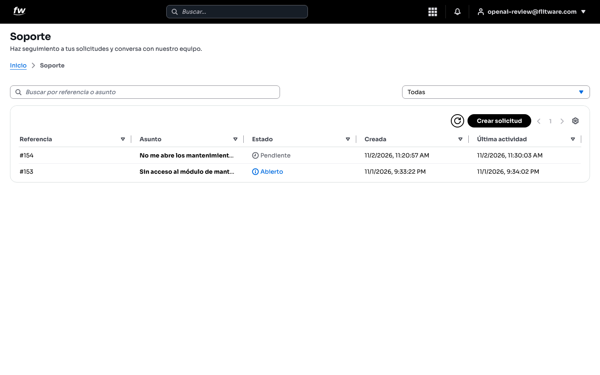
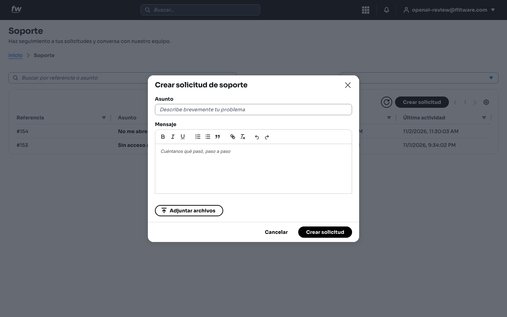
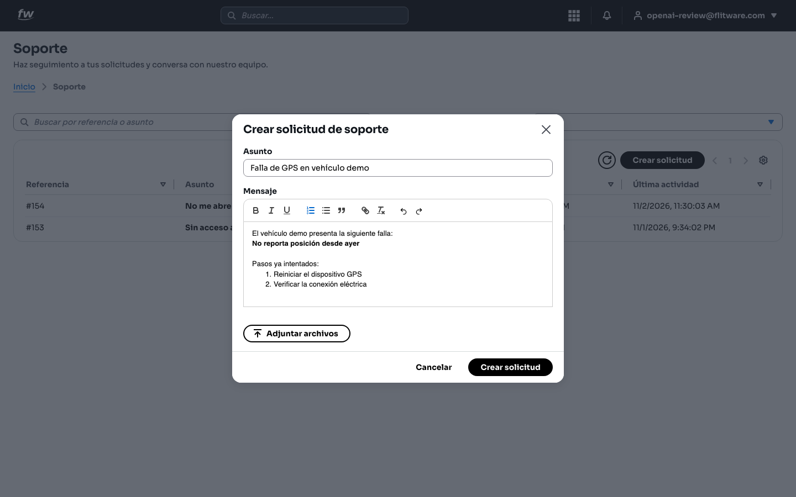
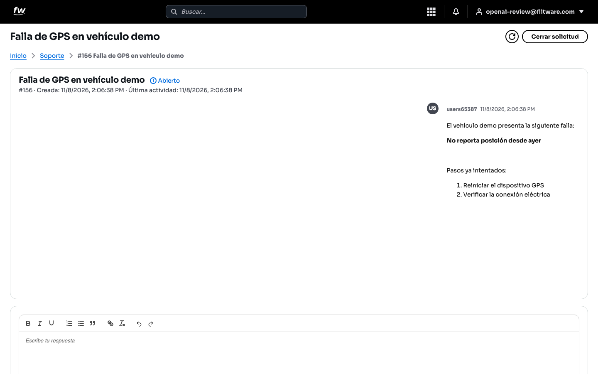
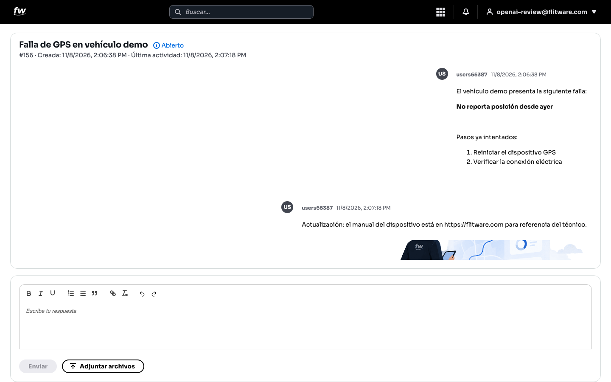
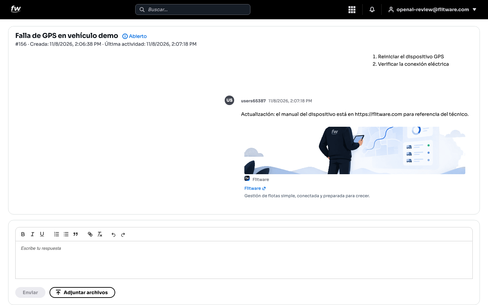
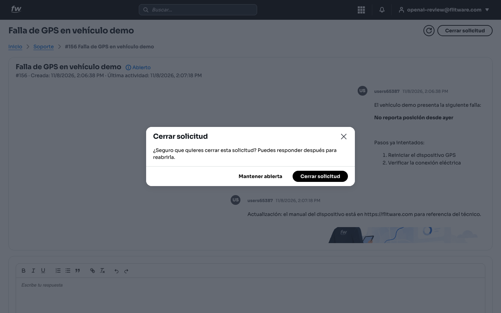
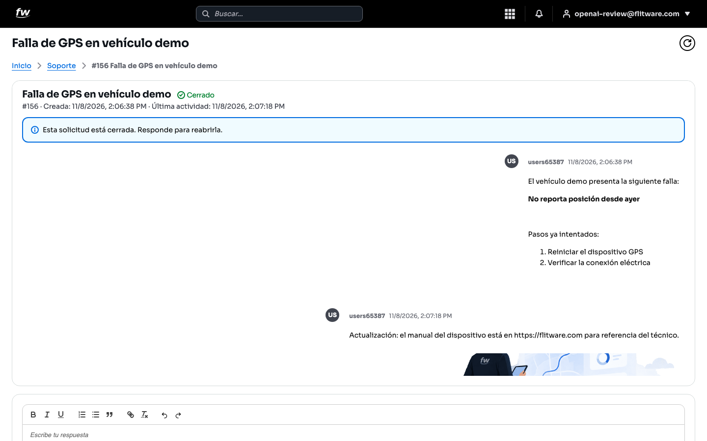

# Solicitudes de soporte: pida ayuda y resuelva más rápido

El módulo **Soporte** es donde usted crea solicitudes de ayuda, conversa con el equipo de Flitware y hace seguimiento hasta que el problema queda resuelto. Cada solicitud tiene una referencia (por ejemplo **#156**) que sirve para ubicarla en segundos.

## Prerrequisitos

- Tener una cuenta activa en Flitware e iniciar sesión.
- Tener acceso al módulo **Soporte** (aparece en el menú de aplicaciones).

## 1. Ver la lista de solicitudes, buscar y filtrar

1. Abra el módulo **Soporte**. Verá el título y el buscador **Buscar por referencia o asunto**.
2. Use el buscador para localizar una solicitud por su número (ej. `154`) o por palabras del asunto.
3. Use el filtro de estado (**Todas**, **Abierto**, **Pendiente**, **Cerrado**) para ver solo las que le interesan.
4. La tabla muestra estas columnas: **Referencia**, **Asunto**, **Estado**, **Creada** y **Última actividad**. Pulse el botón de actualizar si quiere recargar la lista.

:::tip
Los estados significan lo siguiente: **Abierto** (la conversación sigue activa), **Pendiente** (está esperando una respuesta o acción) y **Cerrado** (el caso ya se terminó). Revise primero las **Pendientes**: suelen ser las que esperan algo de usted.
:::

## 2. Crear una solicitud con buen formato

1. Pulse el botón **Crear solicitud** (arriba a la derecha de la lista).
2. Escriba el **Asunto**: una frase corta y clara, por ejemplo `Falla de GPS en vehículo demo`.
3. Escriba el **Mensaje** contando qué pasó, paso a paso. Use la barra de formato: **negrita**, *cursiva*, subrayado, listas numeradas o con viñetas, citas, enlaces para pegar direcciones web, y deshacer/rehacer si se equivoca.
4. Si tiene fotos, videos o documentos, pulse **Adjuntar archivos** y selecciónelos (máximo 5 archivos por mensaje, de 10 MB cada uno como máximo).
5. Pulse **Crear solicitud**. El sistema lo llevará directamente al detalle de su nueva solicitud.

:::warning
El asunto acepta máximo 200 letras y el mensaje máximo 20000. Si un archivo es rechazado, revise el aviso en pantalla: puede ser por el tamaño (más de 10 MB), por el tipo de archivo no permitido, por enviar más de 5 archivos o por estar vacío.
:::

## 3. Ver el detalle y conversar con el equipo

1. Pulse una solicitud en la lista para abrirla. Arriba verá el asunto, el estado (**Abierto**, **Pendiente** o **Cerrado**), la referencia y las fechas de **Creada** y **Última actividad**.
2. Lea la conversación: cada mensaje muestra quién lo escribió y cuándo.
3. Para responder, escriba en el cuadro **Escribe tu respuesta**. Tiene la misma barra de formato (negrita, listas, enlaces, etc.).
4. Pulse **Enviar**. Si lo necesita, agregue archivos con **Adjuntar archivos** antes de enviar.

:::tip
Si al enviar aparece un error, no se preocupe: **su texto se conserva** en el cuadro para que lo reintente sin perder lo escrito. Use el botón de actualizar (arriba a la derecha) para ver si el equipo ya respondió.
:::

## 4. Adjuntar archivos en sus respuestas

1. En el detalle de la solicitud, pulse **Adjuntar archivos** junto al botón **Enviar**.
2. Seleccione hasta 5 archivos (documentos, fotos, videos o audios cortos). Los archivos permitidos incluyen PDF, Word, Excel, CSV, texto, ZIP, imágenes (JPG, PNG, WEBP, GIF), video (MP4, MOV) y audio (MP3, WAV).
3. Verá la lista de **Archivos seleccionados**. Si se equivocó en alguno, pulse **Quitar** para retirarlo antes de enviar.
4. Pulse **Enviar**. Los archivos quedarán visibles dentro del mensaje, en la sección **Adjuntos**.

:::tip
Una foto del tablero, del mensaje de error en pantalla o del dispositivo vale más que mil palabras. Adjunte evidencia siempre que pueda: el técnico resolverá su caso mucho más rápido.
:::

## 5. Vista previa de enlaces

1. Cuando un mensaje contiene una dirección web (por ejemplo `https://flitware.com`), el sistema muestra debajo una tarjeta con imagen, nombre del sitio, título y descripción.
2. Pulse el título de la tarjeta para abrir el enlace en una pestaña nueva.

:::tip
Use esta función a su favor: si el manual de un equipo o un mapa está en internet, pegue el enlace en su mensaje y el técnico verá de qué se trata sin tener que adivinar.
:::

## 6. Cerrar una solicitud y reabrirla si hace falta

1. Cuando su problema esté resuelto, abra la solicitud y pulse **Cerrar solicitud** (arriba a la derecha).
2. Confirme en la ventana: pulse **Cerrar solicitud** para cerrarla o **Mantener abierta** si aún no termina.

3. La solicitud cerrada muestra el estado **Cerrado** y el aviso: *Esta solicitud está cerrada. Responde para reabrirla.*
4. Si el problema vuelve, simplemente escriba una respuesta y pulse **Enviar**: la solicitud se reabre sola, sin crear una nueva.

## Recomendación del experto

Según la recomendación de expertos para una buena experiencia: **trate cada solicitud de soporte como la hoja de vida de un problema**. Una rutina que funciona:

- **Antes de escribir:** anote placa del vehículo, fecha y hora del fallo, y qué intentó hacer. Reúna fotos o videos.
- **Al crear la solicitud:** un problema por solicitud, no mezcle varios temas. Asunto concreto (`GPS sin reporte desde ayer, placa ABC123`) y mensaje con pasos numerados: qué pasó, cuándo, qué intentó.
- **Durante la conversación:** responda en el mismo hilo, no abra solicitudes duplicadas. Si el técnico pide un dato, respóndalo cuanto antes: las solicitudes **Pendientes** se resuelven en el orden en que el cliente responde.
- **Al cerrar:** cierre solo cuando haya comprobado que el problema desapareció (por ejemplo, verifique que el GPS ya reporta en el mapa). Si vuelve a fallar, reabra respondiendo en vez de crear otra: así el técnico conserva todo el historial.

## Errores comunes

- **Asuntos vagos** como "Ayuda" o "No funciona": nadie sabe de qué se trata y su caso tarda más. Diga qué falla y dónde.
- **Mensajes sin contexto**: "se dañó" no ayuda. Incluya siempre qué, cuándo y qué intentó.
- **Crear varias solicitudes para el mismo problema**: genera confusión y respuestas cruzadas. Responda en la solicitud original.
- **Olvidar los adjuntos**: describir un error de pantalla con palabras cuando una captura lo muestra en un segundo.
- **Cerrar sin verificar**: cierre la solicitud solo después de comprobar en su operación que todo funciona.
- **No revisar las Pendientes**: si su solicitud está **Pendiente**, probablemente el equipo espera un dato suyo. Revise la lista cada día.
